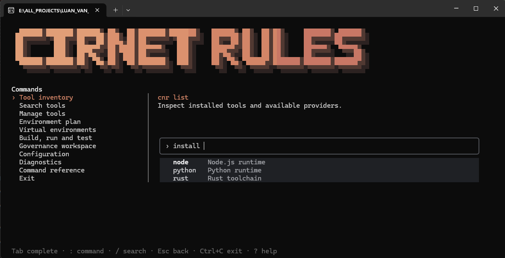
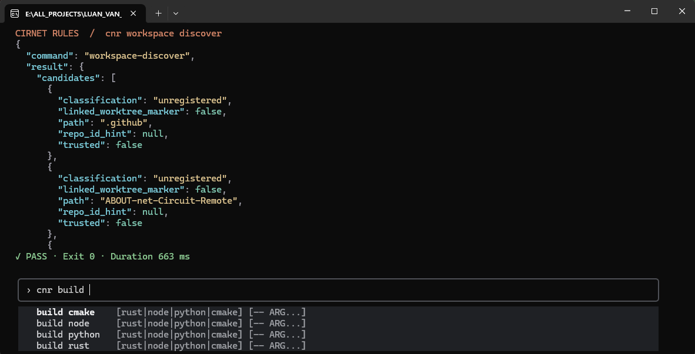

# CIRNET RULES

[English](en/README.md) · [Tiếng Việt](vi/README.md)

**CIRNETRULES** provides a Rust governance core, the CNR CLI and an MCP server over
STDIO. Run coding sessions independently in Codex Desktop, Claude Code or
Antigravity. Use CNR to bind the worktree, resolve the authorized task context,
verify changes and record evidence.
Use the binaries from `target/debug` or make them available on your path.
On Windows the executable is `cnr.exe`.

<p align="center">
  
</p>

<p align="center">
  
</p>

## Giao diện dòng lệnh CNR (CLI / TUI)

Khởi động giao diện dòng lệnh tương tác (TUI) bằng lệnh:

```sh
cnr
# hoặc
cnr tui
# mở với giao diện tiếng Việt
cnr --lang vi
```

### Phím chức năng trong giao diện CLI

| Phím | Chức năng |
| :--- | :--- |
| `↑` `↓` | Di chuyển lựa chọn |
| `Enter` | Mở hoặc thực hiện lệnh |
| `Esc` | Quay lại |
| `/` | Tìm kiếm lệnh |
| `?` | Xem hướng dẫn |
| `Ctrl+C` | Thoát CLI |

### Menu chức năng trong giao diện CLI

| Menu | Dùng để làm gì? | Lệnh tương ứng |
| :--- | :--- | :--- |
| **Tool inventory** | Xem các công cụ đã cài | `cnr list` |
| **Search tools** | Tìm Runtime, SDK, compiler | `cnr search` |
| **Manage tools** | Cài đặt, cập nhật, gỡ công cụ | `cnr install` |
| **Environment plan** | Kiểm tra và đồng bộ môi trường | `cnr env plan` |
| **Virtual environments** | Quản lý môi trường ảo | `cnr venv list` |
| **Build, run and test** | Biên dịch, chạy và kiểm thử | `cnr build --dry-run` |
| **Governance workspace** | Quản lý Repo, Task, Rules và Agent | `cnr workspace discover` |
| **Configuration** | Xem/chỉnh cấu hình CNR | `cnr config show` |
| **Diagnostics** | Kiểm tra tình trạng hệ thống | `cnr doctor` |

---

## Toàn bộ các lệnh CNR CLI trong dự án

### 1. Khởi tạo & Giao diện tương tác

```sh
# khởi động giao diện dòng lệnh tương tác (TUI)
cnr tui
# khởi tạo dự án và tạo file cnr.toml (bảo lưu cấu hình hiện có)
cnr init
```

### 2. Quản lý công cụ & Nhà cung cấp (Tooling & Providers)

```sh
# tìm kiếm công cụ trong danh mục cục bộ (Runtime, SDK, compiler...)
cnr search <QUERY>
# tìm kiếm với bộ lọc theo loại công cụ (runtime, toolchain, sdk, package-manager, development-tool)
cnr search <QUERY> --type <TYPE>
# liệt kê các công cụ đã cài và provider khả dụng
cnr list
# chỉ liệt kê các công cụ đã cài đặt
cnr list --installed
# chỉ liệt kê các công cụ khả dụng trong catalog
cnr list --available
# xem thông tin chi tiết và khả năng hỗ trợ của một công cụ
cnr info <TOOL>
# ghim phiên bản công cụ cụ thể cho dự án (ghi vào cnr.toml)
cnr pin <TOOL@VERSION>
# chọn phiên bản công cụ hoạt động trong profile hiện tại
cnr use <TOOL@VERSION>
# xem trước kế hoạch cài đặt phiên bản công cụ cụ thể
cnr install <TOOL@VERSION> --dry-run
# xác nhận cài đặt phiên bản công cụ vào dự án
cnr install <TOOL@VERSION> --yes
# kiểm tra các bản cập nhật khả dụng
cnr update
# cập nhật tất cả công cụ trong môi trường hiện tại
cnr update --all
# gỡ cài đặt phiên bản công cụ do dự án sở hữu
cnr remove <TOOL@VERSION> --yes
# chẩn đoán điều kiện môi trường cục bộ và trạng thái dự án
cnr doctor
```

### 3. Quản lý môi trường dự án & Môi trường ảo (Environment & Venv)

```sh
# xem toàn bộ cấu hình dự án hiện tại
cnr config show
# đọc một giá trị cấu hình theo khóa
cnr config get <KEY>
# thiết lập một giá trị cấu hình
cnr config set <KEY> <VALUE>
# xóa một khóa cấu hình
cnr config unset <KEY>
# xem kế hoạch phân giải môi trường, phiên bản ghim và xung đột
cnr env plan
# xuất kế hoạch môi trường ra định dạng JSON
cnr env plan --json
# khóa môi trường dự án vào cnr.lock
cnr env lock
# kiểm tra kế hoạch đồng bộ môi trường với lockfile
cnr env sync --dry-run
# xác nhận đồng bộ môi trường dự án
cnr env sync --yes
# xem danh sách các profile môi trường trong dự án
cnr env profiles
# xuất cấu hình môi trường dự án ra định dạng JSON
cnr env export --json
# nhập cấu hình môi trường từ file JSON
cnr env import <PATH>
# liệt kê các môi trường ảo của dự án
cnr venv list
# xem thông tin chi tiết một môi trường ảo
cnr venv info <NAME>
# tạo môi trường ảo mới
cnr venv create <NAME> [<VERSION>]
# chạy lệnh hoặc script bên trong môi trường ảo
cnr venv run <NAME> -- <ARG...>
# xóa một môi trường ảo
cnr venv remove <NAME>
```

### 4. Biên dịch, Chạy, Kiểm thử & Quản lý gói (Build, Run, Test & Package)

```sh
# thao tác quản lý gói native (rust, node, python)
cnr package [rust|node|python] list
cnr package [rust|node|python] add <PACKAGE>
cnr package [rust|node|python] remove <PACKAGE>
cnr package [rust|node|python] sync
cnr package [rust|node|python] outdated
# xem trước kế hoạch biên dịch native cho dự án
cnr build --dry-run
# biên dịch dự án native (chọn engine: rust, node, python, cmake)
cnr build [rust|node|python|cmake]
# chạy dự án native
cnr run [rust|node|python|cmake]
# chạy kiểm thử dự án native
cnr test [rust|node|python|cmake]
# thực thi lệnh tường minh sau dấu phân cách --
cnr exec -- <PROGRAM> [ARGS...]
```

### 5. Quản lý Governance & Không gian làm việc (Governance & Workspace)

```sh
# kiểm tra tính hợp lệ của tài liệu, liên kết và quy tắc governance
cnr governance validate
# xem cấu hình và nguồn thẩm quyền governance
cnr governance inspect
# thiết lập ngữ cảnh quản trị cho repository và task
cnr governance context --repo <NAME> [--task <ID>] [--profile <ID>]
# kiểm tra dữ liệu di chuyển governance cũ
cnr governance migrate inspect --source <FILE>
# xuất dữ liệu governance sang thư mục đích
cnr governance migrate export --source <FILE> --destination <DIR>
# kiểm tra tính hợp lệ của archive di chuyển
cnr governance migrate validate --archive <DIR>
# xem trước kế hoạch nhập archive di chuyển
cnr governance migrate import --archive <DIR> --dry-run
# xác nhận nhập archive di chuyển với mã băm mong muốn
cnr governance migrate import --archive <DIR> --yes --expected-digest <DIGEST>
# khôi phục (rollback) lại dữ liệu di chuyển
cnr governance migrate rollback --expected-digest <DIGEST> --yes
# dò tìm và phát hiện các workspace / git worktree ứng viên
cnr workspace discover
# liên kết một worktree cục bộ với repository được quản trị
cnr workspace bind --repo <NAME> --path <PATH> --actor <NAME>
# kiểm tra tình trạng sức khỏe của workspace
cnr workspace health
# xem danh sách các binding worktree
cnr workspace binding list [--repo <NAME>]
# xem thông tin một binding cụ thể
cnr workspace binding show [--binding <ID>]
# kiểm tra tính hợp lệ của các binding
cnr workspace binding validate
```

### 6. Quản lý Task & Điều phối (Task Management & Coordination)

```sh
# tạo task governance mới
cnr task create
# xem chi tiết nội dung và tiến độ của task
cnr task show --task <ID>
# khôi phục và tiếp tục thực hiện task
cnr task resume
# sửa đổi nội dung hoặc yêu cầu của task
cnr task revise
# xem ngữ cảnh của task
cnr task context
# khởi tạo ban đầu cho task
cnr task bootstrap
# kiểm tra khác biệt (diff) của task so với baseline
cnr task diff-check
# xác minh kết quả hoàn thành task
cnr task verify
# đánh giá và review task
cnr task review
# chấp thuận và phê duyệt kết quả task
cnr task accept
# đóng task sau khi hoàn thành
cnr task close
# nhận quyền sở hữu (claim lease) đối với task
cnr task claim
# gia hạn lease của task
cnr task renew
# giải phóng quyền sở hữu task
cnr task release
# báo cáo tiến độ thực hiện task
cnr task report
# xem trạng thái lease và thực thi của task
cnr task status
# phục hồi task sau khi gặp sự cố
cnr task recover
# chuẩn bị phiên làm việc cho task
cnr task session-prepare
# kiểm tra phụ thuộc giữa các task
cnr task dependency check
# xuất bằng chứng thực thi của task
cnr task evidence export
# kiểm tra thông tin bằng chứng của task
cnr task evidence inspect
```

### 7. Quản lý Agent, Cache, Audit, CI & MCP

```sh
# liệt kê cấu hình chỉ dẫn dành cho AI Agent
cnr agent list
# xuất chỉ dẫn Agent ra thư mục bundle
cnr agent export --repo <NAME> --agents codex,claude,antigravity --output <DIR>
# kiểm tra tính hợp lệ của bundle chỉ dẫn Agent
cnr agent check --bundle <DIR>
# xuất file cấu hình máy chủ MCP cho Agent
cnr agent mcp-config export --binary <PATH> --workspace <PATH> --output <DIR>
# kiểm tra file cấu hình MCP
cnr agent mcp-config check --bundle <DIR>
# xem trước đồng bộ chỉ dẫn Agent vào worktree đích
cnr agent sync --bundle <DIR> --target <WORKTREE> --dry-run
# xác nhận đồng bộ chỉ dẫn Agent vào worktree đích
cnr agent sync --bundle <DIR> --target <WORKTREE> --yes --expect <DIGEST> --task <ID> --actor <NAME>
# khôi phục lại chỉ dẫn Agent theo receipt
cnr agent rollback --target <WORKTREE> --receipt <ID> --dry-run
# kiểm tra và dọn dẹp cache của dự án
cnr cache
# xem biên nhận audit cho công cụ dự án
cnr audit tooling [--project <PATH>]
# xem biên nhận audit cho task
cnr audit task --task <ID>
# xem biên nhận audit cho việc di chuyển dữ liệu
cnr audit migration --receipt <DIGEST>
# xem biên nhận audit cho Agent
cnr audit agent --receipt <ID>
# xác minh candidate task trước khi tích hợp CI
cnr ci verify --bundle <FILE> --target <CHECKOUT> --expected-digest <SHA256> --authority-commit <COMMIT> --governance-root <PATH>
# sinh file hoàn thành lệnh tự động cho shell (bash, zsh, fish, powershell)
cnr completion <SHELL>
# khởi chạy máy chủ MCP (Model Context Protocol) qua STDIO
cnr mcp serve --governance-root <PATH> --workspace <PATH>
```

### 8. Bảng các cờ (Options) toàn cục của `cnr`

| Cờ (Option) | Kiểu | Mô tả |
| :--- | :--- | :--- |
| `--project <PATH>` | Đường dẫn | Chọn thư mục dự án hoặc workspace bảo trì |
| `--scope <scope>` | Giá trị | Phạm vi quản lý: `project`, `user`, `system` (mặc định: `project`) |
| `--lang <lang>` | Ngôn ngữ | Chọn ngôn ngữ hiển thị giao diện: `en`, `vi` (mặc định: `en`) |
| `--type <TYPE>` | Thể loại | Lọc danh mục: `runtime`, `toolchain`, `sdk`, `package-manager`, `development-tool` |
| `--installed` | Cờ | Chỉ hiển thị các công cụ đã cài đặt |
| `--available` | Cờ | Chỉ hiển thị các công cụ khả dụng trong catalog |
| `--all` | Cờ | Chọn tất cả công cụ trong môi trường để cập nhật |
| `--dry-run` | Cờ | Xem trước kế hoạch thay đổi, không ghi dữ liệu thực tế |
| `--yes` | Cờ | Xác nhận thực thi thao tác trong phạm vi dự án |
| `--locked` | Cờ | Yêu cầu lockfile môi trường (`cnr.lock`) phải khớp hoàn toàn |
| `--offline` | Cờ | Yêu cầu thực hiện ngoại tuyến, chỉ dùng tài nguyên đã có |
| `--json` | Cờ | Xuất kết quả dưới dạng một tài liệu JSON ra stdout |
| `--timeout-ms <MS>` | Số nguyên | Giới hạn thời gian chạy tiến trình con (mặc định: `120000` ms) |
| `--no-banner` | Cờ | Ẩn banner tiêu đề ASCII art khi khởi động |
| `--non-interactive` | Cờ | Tắt chế độ nhắc tương tác |

---

## Toàn bộ các lệnh lõi Governance (`cirnet-governance`)

Bảng liệt kê toàn bộ các lệnh kiểm tra, bảo trì và xác minh của binary `cirnet-governance`:

| Lệnh | Cú pháp & Tùy chọn | Mô tả chức năng |
| :--- | :--- | :--- |
| `validate` | `cirnet-governance validate` | Kiểm tra tính hợp lệ toàn diện của tài liệu song ngữ, liên kết và schema |
| `context` | `cirnet-governance context --repo <NAME> --task <NAME> --risk <LEVEL>` | Phân giải và kiểm tra ngữ cảnh quản trị cho repository và task |
| `check-translations` | `cirnet-governance check-translations` | Kiểm tra tính đồng bộ và mã băm SHA256 của các tài liệu song ngữ EN / VI |
| `check-versions` | `cirnet-governance check-versions` | Kiểm tra tính nhất quán của số phiên bản giữa các file cấu hình |
| `check-release` | `cirnet-governance check-release` | Kiểm tra điều kiện release và tính sẵn sàng phát hành |
| `check-drift` | `cirnet-governance check-drift` | Kiểm tra độ sai lệch giữa cấu hình thực tế và quy tắc governance |
| `doctor` | `cirnet-governance doctor` | Chẩn đoán trạng thái hệ thống, môi trường và cấu hình governance |
| `bootstrap` | `cirnet-governance bootstrap --agent <NAME> --session <PATH>` | Cài đặt hoặc gỡ cài đặt chỉ dẫn cho Agent (Codex, Claude, Antigravity) |
| `workspace-discover` | `cirnet-governance workspace-discover` | Dò tìm và phát hiện các workspace / git worktree ứng viên |
| `workspace-bind` | `cirnet-governance workspace-bind --repo <NAME> --workspace <PATH>` | Liên kết một worktree với repository được quản trị |
| `workspace-health` | `cirnet-governance workspace-health` | Đánh giá tình trạng sức khỏe và tính toàn vẹn của workspace |
| `route` | `cirnet-governance route` | Định tuyến yêu cầu tác vụ đến đúng repository và agent |
| `task-create` | `cirnet-governance task-create` | Tạo một task governance mới |
| `task-show` | `cirnet-governance task-show --task <ID>` | Hiển thị thông tin chi tiết, trạng thái và tiến độ của task |
| `task-resume` | `cirnet-governance task-resume --task <ID>` | Khôi phục và tiếp tục thực hiện task đang tạm dừng |
| `task-checkpoint` | `cirnet-governance task-checkpoint --task <ID>` | Tạo điểm kiểm tra checkpoint lưu vết tiến độ cho task |
| `task-transition` | `cirnet-governance task-transition --task <ID> --to <STATE>` | Chuyển đổi trạng thái của task theo quy trình chuẩn |
| `task-revise` | `cirnet-governance task-revise --task <ID>` | Sửa đổi nội dung hoặc yêu cầu của task |
| `task-context` | `cirnet-governance task-context --task <ID>` | Hiển thị ngữ cảnh và ràng buộc thực thi của task |
| `context-prune` | `cirnet-governance context-prune` | Dọn dẹp ngữ cảnh và dữ liệu cũ không còn hiệu lực |
| `grant-evaluate` | `cirnet-governance grant-evaluate` | Đánh giá và cấp quyền thực thi cho agent hoặc người dùng |
| `run-step` | `cirnet-governance run-step --step <ID>` | Chạy một bước thực thi đã được phê duyệt trong task |
| `cancel-step` | `cirnet-governance cancel-step --step <ID>` | Hủy bỏ một bước thực thi đang chạy |
| `diff-check` | `cirnet-governance diff-check` | Kiểm tra sự khác biệt của các file so với baseline được cấp phép |
| `task-verify` | `cirnet-governance task-verify --task <ID>` | Xác minh kết quả thực hiện task so với yêu cầu ban đầu |
| `review-context` | `cirnet-governance review-context --task <ID>` | Xem lại ngữ cảnh phục vụ quá trình review task |
| `task-review` | `cirnet-governance task-review --task <ID>` | Thực hiện đánh giá và review kết quả task |
| `task-accept` | `cirnet-governance task-accept --task <ID>` | Phê duyệt và chấp thuận nghiệm thu kết quả task |
| `task-close` | `cirnet-governance task-close --task <ID>` | Đóng và lưu trữ task sau khi hoàn thành |
| `docs-preview` | `cirnet-governance docs-preview` | Xem trước kết quả tài liệu sinh tự động |
| `docs-apply` | `cirnet-governance docs-apply` | Áp dụng thay đổi tài liệu vào codebase |
| `docs-check` | `cirnet-governance docs-check` | Kiểm tra tính nhất quán của tài liệu và bảng chỉ mục |
| `task-bootstrap` | `cirnet-governance task-bootstrap --task <ID>` | Khởi tạo cấu hình và môi trường ban đầu cho task |
| `release-check` | `cirnet-governance release-check` | Kiểm tra các điều kiện kiểm chứng bắt buộc trước khi phát hành |

---

## Các lệnh phát triển & kiểm thử với Cargo

### Các lệnh kiểm tra mã nguồn

```sh
# kiểm tra định dạng mã nguồn (format check)
cargo fmt --all --check
# kiểm tra chất lượng code và bắt lỗi cảnh báo nghiêm ngặt
cargo clippy --locked --all-targets -D warnings
# kiểm tra lỗi biên dịch nhanh (không sinh mã máy)
cargo check --locked --all-targets
# kiểm tra khả năng tạo tài liệu API Rust
cargo doc --locked --no-deps
# kiểm thử toàn diện với tất cả feature flags
cargo test --locked --all-features
# kiểm tra build phiên bản Release
cargo build --locked --release --bins
```

### Các lệnh xóa, build & chạy kiểm thử

```sh
# xóa sạch các artifact build trong thư mục target/
cargo clean
# biên dịch tất cả binary executable (cnr và cirnet-governance)
cargo build --locked --bins
# chạy toàn bộ bài kiểm thử trên tất cả target (lib, bins, tests)
cargo test --locked --all-targets
```

```powershell
# Giải thích các tham số thông dụng:
# --locked: Không cho phép Cargo thay đổi file Cargo.lock
# --all-targets: Áp dụng trên tất cả library, binary, test, example, benchmark
# -D warnings: Chuyển toàn bộ warning thành error để đảm bảo chất lượng code tuyệt đối
# --bins: Chỉ áp dụng trên các binary executable khai báo trong Cargo.toml
```

---

[Operator workflow](en/references/cirnetrules-local.md) ·
[Hướng dẫn CNR](vi/references/cnr.md) ·
[Agent configuration](en/adapters/README.md) ·
[Legacy data recovery](en/references/cirnetrules-identity.md) ·
[Governance registry](governance.yaml)

[MCP STDIO](en/references/mcp.md) · [Shared task coordination](en/references/shared-task-coordination.md) · [Phối hợp task dùng chung](vi/references/shared-task-coordination.md)
