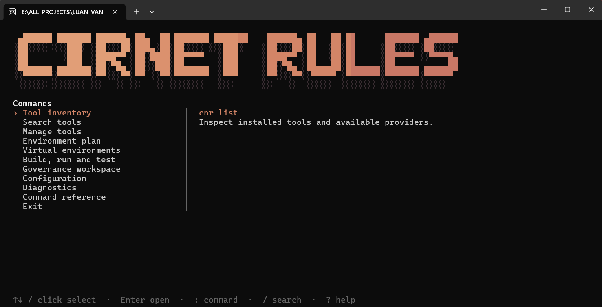

# CIRNET RULES

[English](en/README.md) · [Tiếng Việt](vi/README.md)

**CIRNETRULES** provides a Rust governance core, the CNR CLI and an MCP server over
STDIO. Run coding sessions independently in Codex Desktop, Claude Code or
Antigravity. Use CNR to bind the worktree, resolve the authorized task context,
verify changes and record evidence.
Use the binaries from `target/debug` or make them available on your path.
On Windows the executable is `cnr.exe`.

<p align="center">
  
</p>

## Giao diện dòng lệnh CNR (CLI / TUI)

Khởi động giao diện dòng lệnh tương tác (TUI) bằng lệnh:

```sh
cnr
# hoặc
cnr tui
# mở với giao diện tiếng Việt
cnr --lang vi
```

### Phím chức năng trong giao diện CLI

| Phím | Chức năng |
| :--- | :--- |
| `↑` `↓` | Di chuyển lựa chọn |
| `Enter` | Mở hoặc thực hiện lệnh |
| `Esc` | Quay lại |
| `/` | Tìm kiếm lệnh |
| `?` | Xem hướng dẫn |
| `Ctrl+C` | Thoát CLI |

### Menu chức năng trong giao diện CLI

| Menu | Chức năng |
| :--- | :--- |
| **Tool inventory** | Xem các công cụ đã cài |
| **Search tools** | Tìm Runtime, SDK, compiler |
| **Manage tools** | Cài đặt, cập nhật, gỡ công cụ |
| **Environment plan** | Kiểm tra và đồng bộ môi trường |
| **Virtual environments** | Quản lý môi trường ảo |
| **Build, run and test** | Biên dịch, chạy và kiểm thử |
| **Governance workspace** | Quản lý Repo, Task, Rules và Agent |
| **Configuration** | Xem/chỉnh cấu hình CNR |
| **Diagnostics** | Kiểm tra tình trạng hệ thống |

## Các lệnh CNR CLI trong dự án cirnet-rules

### Quản lý Governance & Workspace

```sh
# kiểm tra tính hợp lệ của tài liệu, liên kết và quy tắc governance
cnr governance validate
# xem cấu hình và nguồn thẩm quyền governance
cnr governance inspect
# dò tìm và phát hiện các workspace / git worktree ứng viên
cnr workspace discover
# xem chi tiết nội dung và tiến độ của task
cnr task show --task <ID>
# liệt kê và đồng bộ chỉ dẫn cho Agent (Codex, Claude, Antigravity)
cnr agent list
# kiểm tra biên nhận audit cho task, migration, agent và tooling
cnr audit
```

### Quản lý công cụ & môi trường (Tooling & Environment)

```sh
# xem danh sách công cụ đã cài và provider khả dụng
cnr list
# tìm kiếm công cụ trong danh mục (Runtime, SDK, compiler...)
cnr search <QUERY>
# xem thông tin chi tiết và khả năng hỗ trợ của một công cụ
cnr info <TOOL>
# xem trước kế hoạch cài đặt phiên bản công cụ cụ thể
cnr install <TOOL@VERSION> --dry-run
# xác nhận cài đặt phiên bản công cụ vào dự án
cnr install <TOOL@VERSION> --yes
# kiểm tra và cập nhật tất cả công cụ trong môi trường
cnr update --all
# gỡ cài đặt phiên bản công cụ do dự án sở hữu
cnr remove <TOOL@VERSION>
# ghim phiên bản công cụ cụ thể cho dự án
cnr pin <TOOL@VERSION>
# chọn phiên bản công cụ trong profile hiện tại
cnr use <TOOL@VERSION>
# chẩn đoán điều kiện môi trường cục bộ và trạng thái dự án
cnr doctor
# xem kế hoạch phân giải môi trường, phiên bản ghim và xung đột
cnr env plan
# khóa môi trường dự án vào cnr.lock
cnr env lock
# xem trước kế hoạch đồng bộ môi trường dự án
cnr env sync --dry-run
# xác nhận đồng bộ môi trường dự án
cnr env sync --yes
# quản lý và liệt kê các môi trường ảo của dự án
cnr venv list
# xem toàn bộ cấu hình dự án hiện tại
cnr config show
```

### Biên dịch, Chạy và Kiểm thử dự án (Build, Run & Test)

```sh
# xem trước kế hoạch biên dịch native cho dự án
cnr build --dry-run
# biên dịch dự án native
cnr build
# chạy dự án native
cnr run
# chạy kiểm thử dự án native
cnr test
# thực thi lệnh tường minh sau dấu phân cách --
cnr exec -- <PROGRAM> [ARGS...]
```

### Lệnh Governance nâng cao (cirnet-governance)

```sh
# kiểm tra toàn diện tính hợp lệ của tài liệu song ngữ, liên kết và quy tắc
cirnet-governance validate
# kiểm tra tính đồng bộ của bản dịch tài liệu song ngữ (EN / VI)
cirnet-governance check-translations
# kiểm tra phiên bản công cụ và phụ thuộc
cirnet-governance check-versions
# chẩn đoán trạng thái môi trường và cấu hình governance
cirnet-governance doctor
```

## Các lệnh kiểm tra với Cargo

```sh
# kiểm tra định dạng mã nguồn
cargo fmt --all --check
# kiểm tra chất lượng code
cargo clippy --locked --all-targets -D warnings
# kiểm tra lỗi biên dịch
cargo check --locked --all-targets
# kiểm tra khả năng tạo tài liệu API
cargo doc --locked --no-deps
# kiểm thử với tất cả feature flags
cargo test --locked --all-features
# kiểm tra build phiên bản Release
cargo build --locked --release --bins
```

## Các lệnh xóa & build & kiểm thử chương trình

```sh
# xóa các artifact build
cargo clean
# build chương trình
cargo build --locked --bins
# chạy kiểm thử
cargo test --locked --all-targets
```

```powershell
# --locked: Không cho phép Cargo thay đổi dependency lockfile
# --all-targets: Kiểm tra tất cả targets như library, binary, tests, examples, benchmarks
# -D warnings: Chuyển tất cả warnings thành errors
# --bins: Chỉ build các binary executable được khai báo trong project
```

[Operator workflow](en/references/cirnetrules-local.md) ·
[Hướng dẫn CNR](vi/references/cnr.md) ·
[Agent configuration](en/adapters/README.md) ·
[Legacy data recovery](en/references/cirnetrules-identity.md) ·
[Governance registry](governance.yaml)

[MCP STDIO](en/references/mcp.md) · [Shared task coordination](en/references/shared-task-coordination.md) · [Phối hợp task dùng chung](vi/references/shared-task-coordination.md)
