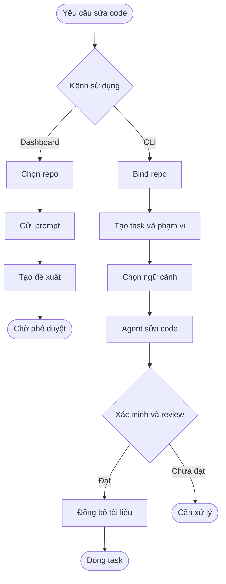

# OPENRULES

[English](en/README.md) · [Tiếng Việt](vi/README.md)

Local Rust tooling for scoped task routing, execution, verification and governance.

[Dashboard operator guide](en/references/dashboard.md) · [Hướng dẫn Dashboard](vi/references/dashboard.md)

Open **Settings → Configuration** to author and review governance from Desktop.
[Mở thư viện governance](vi/references/governance-workspace.md) · [Governance workspace](en/references/governance-workspace.md)

[Unreleased changes](en/CHANGELOG.md) · [Thay đổi chưa phát hành](vi/CHANGELOG.md)

`cirnet-rules` quản lý quy trình làm việc và bằng chứng cho các repo CIRNET.
Repo sản phẩm vẫn sở hữu source code, contract và artifact của mình; Remote
sở hữu lựa chọn release hệ thống.

## Luồng làm việc khi yêu cầu agent sửa code

Dashboard và CLI có hai luồng local riêng. Dashboard tiếp nhận yêu cầu và tạo
đề xuất chờ duyệt; quy trình task qua CLI được người vận hành hoặc agent chủ
động thực hiện theo phạm vi được ủy quyền.

**Dashboard.** Chọn repo trong Settings hoặc New Chat rồi gửi prompt để tạo
đề xuất có phạm vi, ở trạng thái `WAITING_APPROVAL`. Dashboard cũng hỗ trợ
automation chạy thủ công hoặc theo lịch để tạo đề xuất. Đề xuất không tự trở
thành task CLI, không cấp quyền ghi và chưa tự gọi agent sửa source code.

**CLI và agent.** Với task được quản lý qua CLI, quy trình hiện tại gồm:

1. **Bind repo:** `workspace-discover` tìm checkout; `workspace-bind` gắn
   repo với worktree và danh tính Git cụ thể.
2. **Tạo task:** chuẩn bị spec, plan và descriptor bằng `task-create`, gồm
   mục tiêu, phạm vi đọc/ghi, mức rủi ro, quyền và tiêu chí chấp nhận.
3. **Chọn ngữ cảnh:** `route` và `task-context` chọn hướng dẫn, source và
   các ảnh hưởng trực tiếp trong phạm vi được cấp.
4. **Sửa code:** agent làm việc qua môi trường thực thi được ủy quyền;
   `diff-check` kiểm tra thay đổi so với phạm vi task.
5. **Xác minh và review:** sau khi triển khai, `task-verify`, `task-review`
   và `task-accept` ghi nhận kiểm tra và review theo điều kiện task. Thiếu
   quyền, vượt phạm vi hoặc thiếu bằng chứng có thể khiến bước đó bị chặn.
6. **Hoàn tất:** đồng bộ tài liệu sau khi task được chấp nhận, hoặc ghi lý do
   không cần cập nhật, rồi dùng `task-close`. Release là quy trình riêng và
   cần task RELEASE cùng quyền tương ứng.

Ví dụ, với yêu cầu sửa API client của `cirnet-interface`, routing có thể chỉ ra
ranh giới HTTP do `cirnet-remote` sở hữu. Agent chỉ đọc hoặc sửa các repo và
file đã nằm trong phạm vi được cấp; thay đổi contract cần được xử lý theo
đúng repo sở hữu và phạm vi task.

Xem [quy trình local](en/references/openrules-local.md),
[routing](en/routing/README.md), [công cụ](en/tools/README.md),
[Dashboard](vi/references/dashboard.md) và [registry](governance.yaml).
