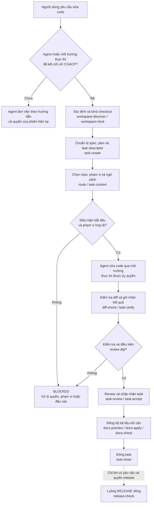

# CIRNET Governance & Agent Control Plane

[English](en/README.md) · [Tiếng Việt](vi/README.md)

Local Rust tooling for scoped task routing, execution, verification and governance.

`cirnet-rules` quản lý quy trình làm việc và bằng chứng cho các repo CIRNET.
Repo sản phẩm vẫn sở hữu source code, contract và artifact của mình; Remote
sở hữu lựa chọn release hệ thống.

## Luồng làm việc khi yêu cầu agent sửa code

Sơ đồ dưới đây mô tả **quy trình local khi người vận hành hoặc agent chủ động
sử dụng CGACP**. Một prompt thông thường không tự kích hoạt `cirnet-rules`.

1. **Xác định checkout.** `workspace-discover` tìm các repo có thể sử dụng;
   `workspace-bind` gắn repo với một worktree và danh tính Git cụ thể.
2. **Xác định công việc.** Spec, plan và task descriptor mô tả mục tiêu,
   repo chính, phạm vi đọc/ghi, kiểm thử, mức rủi ro và quyền tương ứng.
   Task liên quan nhiều repo có thể dùng task cha và các task con riêng.
3. **Chọn ngữ cảnh.** `route` đối chiếu phạm vi với registry và các ảnh hưởng
   trực tiếp; `task-context` cung cấp hướng dẫn, skill và source đã chọn.
   Một phụ thuộc được chỉ ra không tự mở rộng quyền đọc hoặc ghi.
4. **Thực hiện.** Khi task đủ điều kiện, agent hoặc môi trường thực thi bên
   ngoài sửa các file trong phạm vi được ủy quyền. `diff-check` kiểm tra
   thay đổi sau khi thực hiện; nó không thay thế sandbox của hệ điều hành.
5. **Xác minh và review.** `task-verify` ghi nhận các kiểm tra được cấu hình;
   `task-review` và `task-accept` xử lý review, chấp nhận theo điều kiện của
   task. Thiếu bằng chứng, vượt phạm vi hoặc chưa đáp ứng điều kiện review
   có thể khiến bước liên quan bị chặn.
6. **Tài liệu và kết thúc.** Sau khi task được chấp nhận, cập nhật tài liệu
   theo phạm vi được cấp hoặc ghi rõ lý do không cần cập nhật, rồi đóng task.
   Release và triển khai là các hành động riêng, không tự chạy từ task WORK.

Ví dụ, với yêu cầu sửa API client của `cirnet-interface`, routing có thể chỉ ra
ranh giới HTTP do `cirnet-remote` sở hữu. Agent chỉ đọc hoặc sửa các repo và
file đã nằm trong phạm vi được cấp; thay đổi contract cần được xử lý theo
đúng repo sở hữu và phạm vi task.

## Ranh giới thực thi

- `task-bootstrap` có thể chuẩn bị handoff cho agent; handoff không tự cấp
  quyền cho môi trường thực thi hoặc chứng minh agent đã nạp hướng dẫn.
- Runner quản lý chỉ hỗ trợ các thao tác Git đọc thông tin được chỉ định và
  kiểm tra JSON/UTF-8. Build, test tổng quát, network và cô lập tiến trình cần
  môi trường thực thi riêng được ủy quyền.
- Hook discovery, native agent discovery và phiên agent thật cần bằng chứng
  riêng; tài liệu adapter hiện ghi các kiểm tra đó là `NOT_RUN`.
- Registry hiện ghi release train đích `0.2.4`, họ tương thích `0.2` và
  trạng thái `NOT_ACTIVATED`. Release hiện hành do repo sở hữu lựa chọn.

Xem [quy trình local](en/references/cgacp-local.md),
[routing](en/routing/README.md), [công cụ](en/tools/README.md),
[adapter](en/adapters/README.md) và [registry](governance.yaml).
