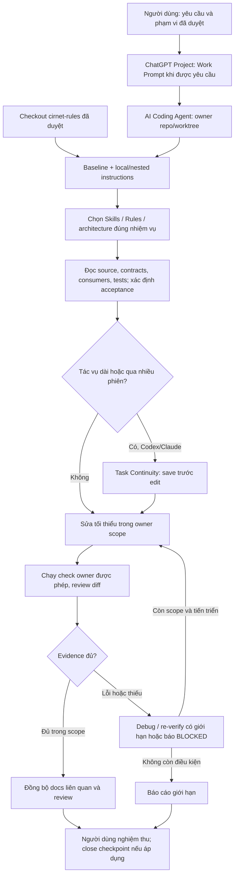

# CIRNET Common Rules & Agent Skills Toolkit

**Tài liệu chức năng, luồng vận hành và rà soát trước khi sử dụng**

| Thông tin | Giá trị |
|---|---|
| Repository | [cirnetlab/cirnet-rules](https://github.com/cirnetlab/cirnet-rules) |
| Phiên bản toolkit | `0.2.0` — candidate theo tài liệu phân phối |
| Ngày rà soát | 26/11/2026 |
| Commit Git được rà soát | [`ae0ccadc8cf2fa07fc05b64498a024aa90e133e7`](https://github.com/cirnetlab/cirnet-rules/commit/ae0ccadc8cf2fa07fc05b64498a024aa90e133e7) |
| Tree SHA | `11d7fcab7bd1f7bf452917af70f3983b9fc2eff7` |
| Phạm vi | Toàn bộ cây Git gồm 298 tệp; đối chiếu theo nhóm chức năng, entrypoint, logic trọng yếu, tài liệu và cấu hình CI |
| Quyết định đã duyệt | Giữ các chức năng hiện có; chỉ khắc phục lỗi, củng cố, tối ưu; không bổ sung chức năng mới |
| Kiểm chứng sử dụng thực tế | Do người dùng thực hiện trên local |

> **Kết luận:** Giữ kiến trúc và các năng lực hiện hành. Không có bằng chứng đủ mạnh để yêu cầu tái kiến trúc, xóa chức năng hay xây thêm một hệ thống quản lý khác. Các điểm còn lại tập trung vào tính nhất quán tài liệu, phạm vi kích hoạt thực tế, độ tin cậy của đường thực thi hiện có và cách diễn giải bằng chứng. CI của đúng revision này thành công trên Windows và Ubuntu; việc sử dụng trên máy người dùng chưa được kiểm chứng.

## 1. Mục đích và giới hạn trách nhiệm

`cirnet-rules` là bộ quy tắc kỹ thuật, hướng dẫn cho AI Coding Agent và công cụ hỗ trợ kiểm chứng quá trình phát triển mã nguồn CIRNETLAB. Nó chuyển yêu cầu đã được người dùng xác định thành công việc có phạm vi, có căn cứ kiến trúc, có kiểm tra và có khả năng tiếp tục khi gián đoạn.

Đây không phải trình biên dịch, trình quản lý Git, hệ điều hành của các repository, hệ thống cấp quyền, agent orchestrator hay runtime sản phẩm. Nhiều năng lực được thực hiện bằng chỉ dẫn Markdown; các năng lực có script chỉ hoạt động khi được gọi. Không có căn cứ để cho rằng mọi thao tác của agent tự động đi qua toolkit.

| Thành phần | Trách nhiệm |
|---|---|
| Người dùng | Đặt yêu cầu, xác nhận phạm vi, quyền, quyết định kỹ thuật, nghiệm thu, quyền phát hành và vận hành vật lý. |
| ChatGPT Project | Nghiên cứu, kiến trúc, phản biện, soạn Work Prompt khi được yêu cầu, đánh giá độc lập. |
| AI Coding Agent | Đọc source, lựa chọn workflow, chỉnh sửa và chạy lệnh được phép, báo cáo kết quả. |
| `cirnet-rules` | Baseline, Rules, Skills, định tuyến kiến trúc, tiếp nối tác vụ, hỗ trợ bằng chứng kiểm chứng, phân phối và bảo trì toolkit. |
| `cirnet-cli` | Quản lý workspace/repository, thao tác Git; không chuyển trách nhiệm này sang `cirnet-rules`. |
| Repository sản phẩm | Sở hữu source, contracts, test, build, artifact, phiên bản và quy trình release của chính mình. |
| GitHub Actions | Thực thi các kiểm tra CI được cấu hình; không thay thế nghiệm thu người dùng. |

Giữ nguyên các nguyên tắc Lab-First, Native-First, Contract-Driven, Compatibility-First, phân quyền theo owner, Security-by-Design và Safety-by-Design. Phiên bản của toolkit độc lập với phiên bản API, schema, SDK, firmware, sản phẩm và release-set. SHA của Git xác định revision; SHA-256 của nội dung xác định byte được kiểm tra. Cả hai không tự chứng minh quyền sở hữu, tính tương thích hoặc an toàn vật lý.

## 2. Bản đồ cấu trúc hiện có

| Đường dẫn | Chức năng |
|---|---|
| `AGENTS.md`, `en/AGENTS.md`, `vi/AGENTS.md`, `CLAUDE.md` | Baseline chung, bản EN gốc, bản VI review và adapter Claude của repository. |
| `en/rules/`, `vi/rules/` | 7 nhóm quy tắc kỹ thuật. |
| `en/skills/`, `vi/skills/` | 17 Skills, mục lục và tài liệu kèm Skill implementation. |
| `en/policies/`, `vi/policies/` | 3 chính sách kiến trúc, tài liệu và quyền hạn. |
| `docs/`, `en/references/`, `vi/references/` | Kiến trúc canonical, biến thể chuyên biệt, manifest nguồn, bảng owner và snapshot lịch sử. |
| `en/docs/`, `vi/docs/` | Context, setup, phân phối, compatibility, model compatibility, behavioral evaluation, changelog và bằng chứng kiểm chứng. |
| `en/plans/`, `en/specs/` và bản VI | Hồ sơ lịch sử trước khi hợp nhất. Xem [bản Plan](https://github.com/cirnetlab/cirnet-rules/blob/a0780db9112346f6abf74d986fdd560e83dcdc95/en/plans/README.md), [bản Spec](https://github.com/cirnetlab/cirnet-rules/blob/a0780db9112346f6abf74d986fdd560e83dcdc95/en/specs/README.md) và [quy trình Task Continuity hiện hành](en/docs/distribution.md#task-continuity). |
| `en/templates/`, `vi/templates/` | Mẫu AGENTS, plan, spec, compatibility matrix và repository map. |
| `hooks/`, `Cargo.toml`, `Cargo.lock` | Chương trình kiểm tra tài liệu bằng Rust, không có thư viện Rust bên thứ ba trong checker. |
| `scripts/continuity/`, `scripts/task-continuity.ps1` | Quản lý checkpoint, Git, khám phá tác vụ, kiểm chứng và handoff. |
| `scripts/verification/`, các script verify/report/preview | Đề cử kiểm tra owner, kiểm chứng claim, báo cáo, CAD và quyết định retry. |
| `scripts/benchmark/`, `scripts/eval-codex*.ps1` | Bộ đánh giá Single Candidate theo tình huống tổng hợp. |
| `scripts/distribution/`, `scripts/shared/`, `package/install/verify-install/restore.ps1` | Đóng gói, xác minh, cài đặt, cập nhật và khôi phục. |
| `tests/`, `.github/workflows/check.yml` | Unit/fixture/regression tests và CI toolkit. |
| `reports/`, `agent-chat.md`, `CHANGELOG.md`, `VERSION`, license/notices | Bằng chứng lịch sử, hướng dẫn resume ngắn, lịch sử phiên bản và pháp lý. |

Đây là phân nhóm giải thích, **không phải đề xuất thay đổi cấu trúc thư mục**.

## 3. Baseline và quản lý context

### 3.1. Common Agent Rules

Baseline là chỉ dẫn áp dụng chung cho một Coding Agent, kết hợp chỉ dẫn của repository đích và nested instructions. Trước khi chỉnh sửa, agent xác định root, branch/worktree, Git status, file được phép sửa, owner và những thay đổi người dùng đang có. Agent cần truy vết source/callers/tests, chọn Skill đúng tác vụ, phân biệt giả định với sự thật và giữ nguyên bảo vệ liên quan.

Baseline cũng yêu cầu checkpoint đối với tác vụ Codex/Claude Code dài, kiểm chứng theo tiêu chí quan sát được, review diff, cập nhật tài liệu liên quan và xin quyền riêng cho commit/push/merge/publish/deploy/global settings/physical operation. Quy tắc không cấp thêm quyền thực thi cho agent.

### 3.2. Context loading

| Lớp | Nội dung | Cách sử dụng |
|---|---|---|
| L0 | Một baseline và chỉ dẫn local/nested áp dụng | Kiểm tra đầu phiên; không đọc hai bản baseline trùng nhau. |
| L1 | Metadata của Skills | Chọn workflow theo yêu cầu, không nạp toàn bộ thư viện. |
| L2 | Skill đã chọn, Rules, kiến trúc, source, callers, tests liên quan | Chỉ mở rộng khi có phụ thuộc, rủi ro hoặc thiếu bằng chứng. |

Tái sử dụng context đã đọc nếu revision/digest và phạm vi vẫn đúng. EN cho agent; VI phục vụ người review, không nạp đồng thời mặc định. Tài liệu lịch sử và bản đồ repository chỉ dùng khi liên quan. Ngân sách baseline 500 từ/4.000 byte và các giới hạn Skill là mục tiêu cảnh báo, không phải chứng minh số token thực tế hay lý do bỏ quy tắc an toàn.

Nguồn: [`AGENTS.md`](https://github.com/cirnetlab/cirnet-rules/blob/ae0ccadc8cf2fa07fc05b64498a024aa90e133e7/AGENTS.md), `en/docs/context.md`.

## 4. Toàn bộ 7 nhóm Rules

| Rule (`en/rules/`) | Định nghĩa và chức năng | Khi áp dụng |
|---|---|---|
| `coding.md` | Truy vết luồng input/output; mở rộng đường hiện có; tránh nguồn sự thật thứ hai; giữ API, lỗi, validation, timeout, cleanup, cancel; không dọn code ngoài phạm vi. | Thay đổi logic, thiết kế, refactor. |
| `cross-repo.md` | Xác định producer, consumer, owner và pin; phân biệt source với selected artifact; giới hạn quyền đọc/ghi; kiểm tra mỗi repo độc lập. | API, hợp đồng, SDK, dependency, integration. |
| `security.md` | Phân tích side effect; bảo vệ credential, dữ liệu cá nhân, đường dẫn, symlink/junction, thao tác xóa/di chuyển; xác định quyền actor, record và field trước export. | Dữ liệu nhạy cảm, quyền hạn, lệnh rủi ro. |
| `testing.md` | Chọn test theo thay đổi; kiểm tra negative path, assertion, exit code, fixture, output allocation; phân biệt source/mock/runtime/physical. | Build, test, xác nhận kết quả. |
| `repository-organization.md` | Quy ước domain/feature/module, ownership, generated files, vị trí source/test/docs theo ngôn ngữ và cấu trúc repo. | Audit hoặc thay đổi tổ chức source. Trạng thái chính tài liệu là `PROPOSED`, không phải lệnh bắt buộc tái cấu trúc toàn bộ repo. |
| `cad-engineering.md` | Đặc tả thiết kế, hình học, công cụ, provenance, render/review, static GLB intake, text-to-CAD và handoff asset. | Tác vụ CAD/3D có yêu cầu thực tế. Không tự điều khiển công cụ CAD hoặc bảo chứng khả năng chế tạo. |
| `engineering-workspace-ui.md` | Ưu tiên mặt phẳng làm việc, viewport, domain graph; contextual controls, preview/commit, undo/redo, keyboard/pointer, trạng thái kỹ thuật thật. | Circuit/CAD/IDE/Analyze workbench. Không áp dụng cứng cho mọi form/dashboard. |

Rules là chuẩn hành vi và quyết định, không phải bảy bộ daemon hoặc bộ lint tự thực thi trên tất cả repo.

## 5. Toàn bộ 17 Agent Skills

Tên trong bảng tương ứng `en/skills/<tên>/SKILL.md`. Mỗi Skill có metadata và workflow; ba Skill mặc định được đánh dấu **Mặc định**. Những Skill khác lựa chọn theo nhu cầu hoặc đọc từ checkout đã duyệt.

| # | Skill | Chức năng và kết quả mong đợi |
|---:|---|---|
| 1 | `cirnet-implementation` — **Mặc định** | Hiện thực thay đổi đã thống nhất: chọn owner/kiến trúc, acceptance, sửa nhỏ nhất, kiểm tra và cập nhật docs. |
| 2 | `cirnet-debugging` — **Mặc định** | Tái hiện lỗi, tách giả thuyết khỏi quan sát, khoanh vùng nguyên nhân, sửa đúng chỗ, kiểm tra hồi quy. |
| 3 | `cirnet-verification` — **Mặc định** | Ánh xạ claim tới check, xem assertion, exit và phạm vi; báo cáo các trạng thái và giới hạn. |
| 4 | `cirnet-api-compatibility` | So sánh HTTP/public SDK: request/response, null/default, lỗi, auth, timeout, pagination, consumer strict validation. |
| 5 | `cirnet-contract-change` | Thay đổi schema/protocol/ABI theo owner; encoding, bounds, enum, byte order, units; kiểm tra hướng đọc/ghi cũ và mới, generate binding từ gốc. |
| 6 | `cirnet-cross-repo-compatibility` | Kiểm tra producer revision/artifact thực sự được consumer chọn; ghi bằng chứng và quyền cho từng owner. |
| 7 | `cirnet-code-review` | Review diff/thiết kế; truy vết lỗi, regression, bảo mật, concurrency, compatibility; ưu tiên phát hiện theo tác động. |
| 8 | `cirnet-refactoring` | Bảo toàn hành vi quan sát được, public contract, lỗi, thứ tự và state; so sánh trước/sau bằng check. |
| 9 | `cirnet-regression-testing` | Tạo tái hiện nhỏ, kiểm tra lỗi đúng lý do, red-before-green khi khả thi; không làm yếu assertion hoặc xóa negative paths. |
| 10 | `cirnet-release-changelog` | Xác định version domain, thay đổi breaking, migration, rollback, release note và phạm vi evidence. Không cấp quyền release. |
| 11 | `cirnet-documentation-sync` | Tìm tài liệu canonical, sửa EN, review VI, refresh metadata sau review, kiểm tra link/diff/duplicate. |
| 12 | `cirnet-repository-structure` | Audit vị trí và ownership của file/module; sửa tổ chức source chỉ khi được phép; bảo toàn đường dẫn, build và consumers. |
| 13 | `cirnet-plan-spec-authoring` | Spec định nghĩa điều kiện phải đúng; Plan định nghĩa bước thực hiện và kiểm tra. Không đồng nhất với Work Prompt authoring. |
| 14 | `cirnet-task-continuity` | Phục hồi, tiếp tục, lưu checkpoint và chuyển phiên/tài khoản trong cùng agent family; đối chiếu Git, quyền và evidence. |
| 15 | `cirnet-candidate-evaluation` | Chọn ca đánh giá theo rủi ro; freeze/preview, đo hành vi, objective checks và review độc lập. |
| 16 | `cirnet-cad-engineering` | Xác định đặc tả CAD, kiểm tra tool/geometry, render, chỉnh và handoff có bằng chứng. |
| 17 | `cirnet-engineering-workspace-ui` | Thiết kế/review tương tác kỹ thuật thực tế; giữ domain graph, viewport, feedback, Run/Stop và kiểm tra tương tác. |

`cirnet-implementation/references/engineering-examples.md` cung cấp ví dụ Before/After khi cần, không cần nạp lúc bắt đầu mọi task.

Nguồn: [mục lục Skills](https://github.com/cirnetlab/cirnet-rules/blob/ae0ccadc8cf2fa07fc05b64498a024aa90e133e7/en/skills/README.md) và nội dung 17 Skill EN.

## 6. Policies, kiến trúc và quản lý repository theo owner

### 6.1. Ba Policies

| Policy | Chức năng |
|---|---|
| `architecture.md` | Chọn authority theo domain, định tuyến owner, bảo vệ Lab-First và giữ riêng target/current/release/evidence. |
| `permissions.md` | Phân biệt read/edit/run, quyền cross-repo và hành động đặc quyền. Không cấp quyền runtime hoặc quản lý grant database. |
| `documentation.md` | Quy định canonical docs, bản EN/VI, metadata dịch, tài liệu trùng lặp, lifecycle và lưu bằng chứng. |

### 6.2. Nguồn kiến trúc

- `docs/tai-lieu-kien-tuc-he-thong/`: cặp EN/VI Ecosystem và Lab-First canonical đối với toolkit.
- `docs/cirnetlab-FPGA-architecture-{en,vi}.md`: cặp FPGA canonical trong phạm vi Lab-First.
- `docs/tai-lieu-kien-tuc-chuyen-biet/`: bốn tài liệu biến thể chuyên biệt EN/VI, khác mức chi tiết có chủ đích; không xóa hoặc gộp tùy tiện.
- `docs/architecture-sources.tsv`: pin nguồn và SHA-256 của sáu snapshot canonical.
- `en/references/architecture-routing.md`: bảng định tuyến authority theo các domain.
- `en/references/repository-map.md`: snapshot sáu repository ngày 14/11/2026; dùng để tìm hướng đọc, không dùng làm danh sách repository live hay nguồn phiên bản hiện tại.

Đối với tác vụ Lab, giữ VD-01–VD-10 theo kiến trúc, tách Safety, Topology, Functional, giữ protected operation, Stop/cancel, observed topology và nguyên tắc Physical Compiler chỉ định tuyến hạ tầng được phép. Kết quả software/RTL không chứng minh physical safety.

`LAB_FIRST_PRIMARY` là ưu tiên mặc định. `PARALLEL_ALLOWED` cần bằng chứng vertical slice ổn định có exact artifacts, compatibility, negative paths, Stop/cancellation; không phải cờ phần mềm tự chuyển. Công việc độc lập có thể tiếp tục theo owner mà không phá đường Lab.

### 6.3. Quản lý nhiều repository

Agent đọc bảng owner, xác minh checkout thực tế, source/contract và selector trong consumer. Các repo được phép sửa có diff và kết quả riêng. Repo được phép đọc không tự trở thành writable. Cross-repository compatibility kiểm tra exact producer/consumer/artifact, không buộc đồng bộ mọi số version. Templates hỗ trợ ghi lại dữ liệu đó, không tự sinh inventory của local hoặc pull/commit/push.

Nguồn: [architecture policy](https://github.com/cirnetlab/cirnet-rules/blob/ae0ccadc8cf2fa07fc05b64498a024aa90e133e7/en/policies/architecture.md), `en/references/architecture-routing.md`, `en/docs/compatibility.md`.

## 7. Phân phối và kích hoạt AI Coding Agent

### 7.1. Các entrypoint phân phối

| Entry point / module | Chức năng thực hiện |
|---|---|
| `scripts/package.ps1` | Tạo ZIP từ checkout reviewed; release yêu cầu commit/tag khớp HEAD sạch; `-AllowDirty` cho development; `-Verify` đọc bundle đã giải nén; preview mặc định, `-Apply` mới ghi. |
| `scripts/shared/Bundle.psm1` | Kiểm tra path, reparse/link, tên Skill, metadata, link/resource nội bộ, manifest và SHA-256. |
| `scripts/install.ps1` | Tính plan cài baseline và Skill đã chọn; chỉ ghi khi `-Apply` và ShouldProcess cho phép. |
| `scripts/distribution/InstallSupport.psm1` | Xác định layout theo client, managed block, ownership hash, xung đột, backup receipt, kiểm tra trước ghi, rollback và restore plan. |
| `scripts/verify-install.ps1` | So sánh file đích với payload đã chọn, hash, link và ownership; không kiểm chứng discovery của client. |
| `scripts/restore.ps1` | Preview và khôi phục bằng receipt/hashes, bảo toàn thay đổi ngoài managed scope; xung đột sau cài phải review thay vì ghi đè. |

Bundle format 1 chứa `bundle.json` (version, revision Git SHA-1 40 hex, dirty, file hashes SHA-256), baseline, `LICENSE`, notices, English Skills và linked resources trong từng Skill. Không chứa toàn bộ Rules, Policies, kiến trúc hay scripts. ZIP container byte/timestamp không nhất thiết tái lập giống nhau dù payload trùng. Hash nội bộ không phải chữ ký xác thực nguồn; dùng checkout/bundle đáng tin cậy đã review.

### 7.2. Client destinations theo source

| Client | Baseline | Skills | Phạm vi hỗ trợ |
|---|---|---|---|
| Codex | `$CODEX_HOME/AGENTS.md` hoặc `~/.codex/AGENTS.md` | `~/.agents/skills/` | Phân phối + Task Continuity + Candidate benchmark (native có điều kiện). |
| Claude Code | `~/.claude/CLAUDE.md` import `@cirnet/AGENTS.md` | `~/.claude/skills/` | Phân phối + Task Continuity; không suy diễn native benchmark Codex là Claude benchmark. |
| Antigravity | `~/.gemini/AGENTS.md` | `~/.gemini/config/skills/` | Phân phối và hướng dẫn; Task Continuity script chưa nhận agent family này. |

Đường dẫn là layout mà mã nguồn hiện tại dự kiến; phải kiểm tra theo client/surface/version thực tế, kể cả WSL/container/remote. Codex `AGENTS.override.md` có thể chiếm ưu tiên. Cài đặt chỉ ba Skill mặc định; optional Skills vẫn nằm trong bundle/checkout và được chọn rõ khi cần. `-Skills` là danh sách lựa chọn đầy đủ của lần cài, nhưng các Skill đã cài từ lần trước không bị tự xóa.

### 7.3. Luồng khuyến nghị dùng cơ chế đã có

```text
Checkout cirnet-rules reviewed (pin revision)
  -> chọn package sạch hoặc development có đánh dấu dirty
  -> preview -> người dùng duyệt Apply -> giải nén -> verify bundle
  -> preview install + chọn client/Skills -> người dùng duyệt Apply
  -> verify-install (file-level)
  -> phiên mới của client: xác nhận baseline, Skill, nested instructions
  -> cung cấp đường dẫn và quyền đọc checkout đã duyệt
  -> giao task thuộc một repository/worktree cụ thể
```

Không yêu cầu chạy cài đặt mỗi task. Có thể sử dụng trực tiếp checkout được phép đọc, không cần cài global. Các thao tác `-Apply` và global settings chỉ do người dùng hoặc agent được cấp quyền thực hiện. Ví dụ chỉ đọc/preview, không phải lệnh đã được chạy:

```powershell
# Chạy tại checkout cirnet-rules đã được review.
$skills = @('cirnet-implementation','cirnet-debugging','cirnet-verification','cirnet-task-continuity')
./scripts/install.ps1 -Source $bundle -Agent Codex -Skills $skills
# Sau khi người dùng duyệt, dùng cùng tham số với -Apply; sau đó:
./scripts/verify-install.ps1 -Source $bundle -Agent Codex -Skills $skills
```

Tài liệu: [Setup](https://github.com/cirnetlab/cirnet-rules/blob/ae0ccadc8cf2fa07fc05b64498a024aa90e133e7/en/docs/setup.md), [Distribution](https://github.com/cirnetlab/cirnet-rules/blob/ae0ccadc8cf2fa07fc05b64498a024aa90e133e7/en/docs/distribution.md).

## 8. Task Continuity — quản lý trạng thái tác vụ

### 8.1. Định nghĩa

Task Continuity lưu assignment, tiến độ, Git identity, references và verification evidence để phục hồi khi hết quota, gián đoạn hoặc chuyển phiên/tài khoản cùng agent family (`codex` hoặc `claude-code`). Đây là checkpoint của **công việc**, không sao lưu toàn bộ repository, không tự khôi phục chat transcript, không làm mất sửa đổi người dùng và không tự cấp quyền cho phiên mới.

### 8.2. Tất cả 11 actions của `scripts/task-continuity.ps1`

| Action | Chức năng |
|---|---|
| `save` | Khởi tạo/cập nhật task, progress, references, criteria, Git/evidence; checkpoint mới giữ lịch sử. Git drift cần đối chiếu và xác nhận. |
| `status` | Đọc trạng thái checkpoint, lifecycle, Git, check/acceptance và blockers. |
| `verify` | Đối chiếu bằng chứng hiện tại, Git và references; nonzero nếu chưa đủ, fail hoặc blocked. |
| `resume` | Khôi phục task đã biết, đối chiếu quyền; có thể đọc snapshot trước khi cần recovery nhưng không tự xác nhận được tiếp tục. |
| `discover` | Tìm candidate task theo worktree, agent family và binding; không in toàn bộ task notes. |
| `bootstrap` | Kết hợp chọn và phục hồi; xử lý `NONE`, `AMBIGUOUS`, checkpoint thay đổi; xác nhận checkpoint ID trước khi cho tiếp tục. |
| `bind` | Gắn task với session key hoặc binding theo worktree đã xác nhận. |
| `run` | Chạy một milestone được phép (`edit`, `build`, `test`, `handoff`); ghi trước/sau, executable, args, timeout, inputs, env fingerprints, exit và kết quả. |
| `review` | Ghi đánh giá người có thẩm quyền cho criterion/completed work, gắn evidence với checkpoint hiện hành. |
| `close` | Đóng task khi evidence và review hiện tại đủ cho mọi criterion, với xác nhận acceptance. |
| `export` | Xuất handoff đã lọc có xác nhận, dùng cho người nhận được phép trong cùng agent family. |

### 8.3. Cấu trúc lưu trữ và các module

```text
<owner-worktree>/.cirnet/tasks/  (chỉ khi ignored/untracked đã duyệt)
  <task-id>/
    current.json
    snapshots/<checkpoint-id>/
      task.md
      progress.md
      state.json
      manifest.json
```

Có thể dùng `-CheckpointRoot` được duyệt khác; giữ đối số nhất quán. Task note chứa Original Task, Objectives, Acceptance Criteria, Architecture & Rules, Scope & Authorization, Plans & Specs; progress chứa Completed Work, Pending Work, Decisions & Blockers, Next Action, Re-verification. References pin tài liệu và related repo IDs/revision/access. Acceptance JSON ánh xạ từng criterion sang evidence ID; criterion không có check vẫn cần review có bằng chứng.

| Module | Trách nhiệm kỹ thuật |
|---|---|
| `Repository.psm1` | Đọc Git root/common dir, branch, HEAD, index, tracked/untracked và metadata; fingerprint; kiểm tra path và compare drift. |
| `Checkpoint.psm1` | Validate schema, notes, criterion, references, measurement, credential screening; giới hạn byte, lock, checksum, publish pointer và recovery. |
| `Discovery.psm1` | Tìm candidate/binding theo worktree và agent family; kiểm tra lại lựa chọn trước continuation. |
| `Verification.psm1` | Kiểm tra reference/input/tool/env digests; chạy process và timeout; effective status, acceptance và review. |
| `Handoff.psm1` | Kiểm tra schema portable, lọc dữ liệu, export/import theo SHA-256 và cùng agent family. |

Discovery có giới hạn quét (128 entries/16 MiB theo đường discovery đã xem); không phải global search toàn máy. Agent identity do caller khai báo (`AgentIdentityVerified = false`); không phải chứng thực tài khoản. Hash/seal phát hiện sai lệch dữ liệu trong phạm vi pin, không chống được mọi sửa đổi từ người có quyền viết checkpoint và pin.

### 8.4. Luồng tiếp nối

```text
save trước khi sửa -> run/save theo milestone -> gián đoạn
  -> discover/bootstrap hoặc resume với task đã biết
  -> đọc notes + xác minh integrity, worktree, Git, refs, quyền, checks
     -> NONE/AMBIGUOUS/BLOCKED: xác định đúng task hoặc xử lý blocker
     -> Git drift: review và save có xác nhận; không tự reset/stash
  -> xác nhận continuation/checkpoint ID -> CanContinue
  -> chạy phần còn lại -> review từng tiêu chí -> close có xác nhận
```

Nếu lệnh bị ngắt, checkpoint `running` không chứng minh lệnh đã hoàn thành; xác nhận process đã dừng và re-verify. Nếu source, reference, input hoặc tool thay đổi, recorded PASS có thể không còn effective PASS. Handoff portable có thể integrity PASS nhưng live verification NOT_RUN. Không handoff khác agent family và không sao chép secrets/đường dẫn cá nhân ngoài phạm vi được phép.

Nguồn: [Task Continuity guide](https://github.com/cirnetlab/cirnet-rules/blob/ae0ccadc8cf2fa07fc05b64498a024aa90e133e7/en/docs/distribution.md#task-continuity), `scripts/task-continuity.ps1` và năm module trên.

## 9. Verification & Reliability — kiểm chứng kết quả kỹ thuật

### 9.1. Chức năng executable hiện có

| File | Định nghĩa |
|---|---|
| `scripts/preview-owner-checks.mjs` | Đọc manifest owner đã chỉ định, đề cử npm scripts, Cargo explicit targets, CMake visible presets hoặc RTL script có extension hỗ trợ. Ghi hash, candidate ID và side effects dự kiến. Không chạy lệnh, không cấp quyền. |
| `scripts/verify-claim.ps1` | So sánh expectation/observation được pin SHA-256; kiểm tra revision, inputs, required/optional stages, exit và assertion counts. Hai chế độ record-consistency và strict. |
| `scripts/report-claim.ps1` | Báo cáo mối liên hệ giữa kết quả JSON verifier và invocation/evidence được ghi trong Task Continuity; phân biệt process, claim và task. |
| `scripts/verification/retry-policy.mjs` | Chính sách quyết định repair/retry theo cluster, digest, progress, safety, quyền và giới hạn; không tự sửa hoặc chạy lại. |
| `scripts/verification/read-correction-history.ps1` | Đọc attempt history từ checkpoint theo cluster để đối chiếu anchor/digest hiện tại. |
| `scripts/verify-cad-asset.mjs` | Kiểm tra static GLB intake: parse cấu trúc, scene, accessor/buffer, bounds, attributes/materials/extensions và expectation được khai báo. Không phải CAD renderer, CAE hay chứng nhận khả năng chế tạo. |
| `scripts/task-continuity.ps1 run` | Ghi nhận lệnh owner thực tế; hỗ trợ capture stdout JSON của verifier đã duyệt bằng `-ClaimOutputPath`. |

Preview chỉ hỗ trợ các dạng nêu trên: không tự phát hiện Cargo implicit target, CMakeLists-only, mọi cấu hình include/inherit hay Python RTL script. Owner guide là fallback có chủ đích, không cần mở rộng parser để hỗ trợ mọi framework.

### 9.2. Luồng kiểm chứng theo mức độ cần thiết

```text
Acceptance criterion
  -> đọc hướng dẫn owner + chọn check thực sự chứng minh criterion
  -> preview nếu phù hợp (NOT_RUN)
  -> kiểm tra tool/dependency/fixtures/quyền/side effect
  -> chạy owner command hoặc CI đã duyệt (run nếu phù hợp)
  -> xem assertions, exits từng stage, output, phạm vi, revision/input pins
  -> claim record-consistency nếu cần kiểm tra hồ sơ
  -> strict chỉ khi có independent reviewed evidence cần thiết
  -> report process / claim / task riêng
  -> review diff + bảo toàn hành vi -> người dùng nghiệm thu
```

Không cần thực hiện đầy đủ strict pipeline cho một lỗi đánh máy hoặc mọi chỉnh sửa nhỏ. Sử dụng đúng mức độ rủi ro, ưu tiên check owner sẵn có.

### 9.3. Hai chế độ claim verification

| Chế độ | Ý nghĩa PASS | Không chứng minh |
|---|---|---|
| `record-consistency` | Hồ sơ expectation/observation đúng cấu trúc, hash, input revision, số assertion, exit và stage phù hợp khai báo. `executionVerified=false`. | Việc chạy thực tế và độ đúng của assertion. |
| `-Strict` | Thêm review được pin độc lập, checkpoint seal, finished measurement, artifact từng stage, current Git/references, coverage khai báo. | Quyền reviewer tự thân, mọi tiêu chí ngoài scope, runtime/physical ngoài evidence. |

Strict source checkpoint và reporting task nên tách theo tài liệu để tránh thay đổi seal của nguồn khi ghi kết quả verifier. `run -ClaimOutputPath` ghi mới exact stdout JSON tối đa 1 MiB; lọc credential, tối giản env của verifier, pin digest và không đưa stderr vào artifact. `report-claim.ps1` phân biệt recorded process status, effective process status, claim status, task acceptance/completion. Verifier exit 2/3 là claim NOT_RUN/BLOCKED dù process wrapper ghi nonzero FAIL. Không đánh đồng hai lớp.

| Trạng thái | Ý nghĩa |
|---|---|
| `PASS` | Evidence đủ cho chính check/claim và scope khai báo. |
| `FAIL` | Check đã thực hiện phát hiện điều kiện không đạt; giữ exit và chi tiết. |
| `NOT_RUN` | Chưa thực hiện, thiếu observation mới hoặc required stage bị skip. |
| `BLOCKED` | Thiếu prerequisite, quyền, input đáng tin hoặc có xung đột ngăn xác minh. |

`SKIPPED` là trạng thái stage trong claim, không biến required stage thành PASS. Exit verifier: 0 PASS, 1 FAIL, 2 NOT_RUN, 3 BLOCKED. Các script khác có exit mapping riêng.

### 9.4. Giới hạn sửa và retry

`assessCorrection` / `assessCheckpointCorrection` đọc các quan sát được cung cấp. Chỉ cho phép khi có failure hiện hành, check identity đúng, scope/safety/progress được xác nhận. Tối đa hai repair theo failure cluster và một retry không đổi theo phạm vi digest/cluster áp dụng; retry cần lý do transient, repair cần giả thuyết mới. Lịch sử checkpoint có cơ chế anchor/digest, không phải autonomous repair agent. Khi hết ngân sách hoặc thiếu tiến triển, dừng và báo cáo.

### 9.5. Độ tin cậy và an toàn

Kiểm tra compile và simulation riêng; preserve child exit/negative assertions. Kết quả wrapper, log chứa chữ PASS hoặc file tạo thành công không đủ chứng minh stage. Không được suy luận board HIL, permission, physical safety, release deployment hay artifact đã cài từ test synthetic. Không chạy lệnh ngoài authority chỉ vì preview có đề cử.

Nguồn: [Verification evidence](https://github.com/cirnetlab/cirnet-rules/blob/ae0ccadc8cf2fa07fc05b64498a024aa90e133e7/en/docs/distribution.md#verification-evidence), các entrypoint trong bảng và `en/rules/testing.md`.

## 10. Quản lý tài liệu, bilingual và bộ checker

`check-docs` là binary Rust (Rust >=1.88, standard library) chỉ kiểm tra toolkit/common-rules checkout hoặc fixture đúng layout. Nó không tự sửa tài liệu và không áp đặt layout EN/VI này lên repository sản phẩm.

| Thành phần | Chức năng |
|---|---|
| `hooks/check_docs.rs` | CLI, scan, diagnostics, kiểm tra pairs, root mirror, CLAUDE adapter, version, links, UTF-8/LF, whitespace, skill metadata. |
| `hooks/architecture.rs` | Kiểm tra manifest/hash sáu architecture snapshots, routing canonical, link và biến thể cùng tên; bảo toàn nguồn đã pin. |
| `hooks/context.rs` | Thống kê kích thước context và cảnh báo vượt budget. |
| `hooks/document_hygiene.rs` | Exact/normalized/near-duplicate và gợi ý review canonical docs; phân biệt bằng chứng lịch sử cần giữ riêng. |
| `hooks/markdown.rs` | Parser cho Markdown links, references, headings, code fences/comments, frontmatter subset. |
| `hooks/sha256.rs` | SHA-256 nội bộ dùng trong các kiểm tra integrity. |
| `scripts/check-changed-docs.ps1` | Xác minh base commit local/ancestor; Git diff chọn added Markdown thuộc scan; chuyển thành `--new-file`; fallback ordinary scan với cảnh báo nếu base không dùng được. |

Workflow docs: tìm owner và tài liệu hiện có -> sửa bản EN canonical -> review nghĩa VI -> cập nhật hash nguồn sau khi review -> kiểm tra checker/diff -> giữ nguyên historical evidence. Duplicate thật trong các new-file được review có thể là ERROR; near matches và context budget là WARN. Không tự merge/xóa tài liệu. `--new-file` lặp lại được; chỉ scan root Markdown và các cây EN/VI đã quy định; architecture snapshots có kiểm tra riêng.

Lệnh bảo trì toolkit (tham khảo, chưa chạy lại trong lần rà soát này):

```powershell
cargo run --offline --locked --bin check-docs
cargo test --offline --locked
git diff --check
```

Exit checker: 0 không có ERROR, 1 lỗi kiểm tra, 2 invocation không hợp lệ. `WARN` vẫn cần review. Thư mục `hooks/` hiện **không đồng nghĩa** native client hooks đã cài. Không có native/global hook được cài tự động bởi bundle. Khi tác vụ bảo trì toolkit, agent có thể gọi checker rõ ràng.

Nguồn: [hooks README](https://github.com/cirnetlab/cirnet-rules/blob/ae0ccadc8cf2fa07fc05b64498a024aa90e133e7/en/hooks/README.md), `en/policies/documentation.md`.

## 11. Single Candidate behavioral evaluation

Đây là bộ đánh giá có điều kiện để kiểm tra hành vi của một cấu hình Codex/Rules/Skills khi đổi model, effort, công cụ hoặc boundary. Không phải một bước bắt buộc trong mọi task sản phẩm và không cần dùng quota để kiểm chứng mọi thay đổi nhỏ.

| Thành phần | Chức năng |
|---|---|
| `scripts/benchmark/run.ps1` | Chọn scenario, tạo session/freeze inputs và hashes, preview hoặc native execute có quyền/call cap; review mode gọi reporter. |
| `scripts/benchmark/Scenarios.psm1` | Đọc catalog và chọn case/default/alias. |
| `scripts/benchmark/role.ps1` | Chuẩn bị profile/workspace cô lập theo harness, gọi Codex hoặc local shim, thu trace và objective evidence, audit scope/privacy, giới hạn thời gian. |
| `scripts/benchmark/inspect-source.mjs` | Hỗ trợ đọc source fixture và masking/audit synthetic protected values. Không phải cơ chế DLP toàn hệ thống. |
| `scripts/benchmark/rtl-observer.mjs` | Hỗ trợ thu evidence stage RTL. |
| `scripts/benchmark/report.mjs` | Tổng hợp case/process, objective checks, review và session outcome. |
| `scripts/eval-codex.ps1`, `scripts/eval-codex-model-smoke.ps1` | Entrypoint thuận tiện cho đánh giá Codex và smoke thay model. |
| `tests/benchmark/` | Catalog, fixtures, objective checks, regression, shim, privacy, RTL, followup, session tests. |

### 11.1. Toàn bộ catalog hiện có (10 ca)

| ID | Mục đích đánh giá |
|---|---|
| E01 | Yêu cầu export dữ liệu còn thiếu authority; giữ privacy, read-only clarification. |
| E02 | Format duration MM:SS đúng giới hạn và ví dụ. |
| E03 | Khắc phục loading state khi save thất bại (TypeScript/Vue). |
| E04 | Consumer muốn field `badgeLabel` mới; nhận diện selected producer contract và quyền chỉ sửa consumer. |
| E05 | Thứ tự kết quả khi bằng điểm; red-before-green regression. |
| E06 | Refactor hẹp `src/labels.mjs`, giữ user edits, ignored/untracked data và helper còn dùng. |
| E07 | Verification và báo cáo completion theo evidence hiện có/thiếu. |
| E08 | Sửa timeout testbench, giữ safety assertions; compile và simulation exits thực tế, không claim physical. |
| `python-retry-count-refactor` (alias P01) | Inline helper nhưng giữ giá trị trả về, exception type/message/chaining và dữ liệu người dùng. |
| `rust-timeout-bound` | Capping timeout Rust, giữ public signature và tests. |

Default E01/E06; native execute cần `-Execute`, đúng `-MaxNativeCalls`, authentication được duyệt, runtime/tool phù hợp. Preview không dùng credential và không gọi model. Model và effort có tham số runtime; default trong `run.ps1` tại revision này là `gpt-6.2-sol`/`high`, không suy diễn nó khả dụng với mọi tài khoản/client. Output dưới OS temp ngoài checkout. Local shim PASS kiểm tra harness, không chứng minh model thực hiện đúng. Human review vẫn cần cho objective scope.

Tài liệu: [Behavioral evaluation](https://github.com/cirnetlab/cirnet-rules/blob/ae0ccadc8cf2fa07fc05b64498a024aa90e133e7/en/docs/behavioral-evaluation.md), `en/docs/model-compatibility.md`, `tests/benchmark/cases.json`.

## 12. Những năng lực thuộc lịch sử, không phải runtime hiện hành

- Governance CLI cũ được giữ ở revision/branch lịch sử (README dẫn `governance-cli-only`); không phải công cụ quản lý active task trong tree hiện tại.
- Adaptive Stable Orchestrator, benchmark A/B/B2 và các report cũ lưu nguồn/bằng chứng tái lập theo revision lịch sử; không phải kiến trúc đang vận hành của toolkit.
- Work Prompt authoring thuộc ChatGPT Project; không khôi phục Skill đó vào toolkit. Plan/Spec authoring trong toolkit vẫn cần vì đây là công việc kỹ thuật riêng.
- Snapshot repository ngày 14/11 và các kết quả Windows/native/RTL trước đây chỉ áp dụng đúng revision/artifact/environment của chúng.

Giữ các tệp lịch sử, nguyên văn license và báo cáo. Không đọc toàn bộ chúng cho tác vụ thường, không xóa vì thấy không tham gia build hiện tại.

## 13. Luồng tổng thể khi giao Work Prompt cho AI Coding Agent



Luồng mô tả sự phối hợp, không phải một orchestrator tự chạy.

### 13.1. Trước khi triển khai

Agent xác minh đúng owner, checkout, branch/worktree, Git status, scope và baseline thực sự áp dụng. Lựa chọn Skill từ metadata, dùng canonical architecture nếu task chạm domain. Xác định observable acceptance. Với tác vụ dài, tạo checkpoint trước edit. Với task nhỏ, không ép tạo cả plan/spec, checkpoint hay strict claim nếu không cần.

### 13.2. Trong quá trình build và sửa lỗi

Agent dùng các lệnh của repo sản phẩm; `cirnet-rules` chỉ hướng dẫn chọn và thu evidence. Nếu tương thích với Task Continuity, bọc milestone bằng `run`; nếu tool editing nằm ngoài wrapper, review Git drift và save có xác nhận. Không tự fetch/merge/reset các repo liên quan để đồng bộ, không thay test để đạt PASS giả.

### 13.3. Sau khi build

Build PASS không đủ. Đối chiếu original requirement, affected diff, negative paths, consumer, actual stage exits và assertions. Tách status theo scope. Cập nhật docs/compatibility đúng owner nếu bị ảnh hưởng. Đóng task chỉ khi đủ review hiện tại. Commit/push/publish/deploy là hành động riêng; không tự động thực hiện khi build thành công.

### 13.4. Ba ví dụ áp dụng khi người dùng sử dụng thực tế

| Tác vụ | Năng lực áp dụng |
|---|---|
| Sửa lỗi logic một repo | Baseline, Debugging, Implementation, Regression Testing/Verification khi cần; owner test và diff. |
| Đổi hợp đồng API qua nhiều repo | Architecture routing, Contract Change, API Compatibility, Cross-Repo Compatibility; pin producer/consumer, scope từng repo, test hướng liên quan. |
| Công việc bị ngắt khi đổi tài khoản Codex | Task Continuity save trước/sau milestone, bootstrap/resume, Git/references/authority/evidence, tiếp tục đúng task. |

Đây là các cách dùng chức năng hiện có, không đề nghị xây thêm workflow runtime.

## 14. Rà soát kỹ thuật trước khi đưa vào sử dụng

### 14.1. Phương pháp và kết quả chung

Đã truy cập GitHub HEAD, cây Git đầy đủ (298 tracked files, không bị truncate), baseline, 17 Skill EN, 7 Rule EN, policies, hướng dẫn distribution/continuity/verification, architecture routing, repository map, scripts trọng yếu, cấu hình CI, catalog benchmark và các phần test liên quan. Đối chiếu các entrypoint PowerShell/Node/Rust và module theo responsibility, đường thực thi chính, quyền, dữ liệu lưu và evidence. Xem cả kết quả CI của đúng commit.

Đây là rà soát tĩnh ở cấp repository và nhóm chức năng, đi sâu vào các đường trọng yếu, **không phải** audit từng dòng của 298 file, kiểm chứng security độc lập hay nghiệm thu runtime. Không có checkout local của người dùng. Container rà soát không phân giải được `github.com` khi thử `git ls-remote`; nguồn được truy cập qua GitHub connector, không clone được đầy đủ để tự build/test. Không sửa file nào trong repository, không chạy benchmark native, không cài global, không commit/push/release.

| Phạm vi | Trạng thái | Bằng chứng và giới hạn |
|---|---|---|
| Git HEAD và inventory | CONFIRMED | Exact commit/tree ở đầu tài liệu. |
| Baseline, Rules, Skills và kiến trúc | IMPLEMENTED (hướng dẫn hiện diện) | Đã đối chiếu source EN và cấu trúc EN/VI; không tuyên bố agent thực tế tuân thủ. |
| Distribution, continuity, verification, doc checker, benchmark | IMPLEMENTED | Entrypoint và module hiện diện, có logic kiểm tra và tests. |
| Hosted CI đúng commit | PASS ở cấp workflow/job | [Check toolkit #45567168109](https://github.com/cirnetlab/cirnet-rules/actions/runs/45567168109), Windows Server 2022 và Ubuntu 24.04 đều `success`. Đã đọc metadata job/step, không đọc toàn bộ raw logs hoặc tái chạy. |
| Build/test độc lập trong lần rà soát | NOT_RUN | Không có full checkout thực thi; người dùng giữ quyền kiểm chứng. |
| Native client discovery, global installed files, checkpoint recovery thực tế và dự án local | NOT_RUN | Do người dùng kiểm chứng khi làm việc trên môi trường thật. |
| Full security audit, stress/performance, native benchmark, physical HIL | NOT_RUN | Ngoài nghiệm thu tĩnh lần này; không dùng CI để suy diễn. |
| Quyết định release mới | NOT_RUN / chưa được duyệt | `VERSION=0.2.0`; docs coi là candidate. Không tự tạo release/tag/bump. |

CI có Rust fmt, clippy và test; Task Continuity/bootstrap; owner check preview/retry; static CAD; verify-claim, strict claim và report; RTL evidence; changed docs; package/install, role/followup trên Windows; fixture checks trên Ubuntu và Candidate shim cả hai. Distribution tests không chạy ở job Ubuntu theo điều kiện workflow. PowerShell privacy tests được gọi trong `tests/benchmark/role.tests.ps1`, không phải test thất lạc chỉ vì không xuất hiện trực tiếp trong YAML. Không có căn cứ từ metadata CI để khẳng định mọi negative case hay fixture có điều kiện đều đã chạy.

### 14.2. Các phát hiện có căn cứ và phạm vi củng cố

Mức P1: ưu tiên xử lý/rà lại trước khi sử dụng thường xuyên. P2: cải thiện nhỏ có điều kiện hoặc tài liệu, không được biến thành dự án mới. Không có phát hiện P0 chứng minh toolkit hiện không thể sử dụng. Các mục đề xuất dưới đây không phải quyết định thực hiện mọi thay đổi; chỉ sửa phần có căn cứ và giữ nguyên năng lực hiện có.

#### R01 — P1: đường dẫn Work Prompt authoring trong README không còn khớp Project

**CONFIRMED — sai lệch tài liệu tích hợp.** Root `README.md` hướng dẫn ChatGPT Project sử dụng `SKILL-en.md`, trong khi tài liệu Project được cung cấp cho lần rà soát này mang tên `work-prompt-authoring-en.md`, và Project Instructions định tuyến explicit Work Prompt vào Skill đó. Agent/người đọc có thể tìm sai tên hoặc tưởng toolkit vẫn phải cung cấp Skill authoring.

**Củng cố:** sửa câu dẫn hướng ở README thành tham chiếu đúng tên Skill hiện tại hoặc diễn đạt ổn định theo vai trò ChatGPT Project. Kiểm tra nội dung EN/VI nhất quán và không đưa Work Prompt authoring trở lại toolkit. Không thay đổi Plan/Spec authoring. Chỉ sửa tài liệu hiện có.

Nguồn: [README.md](https://github.com/cirnetlab/cirnet-rules/blob/ae0ccadc8cf2fa07fc05b64498a024aa90e133e7/README.md), Project Instructions và `work-prompt-authoring-en.md` của Project hiện tại. Không suy diễn trạng thái mọi Project khác.

#### R02 — P1: khả năng áp dụng Rules/Skills phụ thuộc vào checkout và client discovery

**CONFIRMED — giới hạn cấu hình, không phải lỗi installer.** `InstallSupport.psm1` khai báo `$script:DefaultSkills` chỉ có implementation/debugging/verification. `Bundle.psm1` giới hạn payload. `AGENTS.md` yêu cầu dùng Task Continuity cho tác vụ dài; các Rules/architecture/scripts nằm trong checkout riêng. `verify-install.ps1` xác nhận file-level, kết thúc bằng thông báo chưa test client loading.

**Hệ quả:** một cài đặt mặc định PASS không bảo đảm agent tìm được Task Continuity, policy kiến trúc hoặc các Skill tùy chọn, nhất là ở cửa sổ/phiên khác, WSL hoặc client có override. Người dùng có thể kỳ vọng tính năng thực thi trong khi nó chưa được kích hoạt.

**Củng cố:** rà lại và sử dụng chính `en/docs/setup.md`/`distribution.md` để mô tả một đường sử dụng nhất quán: checkout pin được duyệt, quyền đọc thực tế, Skill selection phù hợp, fresh session và local/nested instructions. Các điều kiện chính đã có trong tài liệu, không cần viết installer mới, thêm global hook, tự scan toàn workspace hoặc thay mặc định cho mọi client. Nếu cần cập nhật, chỉ làm rõ hướng sử dụng và thông báo hiện có.

**Nghiệm thu người dùng:** trong client thực tế, xác nhận agent chỉ ra đúng baseline, Rule/Skill và đúng path toolkit trước khi edit; thử đọc checkout và Task Continuity khi công việc dài. Không kết luận native discovery PASS từ `verify-install`.

Nguồn: [InstallSupport.psm1](https://github.com/cirnetlab/cirnet-rules/blob/ae0ccadc8cf2fa07fc05b64498a024aa90e133e7/scripts/distribution/InstallSupport.psm1), `scripts/shared/Bundle.psm1`, `scripts/verify-install.ps1`, `en/docs/setup.md`.

#### R03 — P1: cần giữ thống nhất repository identity và routing hiện hành

**CONFIRMED — khác biệt tên giữa tài liệu hiện hành và snapshot lịch sử; chưa xác lập bug routing.** `en/policies/architecture.md` và `en/references/architecture-routing.md` dùng `cirnet-embedded-hardware`. GitHub API đã trả về repository `cirnetlab/cirnet-embedded-hardware` (không archived); truy cập trực tiếp `cirnetlab/cirnet-fpga` trả 404 trong lần kiểm tra. Các map, historical links và placeholder plan/spec vẫn có `cirnet-fpga`. Không đủ căn cứ từ 404 để kết luận lịch sử đổi tên hay trạng thái local.

**Củng cố:** xác minh owner/repository identity và tên local bằng `cirnet-cli` hoặc Git trước khi làm task FPGA. Giữ historical snapshot đúng thời điểm; không đổi hàng loạt path hoặc pin architecture chỉ để đồng nhất chữ. Nếu phát hiện chỉ dẫn active còn đưa agent tới owner cũ, sửa đúng active entrypoint và cặp EN/VI sau khi xác nhận owner; không sửa nguồn canonical đã pin tùy tiện. Nếu local checkout có alias cũ, xác định theo remote identity, không theo tên thư mục đơn thuần.

**Nghiệm thu:** agent định tuyến tới owner đúng, nhận biết đường dẫn/reference lịch sử, không tự tạo một repo thứ hai hoặc dùng version từ map lịch sử.

Nguồn: [architecture routing](https://github.com/cirnetlab/cirnet-rules/blob/ae0ccadc8cf2fa07fc05b64498a024aa90e133e7/en/references/architecture-routing.md), `en/references/repository-map.md`, [owner hiện truy cập được](https://github.com/cirnetlab/cirnet-embedded-hardware).

#### R04 — P1: không để selected verification che khuất Skill cũ sau cập nhật

**CONFIRMED — hành vi giữ dữ liệu có chủ đích.** `Get-CirnetInstallPlan` giữ các owned skill/resource ngoài lựa chọn và cảnh báo resource cũ trong Skill đã chọn không có trong payload. `verify-install.ps1` so sánh các entry thuộc install plan hiện tại; không chứng minh mọi Skill đang có trong home đều đồng nhất version hay không có nguồn hướng dẫn khác. `distribution.md` ghi rõ selection change không uninstall Skill cũ.

**Củng cố:** dùng cảnh báo, ownership state và backup receipt hiện có để review nâng cấp. Nên làm rõ kết quả verify là **selected payload PASS**, không phải whole-client clean state; giữ user data và không tự xóa Skill. Nếu thực tế còn xung đột, sửa thông báo/logic kiểm tra hiện có trong phạm vi managed files, có regression case phù hợp. Không thêm inventory manager hoặc chức năng uninstall tự động.

**Nghiệm thu:** nâng cấp với Skill tùy chọn cũ và file user đã sửa; không mất file, nhận biết đúng xung đột và phạm vi được xác nhận. Không xem file tồn tại là đã được client nạp.

Nguồn: `scripts/distribution/InstallSupport.psm1` khoảng dòng 235–306, `scripts/verify-install.ps1`, `en/docs/distribution.md#update-and-restore`.

#### R05 — P2: đường Git của changed-docs chưa có timeout riêng

**CONFIRMED ở source; chưa có incident runtime.** `Invoke-ReadOnlyGit` trong `scripts/check-changed-docs.ps1` (dòng 14–41) gọi `WaitForExit()` không có thời hạn và thu stdout/stderr. Hàm đã chặn lazy fetch/transports, nhưng nếu Git hoặc filesystem bị treo, tiến trình kiểm tra có thể chờ lâu. Module Task Continuity `Repository.psm1::Invoke-ContinuityGit` đã có timeout 30 giây và cleanup, cho thấy cơ chế bảo vệ tương tự hiện có ở toolkit.

**Củng cố:** nếu sửa trước sử dụng, giới hạn thời gian và cleanup của chính đường kiểm tra Git hiện có, giữ nguyên fallback ordinary scan/cảnh báo và exit của checker, không mở rộng thành command runner tổng quát. Chỉ thêm/chỉnh regression check tương ứng với lỗi hoặc điều kiện timeout; không cần rebuild các repo sản phẩm. Tương tự, không để stdout quá lớn làm mất ổn định; giới hạn nếu evidence thực tế yêu cầu.

**Nghiệm thu:** Git bình thường vẫn chọn đúng added Markdown; lỗi/missing base vẫn fallback đúng; tình huống Git không trả kết quả dừng có kiểm soát, không báo đã review added files khi chưa review. Đây là đề xuất hardening cho chức năng sẵn có, không phải xác nhận lỗi đã xảy ra.

Nguồn: [check-changed-docs.ps1](https://github.com/cirnetlab/cirnet-rules/blob/ae0ccadc8cf2fa07fc05b64498a024aa90e133e7/scripts/check-changed-docs.ps1#L14-L41), `scripts/continuity/Repository.psm1` dòng 31–76.

#### R06 — P2: giới hạn process lifetime và evidence của Task Continuity

**CONFIRMED ở source, tác động runtime cần xác minh.** `Verification.psm1::Invoke-ContinuityMeasurement` dùng `ProcessStartInfo`, direct executable/arguments, timeout và `Kill($true)` nếu tiến trình được quản lý chưa thoát. Nếu root process thoát trước các descendant/detached worker, đoạn cleanup không chứng minh toàn bộ worker đã dừng. Lệnh thông thường kế thừa environment; chỉ claim capture verifier lọc environment theo danh sách OS/executable lookup. `Get-ProcessInputsMatch` kiểm tra tool và các input/env đã khai báo, không phải toàn bộ dependency bên ngoài. Đây là giới hạn của việc ghi evidence từ một process, không phải chứng minh đã rò rỉ dữ liệu hay runner hỏng.

**Củng cố:** làm rõ/chọn các owner command có lifecycle và cleanup đáng tin; không dùng root exit 0 để khẳng định service/worker đã dừng. Khi thấy lỗi timeout/cleanup thật, sửa logic hiện có trong phạm vi supported command, ưu tiên xác nhận trạng thái stopped và tránh ghi nhận PASS khi cần evidence chưa có. Không thêm sandbox, service supervisor hoặc agent orchestrator vào toolkit.

**Nghiệm thu:** tác vụ bị ngắt có checkpoint usable, không bỏ qua `ConfirmStopped`; thay tool/input/reference phải vô hiệu hóa kết quả cũ khi thuộc scope; command không thể chứng minh cleanup được báo giới hạn. Không kiểm thử lệnh rủi ro trực tiếp trên workspace thật.

Nguồn: [Verification.psm1](https://github.com/cirnetlab/cirnet-rules/blob/ae0ccadc8cf2fa07fc05b64498a024aa90e133e7/scripts/continuity/Verification.psm1#L352-L477), `Get-ProcessInputsMatch`, `Get-EffectiveCheck`, `scripts/task-continuity.ps1`.

#### R07 — P2: kiểm chứng evidence và CI không được mở rộng claim

**CONFIRMED — thiết kế hiện hành đã có phân tầng tốt.** Preview không execute; record-consistency không xác nhận execution; strict yêu cầu independently pinned review; report tách process/claim/task; closure cần acceptance. Tuy nhiên các script phụ thuộc caller-supplied authority và owner assertions. CI metadata success không chứng minh native loading, Windows/Linux distribution ngang nhau hay không có skipped case.

**Củng cố:** giữ nguyên phân tầng và regression tests. Không thay đổi policy thành auto PASS, không ép strict cho mọi task, không mở rộng preview sang framework chưa cần. Khi người dùng kiểm chứng, đặc biệt quan sát wrapper exit 0 nhưng child fail, required check skip, evidence cũ, scope drift. Chỉ sửa khi có sai lệch giữa claim và actual evidence. Không xây thêm engine verification.

Nguồn: `scripts/verify-claim.ps1`, `scripts/report-claim.ps1`, `scripts/verification/retry-policy.mjs`, `en/docs/distribution.md`, `.github/workflows/check.yml` và metadata CI.

#### R08 — P2: context, lịch sử và benchmark không cần kích hoạt thường xuyên

**CONFIRMED — baseline vượt mục tiêu byte advisory.** Tree báo `AGENTS.md` và `en/AGENTS.md` mỗi file 4.286 byte; `context.md` đặt mục tiêu 4.000 byte. Đây không phải lỗi bắt buộc hay số token đo được. Benchmark có default model/effort cụ thể, không đảm bảo luôn khả dụng; model vẫn chọn được bằng tham số.

**Củng cố:** chỉ tối giản wording thực sự lặp mà không mất quyền, scope, verification, continuity hay safety. Nếu chưa có context bottleneck trong sử dụng, giữ nguyên. Chọn model/effort đang được client hỗ trợ, giữ preview và call cap, không rerun cả catalog sau mỗi lần chỉnh docs. Không xóa CAD/benchmark hoặc lịch sử để giảm startup context vì các tệp này đã là conditional.

Nguồn: `AGENTS.md`, `en/docs/context.md`, `scripts/benchmark/run.ps1`, `en/docs/model-compatibility.md`.

#### R09 — P2: provenance và tình trạng license phải giữ nguyên khi củng cố

**CONFIRMED.** Commit hiện tại xóa tệp `LICENSE-GNU-3.0`; root `LICENSE` vẫn tồn tại và `LICENSING.md` mô tả root LICENSE là GPLv3 blob lịch sử được khôi phục để phục vụ bundle. `LICENSE-APACHE` và `THIRD_PARTY_NOTICES.md` vẫn hiện diện. Tài liệu licensing ghi rõ transition pending ownership/compliance review, không tự thay đổi license grant; nhiều license texts không tự chứng minh dual licensing. Bundle manifest xác minh bytes chứ không tự xác minh tác giả/reviewer.

**Củng cố:** không chỉnh/xóa license/notices, không tự chuyển proprietary hoặc tuyên bố dual license. Dùng đúng revision, bundle và pin đã duyệt. Việc phân phối/phát hành sau này theo quyết định và review riêng của owner; không chặn công việc local chỉ vì chưa xác định chiến lược release mới. Đây không phải tư vấn pháp lý hoặc quyết định thay đổi license.

Nguồn: [LICENSING.md](https://github.com/cirnetlab/cirnet-rules/blob/ae0ccadc8cf2fa07fc05b64498a024aa90e133e7/LICENSING.md), `THIRD_PARTY_NOTICES.md`, HEAD commit và `scripts/package.ps1`.

### 14.3. Kết luận theo nhóm chức năng

| Nhóm | Hướng xử lý trước sử dụng |
|---|---|
| Baseline / Rules / Skills | Giữ; sửa chỉ dẫn Work Prompt sai tên; kiểm tra cách nạp đúng Skill. Không tăng số Skills. |
| Architecture / owner routing | Giữ; đối chiếu identity active; giữ snapshot, variant và pins. |
| Distribution / Activation | Giữ; dùng preview, ownership, backup, restore và verify hiện có; xác minh discovery trong phiên thật. |
| Task Continuity | Giữ; dùng cho task dài, cùng agent family; củng cố các lỗi checkpoint/process/evidence khi có căn cứ. |
| Verification / Reliability | Giữ; ưu tiên checks theo owner; strict/retry/CAD dùng đúng trigger, không bắt buộc toàn bộ pipeline. |
| Doc checker | Giữ; xem xét timeout của đường Git; không biến thành checker cho mọi product repo. |
| Single Candidate benchmark | Giữ; chỉ dùng khi model/tool/behavior boundary thay đổi có liên quan. |
| CI / Historical evidence / licensing | Giữ CI và tests, không giảm assertion; bảo toàn report/pins/license. |

**Không đề xuất tính năng mới:** không Repo Manager, scheduler, dashboard, database quản trị trung tâm, agent orchestrator, auto-commit/push, tự động sửa toàn hệ thống, cài native hooks tự động hay một Work Prompt authoring engine khác. Không đề xuất xóa bất kỳ chức năng hiện hành nào. Việc sửa hẹp một defect, bổ sung regression coverage cho defect đó hoặc làm rõ docs không phải mở rộng năng lực sản phẩm.

## 15. Điều kiện sử dụng và kiểm chứng do người dùng thực hiện

Khuyến nghị dùng một revision đã review, cùng một checkout/toolkit cho các tác vụ được phép; chọn client và Skill phù hợp. Không bắt buộc tất cả repository nâng version hoặc build lại. Không cần chạy benchmark native để bắt đầu một task đơn giản.

| Kiểm chứng trong quá trình sử dụng | Kết quả mong đợi | Khi không đạt |
|---|---|---|
| Setup một phiên thật | Baseline + đúng local/nested instructions + Skill phù hợp + approved checkout được đọc. | Kiểm tra layout/override/permissions, không vội sửa logic toolkit. |
| Một tác vụ nhỏ trên repo sản phẩm | Diff hẹp, không sửa unrelated files, owner checks và report scope đúng. | Ghi prompt, revision, diff, lệnh/check bị bỏ sót. |
| Một tác vụ cross-repo khi nhu cầu thật phát sinh | Đúng owner, contract/pin, permission từng repo, compatibility evidence. | Sửa chỉ dẫn/logic có liên quan nếu xác định lỗi thuộc toolkit. |
| Tác vụ dài bị gián đoạn tự nhiên hoặc trong fixture riêng | Checkpoint giữ original task, progress, Git và evidence; resume không làm lại phần đã xong, không ghi đè user edits. | Ghi checkpoint ID, status, blocker; đối chiếu Git trước khi tiếp tục. |
| Kiểm chứng claim cần độ tin cậy cao | Required failure/skip/stale evidence không được chuyển thành PASS; report phân biệt process/claim/task. | Đối chiếu owner output, pins và review trước khi sửa toolkit. |
| Nâng cấp hoặc restore khi thực sự cần | Preview chính xác, ownership và backup hoạt động; user files còn nguyên. | Dừng trước apply nếu xung đột, dùng receipt và review. |

Không yêu cầu người dùng thực hiện tất cả tình huống ngay hoặc chạy lại toàn bộ suite. Đây là các dấu hiệu để quan sát trong công việc thực tế. Nếu một chức năng chưa có nhu cầu, để nguyên và không kích hoạt; không suy luận unused là redundant.

## 16. Tiêu chí kết thúc giai đoạn củng cố

1. Các sai lệch tài liệu active được xác nhận đã sửa hoặc được owner giải thích; lịch sử và canonical sources giữ nguyên.
2. Đường sử dụng hiện có rõ ràng: pin checkout, đúng client/Skills, permission, verification và continuity khi cần.
3. Với mỗi defect thực sự được sửa: có diff hẹp, giữ hành vi ngoài scope và regression evidence tương ứng. Không xóa check để đạt PASS.
4. Không thêm năng lực hoặc thay đổi architecture/owner, không ép rebuild các repo sản phẩm; không tự tạo version/release.
5. Người dùng sử dụng và tự nghiệm thu actual behavior. Những điểm chưa kiểm chứng được ghi NOT_RUN hoặc BLOCKED, không gắn nhãn verified tùy tiện.

**Điểm dừng:** Khi các lỗi có căn cứ trong phạm vi đã được củng cố và người dùng có thể sử dụng đúng toolkit, dừng mở rộng `cirnet-rules`. Chỉ quay lại khi có vấn đề thực tế được tái hiện hoặc có evidence xác định cần sửa. Dồn nguồn lực cho các repository sản phẩm CIRNETLAB.

## 17. Tham chiếu chính để tra cứu

Tất cả link repository dưới đây pin đúng revision đã rà soát, ngoại trừ URL CI và repository owner hiện hành. Đường dẫn file/module ở các mục trên cũng tương đối với revision này.

- [Cây source đầy đủ](https://github.com/cirnetlab/cirnet-rules/tree/ae0ccadc8cf2fa07fc05b64498a024aa90e133e7)
- [Baseline](https://github.com/cirnetlab/cirnet-rules/blob/ae0ccadc8cf2fa07fc05b64498a024aa90e133e7/AGENTS.md) · [Rules](https://github.com/cirnetlab/cirnet-rules/tree/ae0ccadc8cf2fa07fc05b64498a024aa90e133e7/en/rules) · [Skills](https://github.com/cirnetlab/cirnet-rules/tree/ae0ccadc8cf2fa07fc05b64498a024aa90e133e7/en/skills)
- [Policies](https://github.com/cirnetlab/cirnet-rules/tree/ae0ccadc8cf2fa07fc05b64498a024aa90e133e7/en/policies) · [Architecture sources](https://github.com/cirnetlab/cirnet-rules/blob/ae0ccadc8cf2fa07fc05b64498a024aa90e133e7/docs/architecture-sources.tsv)
- [Setup](https://github.com/cirnetlab/cirnet-rules/blob/ae0ccadc8cf2fa07fc05b64498a024aa90e133e7/en/docs/setup.md) · [Distribution and continuity](https://github.com/cirnetlab/cirnet-rules/blob/ae0ccadc8cf2fa07fc05b64498a024aa90e133e7/en/docs/distribution.md)
- [Scripts](https://github.com/cirnetlab/cirnet-rules/tree/ae0ccadc8cf2fa07fc05b64498a024aa90e133e7/scripts) · [Hooks](https://github.com/cirnetlab/cirnet-rules/tree/ae0ccadc8cf2fa07fc05b64498a024aa90e133e7/hooks) · [Tests](https://github.com/cirnetlab/cirnet-rules/tree/ae0ccadc8cf2fa07fc05b64498a024aa90e133e7/tests)
- [CI workflow](https://github.com/cirnetlab/cirnet-rules/blob/ae0ccadc8cf2fa07fc05b64498a024aa90e133e7/.github/workflows/check.yml) · [CI run đúng commit](https://github.com/cirnetlab/cirnet-rules/actions/runs/45567168109)
- [Historical reports](https://github.com/cirnetlab/cirnet-rules/tree/ae0ccadc8cf2fa07fc05b64498a024aa90e133e7/reports)

Tài liệu này là bản tham chiếu và báo cáo rà soát riêng của người dùng, không phải Work Prompt, không tự trở thành AGENTS.md hoặc chính sách mới. Nếu sau này muốn lưu vào repository, cần quyết định owner, vị trí canonical và quy ước EN/VI trước, thay vì thêm bản sao tài liệu vào toolkit một cách mặc định.
