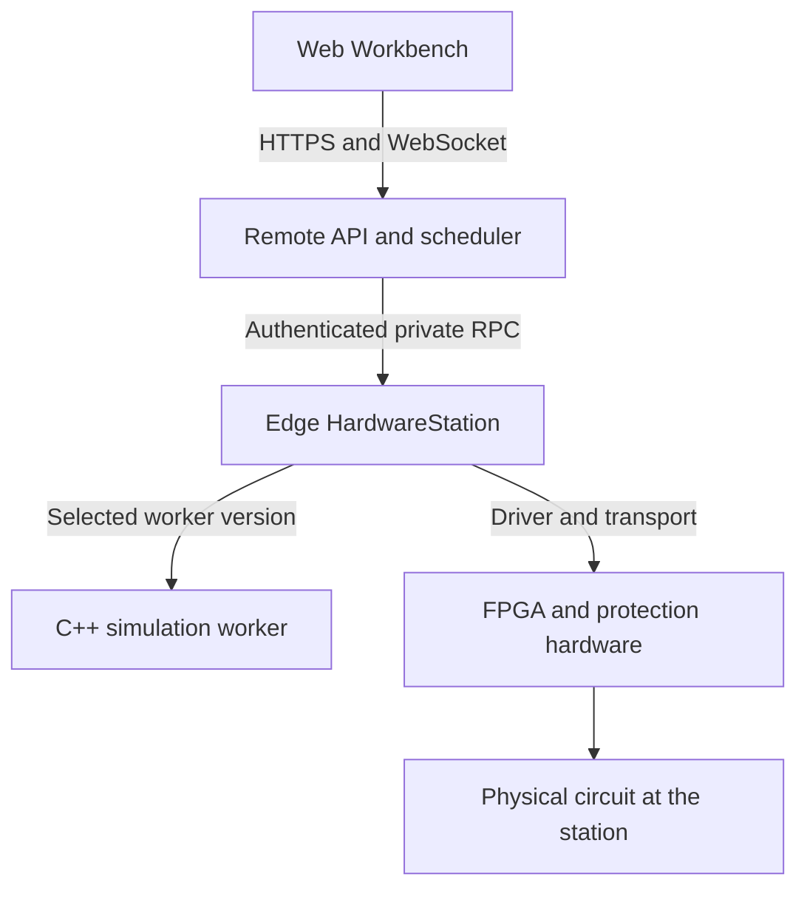
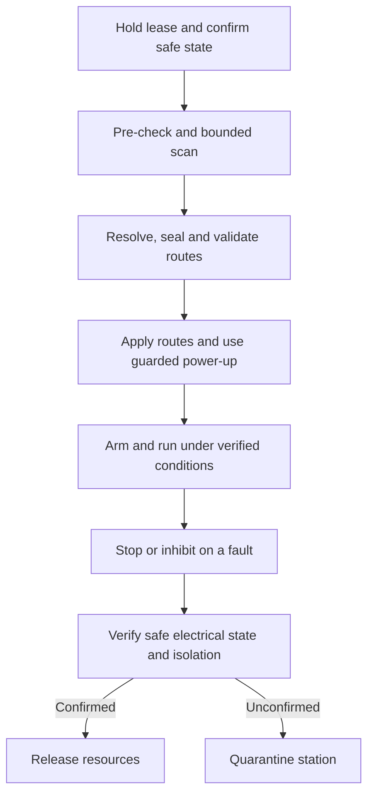

# CIRNET Lab-First — Remote electronics laboratory architecture

**Status** · Target architecture reviewed on 15 November 2026 and proposed for adoption. Implementation evidence applies to a specific release set, configuration and environment.

**Related documents** · [Organization architecture](cirnetlab-architecture-en.md) · [Tiếng Việt](cirnet-architecture-lab-first-vi.md)

## 1. Scope and principles

CIRNET Lab lets students design circuits on the Web, simulate them and experiment with real electronic circuits at a station. The three activities share a workspace, a data model and a workflow for interpreting results. Each run has its own mode, identity and evidence. A simulation and a physical measurement can run in parallel when resources permit. A physical run uses the actual circuit assembled at the station and a separately approved physical execution plan.

Lab-First governs Lab execution, station boundaries, measurement data and electrical safety conditions. The Organization architecture governs other domains, shared data ownership and integration with Studio, Project, Learn and LMS. The selected schemas, interface control document (ICD) and manifest define the interfaces for each deployment.

| Invariant | Implication for the Lab |
|---|---|
| Electrical safety and exercise correctness are independent assessments | An incorrectly wired circuit can run when safety, executability and control authorization are established. |
| Physical evidence comes from the circuit as assembled | The FPGA only connects protected power, stimulus and measurement infrastructure to permitted endpoints. Student wiring and components determine circuit behavior. |
| The station controls energy permits | Rust validates requests and orchestrates execution. Hardware interlocks and protection can inhibit or cut energy independently of the Web client, service or worker. |
| Published capabilities require evidence from the relevant environment | Record simulation, transport emulation, RTL tests and station measurements by evidence type. |

**Initial scope** · Virtual Digital is the first acceptance milestone. Physical Digital uses a verified catalog and verified endpoint and station limits. Virtual Analog uses a dedicated solver when available. General-purpose physical analog routing requires separate hardware and acceptance. Dedicated analog instruments on a digital station have a scope defined by each verified input or output path.

## 2. Runtime architecture and six-repository ownership

| Repository | Lab ownership | Interface |
|---|---|---|
| [cirnet-interface](https://github.com/cirnetlab/cirnet-interface) | Circuit editor, Web Workbench, 3D scene, instrument panels and signal viewer | Vue 3, TypeScript, Pinia, Three.js, SDK generated from Contracts |
| [cirnet-remote](https://github.com/cirnetlab/cirnet-remote) | Lab API, Lab action permissions, experiment management, queue, lease, plan orchestration, results, capture metadata and Lab release lock | Rust modular monolith, HTTPS/WS, PostgreSQL, station RPC. Standalone deployments may also provide local Lab data and sign-in as described in §3. |
| [cirnet-contracts](https://github.com/cirnetlab/cirnet-contracts) | Shared Lab schemas, DTOs, contract identities, RPC descriptors, NCAP, code generation and compatibility fixtures | Rust schema artifacts, TypeScript SDK, Protobuf and versioned shared specifications |
| [cirnet-hardware](https://github.com/cirnetlab/cirnet-hardware) | `HardwareStation` process, local lease enforcement, station lifecycle and recovery, drivers, protection integration and worker supervision | Rust, private edge RPC, drivers and transports, observations, applied state and Stop confirmation |
| [cirnet-simulator](https://github.com/cirnetlab/cirnet-simulator) | Default C++ worker, circuit models, digital and bounded DC engine, SPICE adapter and private worker protocol semantics | Workers are pinned by digest and protocol version. Hardware verifies compatibility, supervises execution and collects results. |
| [cirnet-fpga](https://github.com/cirnetlab/cirnet-fpga) | RTL, bitstreams, deterministic timing, triggers, acquisition, protected routing control and board evidence | Verilog/SystemVerilog, host–FPGA ICD, constraints, testbenches and board measurements |

- Nginx serves the UI and provides a same-origin HTTPS proxy. Rust Remote hosts an API and orchestration modules. Rust Hardware runs in a separate process to isolate driver, USB and worker failures. Station RPC uses an access-controlled socket or restricted loopback with service authentication. Public clients go through Remote.
- Rust serves the backend, Contracts runtime and Hardware. C++ serves the Simulator engine and worker. The browser uses TypeScript and the FPGA uses HDL. Axum/Tokio, Tonic/Protobuf and SQLx/PostgreSQL form the target stack carried over from the source.
- Python serves tests, benchmarks, parity checks and offline tools. Historical releases may retain pinned Python paths. Cut over to a Rust/C++ release set after verifying contracts, behavior, errors, performance, Stop and rollback across real processes.
- Bound worker CPU, memory, events, capture size and duration. Apply limits, timeouts and backpressure to queues, binary streams and worker pools. Give Stop priority independently of simulation and readback.

## 3. Standalone and integrated Lab deployment

Select the authoritative source for each data scope in the deployment configuration. Embedded UIs and adapters use the selected APIs and contracts. Keep standalone Virtual Digital independently releasable while shared domains mature.

| Responsibility | Standalone Lab or before cutover | Integrated Lab after cutover |
|---|---|---|
| Authentication and organization context | Remote manages local Lab accounts and sessions or trusts a configured identity provider. | Platform manages identity, tenants, membership and cross-application sessions. Remote checks the requested Lab action, principal, resource and current state. |
| Design, revisions and project permissions | Remote is the source for design and revision data in the local Lab workspace. | Project owns `EngineeringProject`, revisions and project permissions. Remote fetches an authorized revision and pins the revision and digest for each run. |
| Exercises and assessment | Remote owns local Lab configuration and technical feedback. | LMS owns assignments, classes, submissions, rubrics, academic disclosure and official grades. Remote owns versions of technical Lab configuration, `LabEndpoint`, component profiles and evidence. LMS links the assigned technical version. |
| Execution and safety | Remote owns requests, leases and Lab results. Hardware and FPGA check station state and enforce protection. | The Lab retains those responsibilities. Session, class and project permissions inform authorization. Station conditions apply at execution time. |
| Capture and academic records | Remote manages capture metadata and read authorization through the Lab service. | Remote owns provenance and authorized access to Lab captures. Project and LMS link scoped references and access policies. LMS owns grade records. |

Each cutover needs identity and permission mapping, reconciliation, a single authoritative write switch, revocation of old credentials where applicable, consumer tests and a rollback plan that accounts for new writes. Shadow reads may support reconciliation before the cutover. Use one authority for accepted writes and permission decisions on the same resource in each scope. See the [Organization architecture](cirnetlab-architecture-en.md).

## 4. Data model and contracts

| Layer | Source and meaning |
|---|---|
| **Logical design** | `CircuitGraph` is the circuit contract type. `DesignGraph` is the editable design represented by that type. A revision pins components, pins, nets, parameters and placement. Three.js projects the data. Editor commands establish nets. |
| **Validated design** | `ValidatedGraph` is derived from a revision by checking references, models, signal domains, widths and net rules. It feeds simulation compilation. |
| **Observed circuit** | `DetectedTopologyGraph` records observed physical connectivity and identity along with coverage, ambiguity and evidence provenance. Instructor reference graphs support resolution and assessment. |
| **Execution plan** | `ExecutionPlan` denotes derived, immutable plans. Virtual plans carry models, stimuli, limits and acquisition configuration. Physical plans carry observed endpoints, resources and station infrastructure configuration. |
| **Device configuration image** | The driver derives a hardware-compatible representation from the selected plan. Track the mapping among the plan, sealed image, applied image and evidence of application. |

`PhysicalExecutionPlan` and `InstrumentationExecutionPlan` both appear in the source material. Here, *station routing and instrumentation plan* describes the role of infrastructure configuration derived from the physical plan. Contracts, Remote and Hardware must confirm the implementation type mapping before changing any schema or ABI. Operation labels describe semantics. Use names, types and values from the selected wire contract.

**Contract ownership** · Contracts maintains the canonical forms and fixtures for `CircuitGraph`, `AssignmentDefinition`, `LabEndpoint`, `DetectedTopologyGraph`, `ObservedPinBinding`, `TopologyResolutionResult`, `ResolvedEndpointBinding`, `SafetyVerificationResult`, `TopologyVerificationResult`, `FunctionalVerificationResult`, `ExecutionDecision`, `StationCapabilities`, simulation DTOs, RPC and NCAP. Remote owns API behavior and Lab policy. Simulator owns the private worker protocol and fixtures at the Hardware boundary. Contracts and FPGA maintain the cross-repository control-contract mapping to the ICD, with Hardware verifying driver compatibility.

- Read and exercise legacy `CircuitGraph` 1.0/1.1/1.2 fixtures within the supported version and migration policy. Preserve optional metadata where the contract allows it. Classify `DIGITAL`, `ANALOG`, `POWER`, `GROUND`, `CLOCK` and `MIXED`, and handle unknown domains explicitly.
- Version Graph, Assignment, RPC, API/WS, worker, NCAP, ICD/firmware and SDK independently. Version breaking changes. Exercise old-reader/new-writer and new-reader/old-writer cases as promised by each contract, including additive changes that can affect strict readers.
- Change the source of truth and regenerate or update consumers. Record schema fingerprints, descriptors, digests and provenance in the manifest. Resolve dependencies before execution.

## 5. Virtual Digital and the Analog extension

**Primary flow** · Web saves or selects a revision → Remote authorizes, checks limits and compiles a `VirtualExecutionPlan` → `VirtualHardwareStation` admits the run and assigns a worker → the C++ worker executes → Hardware checks frames, status and captures → Remote persists metadata and publishes authorized results → Web displays signals, waveforms and errors.

Remote distinguishes acceptance, running state and final results. After a disconnect, Web queries state and resynchronizes its stream. Stop goes through Remote to the supervisor, which confirms the worker has stopped or isolates the failed resource under policy. Virtual results carry `SIMULATED`. Physical scan and electrical safety fields use `NOT_APPLICABLE` or a contract-defined null for virtual runs.

- The C++ engine uses discrete events, deterministic ordering for ties, propagation delay and separate time, event and sample budgets. It handles `0/1/X`. Publish `Z` only with corresponding model rules and tests. Label ideal logic gates and power-aware devices explicitly.
- Pin the SHA-256 of the worker bytes, source revision, toolchain, model set and private protocol. Use `CNP1`/`CNP2` generations when the applicable Hardware–Simulator manifest, handshake and fixtures have been selected.
- **Reference circuit** · Two switches drive a 74HC08 AND model with an LED on the output. Inputs `00, 01, 10, 11` settle at `0, 0, 0, 1`. Check event order, unknown states, durable metadata, NCAP bytes and browser display. Extend coverage to NOT, OR, 7-segment, flip-flop, counter, clock/reset and power-aware HC08 within supported models.
- **Virtual Analog** · Simulator owns the C++ adapter, including netlist generation, models and licenses, parameter and process bounds, waveform parsing and error mapping. Pin the native SPICE-compatible solver independently. Bounded DC has its own verified model capability. Analog and mixed-signal have separate acceptance gates. Mixed-signal requires A/D and D/A bridges, timebase, thresholds, synchronization and convergence checks.

| Gate | Virtual Digital acceptance evidence |
|---|---|
| VD-01 | Compatibility fixtures for pinned schemas, SDK, Rust DTOs and RPC |
| VD-02 | Real browser, Remote, Hardware and C++ worker boundaries |
| VD-03 | Truth tables, logic states, event order and timing, and model scope |
| VD-04 | Durable metadata, read authorization, NCAP bytes, sample counts and timebase |
| VD-05 | Rejection of invalid graphs, frames and digests, with explicit worker crash and timeout outcomes |
| VD-06 | Stop, cancellation and disconnect policy stop the intended execution and confirm resource recovery |
| VD-07 | Measured load, memory and latency, with limits on pools, queues and capture |
| VD-08 | UI distinguishes acceptance, progress and results, and reconnect resynchronizes state |
| VD-09 | Logs contain the run ID, test profile, commit and exact digests |
| VD-10 | Separate Windows and Linux edge results, with release acceptance on the advertised target |

## 6. Physical station, scanning and endpoint resolution

### 6.1 Assembly and control

The physical circuit sits at the station. A student beside the bench assembles it in a confirmed safe preparation mode. For a remote student, an on-site operator assembles or confirms the preinstalled circuit. Web controls authorized stimuli and measurements on that confirmed circuit. A component or wiring change requires completion of the current run, confirmation of a safe electrical state, a record of the change and a new scan before another run.

Use validated access control, physical-change detection or operating procedures, together with runtime interlocks and protection. Opening an interlocked area, detecting interference or suspecting a wiring change inhibits energy and invalidates current evidence. A scan age limit bounds the use of evidence. Change detection is verified separately.

### 6.2 Pre-check and bounded scan

1. Hold the fabric lease and confirm the safe state. Disable power to the device under test (DUT), experiment stimuli and output paths, and set switchable routes to their safe positions under the profile. Check the interlock and front-end self-test, and passively observe residual voltage or external sources.
2. After the pre-check, use a **separate scan stimulus permit** bounded by verified voltage, current and duration limits. DUT supply and experiment stimuli stay disabled during scanning. Disable scan excitation on timeout, Stop or fault.
3. Use the board's versioned `BreadboardNodeMap` to map electrically connected hole groups to sense and routing channels. For example, an 830-point breadboard profile may group A1–E1 into one node when the PCB and actual layout verify it. Record excitation, power state, coverage, raw observations, scan generation, timestamp, completion status and profile. Attach uncertainty, leakage and measurement limits where relevant.
4. Disable scan excitation and confirm the electrical condition before applying routes. Produce a `DetectedTopologyGraph` that retains missing, ambiguous and exceptional observations. Interpret observed continuity separately from component identity, polarity, VCC/GND and pin function. Safety remains `INDETERMINATE` whenever required evidence is missing.

| Resolution mode | Scope |
|---|---|
| `AUTO_DISCOVERY` | Infer from scans and signatures for the verified catalog scope and confidence limits |
| `INSTRUCTOR_PROFILE` | Use instructor-provided package and pin semantics with applicable station checks |
| `HYBRID` | Proposed initial Physical Digital default. The instructor profile supplies expected semantics, observation locates the component, and signatures assist within approved limits. |

Keep unresolved identity as `OPAQUE_PHYSICAL_COMPONENT`/`UNKNOWN` under the applicable contract. Treat profiles as hypotheses for the resolver to check. Bind results using observed evidence.

### 6.3 Resolving a `LabEndpoint`

A `LabEndpoint` denotes an allowed role such as `INPUT_SOURCE`, `OUTPUT_SENSE`, `CLOCK`, `VCC`, `GND`, `GENERATOR`, `SCOPE` or `LOGIC_ANALYZER`.

| Reference | Binding meaning |
|---|---|
| `fixed_node_id` | Fixed node of the applicable station and profile, with role and usability verified for the configuration |
| `reference_node_id` | Node in the instructor example. Map it to the student's observed node through independent evidence, even when the IDs are textually equal. |
| `design_port` | Logical port used in Virtual Lab. Physical use requires a separate observed binding. |
| `node_id` (legacy) | Read only with its defined legacy meaning and an explicit migration for fixed-placement data |

The resolver uses exercise requirements, pin profiles, the observed graph and the station profile. It returns `RESOLVED`, `PARTIAL`, `AMBIGUOUS` or `UNRESOLVED` with bindings, assumptions and evidence. Coordinates and matching labels can guide a search. Validate node existence, pin and connection identities, electrical domains and observation consistency. Bound graph size, candidates, search steps and time. Keep uncertainty unresolved when the budget runs out.

The compiler uses only the **verified binding for each selected endpoint**. An overall `PARTIAL` result can proceed when all required endpoints are resolved, the ambiguity affects only instructional feedback and safety is established. A missing required endpoint or feasible route leads to `BLOCK_UNEXECUTABLE` after safety is accounted for under §7.

## 7. Physical compilation, safety and run lifecycle

### 7.1 Plan and approve in stages

1. **Plan with experiment power off.** The Lab Execution Compiler uses observed bindings, allowed endpoints, health, the station profile, protection limits and available resources. Check endpoints on the same net together for resource or electrical domain conflicts. A deterministic, bounded solver finds routes to permitted infrastructure such as protected power, drive and clock paths, probes, triggers and capture buffers.
2. **Freeze the plan and verify the routes to be applied.** Bind the lease, execution generation, station and boot session, scan and profile, plan digest, routes and power, stimulus and measurement limits. Hardware applies the tightest bounds from physical protection, the validated profile and the plan. Assess the sealed plan for contention, incompatible electrical domains, backfeed, possible external power and protection on the relevant paths.
3. **Apply routes under safe switching conditions.** The driver keeps power off and checks required feedback. Use break-before-make, settling and apply verification under the profile. A failure keeps power off and invokes safe handling. Route confirmation completes configuration.
4. **Use guarded power-up and execute.** Before applying DUT power, recheck evidence freshness, live interlocks and protection, applied routes and the lease. After successful guarded power-up, verify measurement and control readiness before enabling each permitted stimulus. A route, electrical configuration, power or permission change outside the plan requires Stop and preparation of a new plan. V1 only accepts value updates on authorized channels within verified limits.

**Routing rule.** Connect infrastructure only to verified endpoints. If the AND.Y → LED1 wire is missing, leave the gap in place, measure authorized points and record actual behavior. Bridging student nets through FPGA/MUX violates the execution contract.

### 7.2 Decision order

Store each result separately. `SafetyVerificationResult` reports `SAFE/UNSAFE/INDETERMINATE` within the scope of the action and profile. `TopologyVerificationResult` reports `MATCH/MISMATCH/UNKNOWN/AMBIGUOUS` for diagnostics and assessment. `FunctionalVerificationResult` reports `PASS/FAIL/PARTIAL/NO_RESPONSE` from a valid run or `NOT_EVALUATED` where evidence is missing. A `NO_RESPONSE` finding requires a valid measurement.

| Order | Condition | Outcome |
|---|---|---|
| 0 | Unauthorized request, invalid lease or controller outside its scope | Reject at the action boundary. Station protection remains active. |
| 1 | Safety is `UNSAFE`/`INDETERMINATE`, safety evidence is stale, or interlock or protection is lost | `BLOCK_SAFETY`. Keep experiment energy disabled or cut it if the condition occurs during a run. |
| 2 | Applicable safety conditions have been established and a required endpoint, capability or execution resource is missing | `BLOCK_UNEXECUTABLE` |
| 3 | Safe, executable, authorized and within the profile | `RUN_NORMAL` or `RUN_GUARDED` under policy. An unidentified component qualifies only for `RUN_GUARDED`, with independent evidence that every relevant supply, stimulus and measurement path stays within protected limits. Missing evidence of polarity, pin domains, external power or parasitic current paths returns to step 1. |

Both Run modes use guarded power-up and keep protection active during execution. Topology or functional errors alone inform technical and instructional feedback. A condition that creates an electrical hazard still enters the safety check. If a station is offline at selection time, Remote reports unavailability during admission. Loss of feedback while a station holds an energy permit invokes the inhibit path and quarantine.

### 7.3 Energy permits and Stop

- **Separate permits by source.** Scan excitation, DUT power and experiment stimuli have separate enable conditions. Scan requires a pre-check and timer. DUT power requires an approved plan, verified routes and power-up conditions. Experiment stimuli require the relevant power and paths to be ready and the correct control scope. Higher layers send a request for each channel.
- **Independent hardware cutoff.** Require current limiting, calibrated sensing, fault detection and an inhibit or cutoff path independent of the host process, FPGA clock and its control logic. Verify an independent watchdog or supervisor under clock loss, configuration loss, reset and communications loss. The profile covers backfeed, external sources and residual voltage based on measurements and protection design. During startup or reset, keep power and excitation off, drives high-impedance and switchable routes in the safe configuration defined by the profile. Keep physical capability unavailable until the protections are demonstrated.
- **Current evidence.** Bind the lease and generation, boot and session, NodeMap and profile revisions, scan generation and coverage, plan digest, applied route revision and expiry. Wiring, route, profile, boot and lease changes or loss of health or protection invalidate corresponding evidence. Recheck before energization and maintain interlock conditions during the run.
- **Normal Stop** has a demonstrated shutdown bound. A deadline overrun, protection fault, lease expiry or watchdog loss triggers priority energy removal. Isolate paths when profile switching conditions are met and retain the fault if safety is unconfirmed. Acquisition, evidence storage and data transfer proceed independently of energy removal.
- Confirm `SAFE_STATE` completion after disabling all excitation and drive, meeting residual voltage and external-source criteria and isolating required paths. A Stop receipt is a separate state. If safe completion is unconfirmed, mark the fabric `QUARANTINED`, keep inhibit asserted and require station intervention. Reopen through authorized recovery, self-check and fresh evidence or plans. Reconnect resynchronizes state. Reset invalidates prior execution permissions and keeps outputs disabled in a fresh session.

An electrical fault or permit loss takes the priority inhibit path from any state. Each operation has its own acceptance outcome. Track station, execution and acquisition state independently. Capture can arm before a trigger and publishes data with its recorded complete, partial or failed status.

## 8. HardwareStation, FPGA and instruments

`HardwareStation` has Virtual and Physical implementations. Shared RPC operations include capability discovery, configuration validation, prepare, run, stop and capture readback. Scanning, electrical checks, route application and guarded power-up apply where supported. RPC timeouts require station-side handling and state confirmation.

**Capability publication.** `StationCapabilities` reflects the build, profile and server or driver verification evidence. Groups include `virtualDigital`, `virtualAnalog`, `physicalDigital`, `physicalAnalogRouting`, `physicalExecutionSlots`, `logicAnalyzerChannels`, `oscilloscopeChannels`, `generatorChannels`, supported domains and models, protocols, scanning, guarded runs, capture limits and firmware or profile versions. Check online, busy, faulted and quarantined states and user permissions separately. The UI displays verified resources and the actual operation state. Public data covers capabilities. Register addresses, pins and switch maps belong to the driver and ICD.

| Hardware milestone | Target scope |
|---|---|
| EP4CE6 prototype | Safe-state control, protocol scaffold, GPIO and clock, protected digital routing and small captures. Prototype exercises may use on-chip memory. |
| EP4CE10 Digital Lab | Verify package, pins, board, external SDRAM, Logic Analyzer, two-channel Scope and two-channel Function Generator on the selected hardware. The FPGA reference proposes 64 MiB of SDR SDRAM. Verify capacity and throughput on the chosen configuration. |
| Physical analog routing | Dedicated switches, relays or crosspoints and analog front-end (AFE) and protection, with verified electrical domains and input and output limits. |

The Scope reads through an AFE and external ADC. The Generator uses direct digital synthesis (DDS), a DAC, filtering and a protected output stage. The Logic Analyzer uses digital sense paths, triggers and acquisition. Each instrument and supported mode needs evidence for usable channels, ranges, accuracy, timing, buffer limits and calibration where applicable.

- Separate system, acquisition, DDS, SDRAM and host clocks as defined by the actual clock plan. Verify clock-domain crossings (CDC), reset release, PLL, constraints, timing, pins and resource budgets. One SDRAM arbiter services acquisition and host readback within latency, buffer and admission bounds. Record overflow and backpressure as errors or partial capture with sample status.
- Drivers may use Serial or USB–SPI for development, USB3 FIFO as a throughput target and Ethernet as a future option. Settle hardware, ABI and measured bandwidth before publishing support.
- The ICD defines versions, commands, sequences, lengths, integrity and CRC, framing, timeouts, acceptance and completion states, and reset and handshake behavior. The source names `GET_CAPABILITY`, `SET_CLOCK`, `SET_ROUTE`, `WRITE_OUTPUT`, `CONFIGURE_TRIGGER`, `ARM_CAPTURE`, `START_CAPTURE`, `READ_CAPTURE`, `STOP`, `RESET` and `SAFE_STATE`. Confirm names and mappings against the actual ICD before release. CRC checks frame integrity. Commands are authenticated at the driver trust boundary.
- Verify lease and execution context, boot session, plan or image, and sequence at the relevant boundaries. Suppress duplicates within the defined window. After reset, invalidate old contexts, drain or isolate stale transport data, and bind the new session before side effects. Keep inhibit asserted if session freshness is unproven. Normal Stop reduces energy and is scoped to its execution. Independent hardware emergency inhibit takes priority.

## 9. Scheduling, leases and recovery

The target is **30–50 concurrent connected users** editing, observing, queuing or running virtual experiments. Each shared electrical fabric has **one active physical execution at a time**. Publish additional slots only for electrically isolated partitions with independent resources and protection and hardware-in-the-loop (HIL) evidence.

1. Remote issues a lease scoped to the tenant when integrated, principal and controller, station and fabric, generation and deadline. Allocate transactionally with a unique active lease per fabric. Use bounded queues, FIFO by default, rate limits and bounded priorities where policy permits.
2. The station binds control to the current lease generation and boot session and rejects stale or expired commands. The local watchdog and maximum run duration remain effective on host or database disconnect. Authenticate lease renewal and enforce limits independently of heartbeats. The station tracks the deadline locally and rejects stale heartbeats or heartbeats from the wrong generation.
3. Use an `idempotencyKey` scoped to principal and action for side effects, with a request fingerprint. An identical retry returns the same operation state. Reject reuse of a key with different inputs. On lost acknowledgement or restart, reconcile the operation and station, and block Start or Apply replay while the outcome is unresolved.
4. Define behavior for Start, Stop, timeout, lease expiry, loss of the control channel under policy and authorization revocation. After Stop or fault, Remote reassigns a slot only after confirming the safe state for the correct generation and reconciling current state. Lease expiry triggers Stop. Station confirmation controls resource release. Quarantine the station while its electrical state is unconfirmed.
5. On restart, reconcile the database, Hardware and boot session before reopening admission. Test races, stale leases, lost acknowledgements, stale controllers, worker termination, service crashes and recovery. Viewers read authorized state. Control belongs to the bound controller, and Stop is available to that controller or an authorized Stop role.

## 10. Workbench, authorization and evidence

**Workbench.** Keep graph commands and undo/redo separate from Pinia UI state and the Three.js renderer. Use InstancedMesh for repeated geometry, lazy-loading and GLB compression where effective, bounded snapshots and WebGL context-loss handling. Show run mode, result origin, safety, topology and function, capture status and session control permissions. Update the 3D view from committed graph changes.

**Authorization and exercises.** Remote checks authentication, tenant scope when integrated, role, ownership, action and lease. Cookie sessions require HTTPS, Secure and HttpOnly cookies, Origin checks and CSRF protection for mutations. Check viewing, control, Stop and export independently. An `AssignmentDefinition` may link a reference graph or profile, expected behavior, allowed endpoints, topology or functional assessment policy and disclosure policy. Apply disclosure to REST, WebSocket, captures, errors and export. Expose assignments, results and answers under the applicable permission.

| Data | Contents and handling |
|---|---|
| `ExperimentResult` | Experiment, operation and station IDs, mode, state, decision, applicable safety, topology and functional results, warnings and errors, model, profile and versions, links to captures and original observations |
| Sealed capture | ID, instrument and channel, sample count, units, sample rate and timebase, `SIMULATED` or `MEASURED` origin, encoding and version, complete or partial status, checksum and calibration or profile if applicable |
| Metadata and bytes | PostgreSQL stores scope, state, metadata and byte identifiers. File or object storage holds large payloads. Publish complete results after durable writes and checksum verification. Clean staging data and orphans under policy. Submissions reference pinned artifacts and revisions. |
| Events and readback | WebSocket carries per-stream sequence, gap detection, snapshots or cursor resync and renewed authorization on reconnect. Stream large captures as binary or use authorized download with backpressure, quotas and retention. |

Select NCAP v1 digital or v2 sampled under the contract. Declare encodings such as digital events or RLE and numeric sample types, and reject mismatched versions. Read back sealed captures or use a snapshot mode under its own contract. Mark complete after the required data is acquired and recorded. Flag missing samples, degraded timestamps and trigger errors. Safe Stop proceeds even if waveform storage or transfer fails.

## 11. Edge deployment, releases and verification

**Target configuration.** Linux Mini PC, Nginx, systemd, PostgreSQL, Rust Remote and Hardware, and a supervised C++ worker. The source lists an Intel Xeon W-1370, 16 GB of RAM and a 256 GB SSD as a starting configuration. Measure load and capture volume to size memory and storage. Use SQLite for tests, prototypes or controlled migration. Compose fits integration environments. The browser renders 3D and the edge operates the station. Hybrid deployments use an authorized gateway and keep Hardware RPC inside the trusted edge network.

**Operations.** Separate service privileges, device access and secrets. Health and readiness distinguish API liveness, worker readiness and station readiness. Back up the database and capture index and bytes to a consistent recovery point and rehearse restores. Log correlation, experiment, station, lease, operation, plan, generation and release set while limiting personal data and secrets. Measure API, queue and Stop latency, worker and electrical faults, quarantine, WebSocket lag, memory and capture volume. Establish release thresholds from test plans and hardware requirements.

**Lab release set.** Remote selects the integrated Lab artifacts in `cirnet-remote/integration/release-set.json`. The source records a historical lock, Rust candidates, a pinned C++ worker and an FPGA scaffold. Candidates have their own test manifests. Record commits, byte digests, toolchain, OS and ABI, SDK and schema fingerprints, RPC descriptors, configuration, profiles and migrations. Pin the worker, protocol, model, encoding and dependencies. Physical releases add bitstream digest, board and hardware profiles, driver and ICD, calibration and HIL evidence. Virtual releases require the artifacts for the virtual path. New tags follow `<repo_name>-<version>`. Retain historical tags and locks for traceability and rollback.

1. Select Contracts artifacts and fixtures. Build the UI from the selected SDK, build Remote and Hardware, and choose the compatible worker. For hardware, select the bitstream for the board and the ICD for the driver.
2. Verify versions, digests and trusted provenance before running. Accept the exact set on the published target. Exercise both directions of conformance under the contract compatibility policy. Test migration and process-boundary failures during integration.
3. Release within the scope of verified evidence. For rollback, close admission, drain or Stop, and confirm the electrical state or retain quarantine. Validate database, capture and device compatibility before activating the recovery set. Reconcile unfinished operations at startup.

| Verification layer | Minimum acceptance |
|---|---|
| Unit and contract | State machines, validators, typed failures, resource limits, SDK/RPC/NCAP and legacy data compatibility |
| Virtual Digital E2E | VD-01 through VD-10 with the exact selected set, real browser and worker, read authorization and Stop |
| FPGA and transport simulation | RTL reset, watchdog and fault handling, integrity, stale frame rejection, resource bounds, CDC and part-specific timing |
| Physical HIL | Interlocks, measured cutoff, residual voltage and external sources, route and readback failures, watchdog and clock loss, post-scan interference, stale plans and leases, restart and quarantine |
| Instrument HIL | Calibration, ranges, sample counts and timebase, triggers, CDC, overflow, SDRAM capacity and throughput, real captures |
| Load and soak | 30–50 target connections, virtual loads, one slot per fabric, fairness, backpressure, Stop latency and recovery |
| Release acceptance | Exact artifacts, install, restore and migration, security, Vietnamese and English documentation and verified release scope |

## 12. Acceptance sequence and required scenarios

| Priority | Condition for acceptance |
|---|---|
| 1. Virtual Digital | Settle the minimum contracts for one end-to-end workflow, starting with AND/LED. Accept the pinned Rust and C++ set, browser, Stop and capture on the target Linux environment. |
| 2. Independently selectable extensions | Expand models and Virtual Instruments, tune C++ and edge load, or develop the Virtual Analog adapter. Each has its own evidence and capability flags. |
| 3. FPGA emulator and prototype | Verify semantics, framing and versions, reset, watchdog, registers and controller in the emulator and RTL. EP4CE6 demonstrates small hardware feasibility under a profile. |
| 4. Physical Digital | Enable after schematics, interlocks, scan and endpoints, compilation, leases, protected I/O, safety and board-level HIL. Prototyping can proceed alongside advanced simulation. |
| 5. Instruments and scale | EP4CE10, SDRAM, ADC/DAC/AFE, calibration and measured user capacity. Physical analog routing has its own protection envelope and HIL. |

Physical Digital depends on its own hardware, authorization and integration gates. Virtual Analog proceeds under its solver gates.

| Scenario | Expected outcome |
|---|---|
| A student places the IC elsewhere and omits the AND.Y–LED wire. Required endpoints have evidence and the circuit is safe. | Run under the profile, retain `MISMATCH`, route only infrastructure and report measured `FAIL`, `PARTIAL` or `NO_RESPONSE` as appropriate. |
| An opaque component has unknown polarity or power domains, or an unsafe short or contention is detected. | `BLOCK_SAFETY`. Keep experiment power disabled and record the reason within disclosure scope. |
| A required endpoint is missing and relevant safety conditions are established. | `BLOCK_UNEXECUTABLE`. An ambiguity limited to assessment may proceed under §6.3. |
| Two Run requests contend, a stale command arrives after reassignment, or Start acknowledgement is lost. | One lease holds the fabric. Reject the stale command. Query and reconcile the original operation identity. |
| Host disconnect, wiring change after scan, capture fault or Stop during power-up. | Invalidate affected evidence. Inhibit or cut energy when protection requires it. Release only after safe confirmation. |
| Authorization is revoked before reconnect, or another tenant requests a capture. | Reject read or control. Handle active resources under revocation policy and local safety conditions. |

## 13. Decisions, open gates and source review

| ADR | Decision |
|---|---|
| ADR-CIRNET-001 | Safety and executability are conditions for energization. Topology and function inform diagnostics and assessment. |
| ADR-CIRNET-002 | Rust core services, C++ default Simulator, TypeScript Web, HDL FPGA and Python for offline verification. |
| ADR-CIRNET-003 | Keep logical DesignGraph, observed topology and measurement results distinct. |
| ADR-CIRNET-004 | HYBRID is the proposed default for initial Physical Digital deployment. |
| ADR-CIRNET-005 | Physical bindings require evidence from the current station, scan and profile. |
| ADR-CIRNET-006 | The compiler and FPGA route only authorized infrastructure. |
| ADR-CIRNET-007 | Contracts and pinned artifacts define compatibility verification. |
| ADR-CIRNET-008 | Publish capabilities for verified configurations. |
| ADR-CIRNET-009 | One physical execution per shared fabric, with handover after confirmed safety. |
| ADR-CIRNET-010 | Lab-First names the Lab architecture. Track schema, artifact and release versions independently. |

**Open gates.** Remote, Hardware, Simulator and Interface need VD-01 through VD-10 results for the selected Linux release set. Contracts, Hardware and FPGA need the ICD and physical-plan-to-image mapping. Hardware and FPGA need schematics, PCB and BOM, electrical profiles, residual-voltage evidence, cutoff criteria, Stop timing, pin and clock constraints, and board HIL. Simulator needs a dependency and license decision and fixtures for Analog. Remote, Platform, Project and LMS need the corresponding cutover acceptance before use in integrated profiles. Measure load and rehearse restore in the target environment. Record `NOT_RUN`, `BLOCKED` or `FAILED` according to evidence.

**Status vocabulary.** `TARGET` is an intended direction, `DESIGNED` has a specification, `IMPLEMENTED` has code, `TESTED` has test results, `VERIFIED` has met criteria in a defined configuration, and `RELEASED` has a release set. Attach evidence to the correct artifacts. `UNAVAILABLE` marks a capability unavailable in the configuration. `BLOCKED` marks a gated request or check. An operation requires verified capability, station readiness and separate authorization.

| Issue in the source documents | Revision |
|---|---|
| Lab-First claimed Organization-wide scope | Scope it to Lab and refer shared ownership to the Organization architecture (§1–3). |
| Remote authentication, project and assignment duties overlapped Platform, Project and LMS | Specify standalone and integrated profiles with scoped cutover criteria (§3). |
| Scan, safety, compilation and routing lacked clear energy permit boundaries | Stage the pre-check, bounded scan, approval, route verification and guarded power-up (§6–7). |
| Reference and observed IDs could be confused, or a lease or acknowledgement mistaken for safety evidence | Bind observations and evidence to the station and generation, and confirm electrical state before handover (§6–9). |
| The roadmap put Virtual Analog ahead of Physical Digital and repeated the C++ decision | Use C++ Virtual Digital as the first end-to-end workflow. Advanced branches have their own prerequisites and evidence (§5, §11–12). |

**Sources.** This revision compares the attached `cirnet-architecture-lab-first(4).md` and `cirnetlab-architecture(1).md`. The project reference `net-Circuit-Remote_FPGA_Architecture_Lab-First_v2.md` (proposed revision 2.1) informs scan, plan and image, energy permits, Stop and transport. The relevant owners must verify ABI, hardware, source code and implementation acceptance. See general operational technology guidance on preserving safety controls during remote access in [NIST SP 800-82 Rev. 3](https://csrc.nist.gov/pubs/sp/800/82/r3/final).
