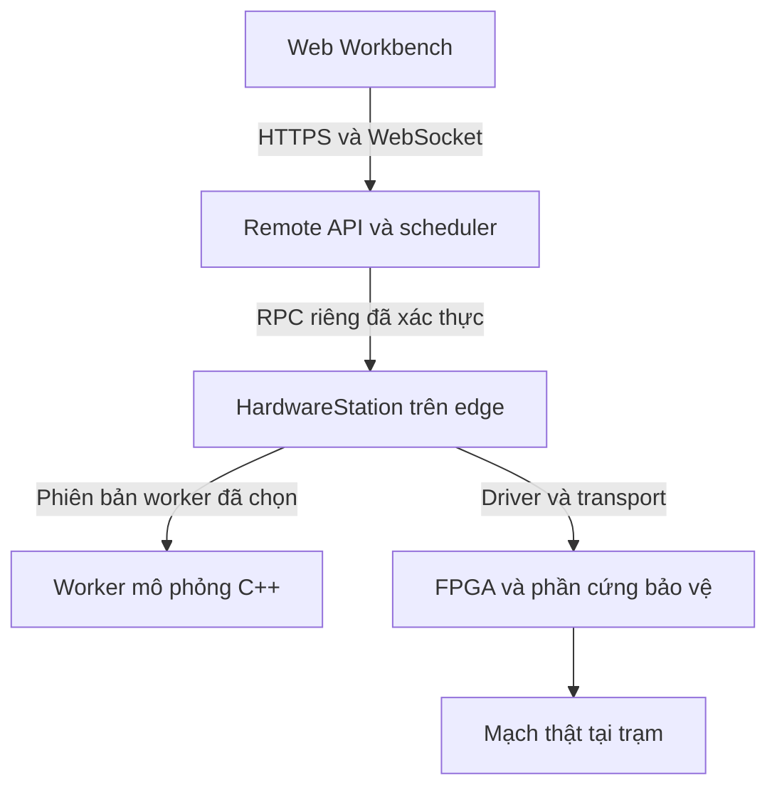
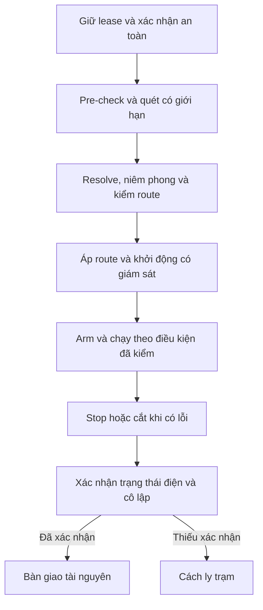

# CIRNET Lab-First — Kiến trúc phòng thí nghiệm điện tử từ xa

**Trạng thái** · Kiến trúc mục tiêu đã rà soát ngày 15/11/2026, đề xuất áp dụng. Bằng chứng triển khai gắn với bộ phát hành, cấu hình và môi trường cụ thể.

**Tài liệu liên quan** · [Kiến trúc cấp Organization](cirnetlab-architecture-vi.md) · [English](cirnet-architecture-lab-first-en.md)

## 1. Phạm vi và nguyên tắc

CIRNET Lab cho phép sinh viên thiết kế mạch trên Web, mô phỏng và thực hành trên mạch điện tử thật của trạm. Ba hoạt động dùng chung không gian làm việc, mô hình dữ liệu và quy trình đọc kết quả. Mỗi lượt chạy có chế độ, định danh và bằng chứng riêng. Mô phỏng và phép đo thật có thể chạy song song khi còn tài nguyên. Phép đo thật luôn dùng mạch đang lắp ở trạm và kế hoạch vật lý được phê duyệt riêng.

Lab-First quy định luồng thực thi Lab, ranh giới trạm, dữ liệu đo và các điều kiện an toàn điện. Kiến trúc cấp Organization quy định các miền ngoài Lab, quyền sở hữu dữ liệu chung và cách tích hợp Studio, Project, Learn và LMS. Schema, đặc tả giao tiếp phần cứng (ICD) và manifest đã chọn xác định giao diện của từng bộ triển khai.

| Bất biến | Hệ quả đối với Lab |
|---|---|
| An toàn điện và tính đúng của bài thực hành là hai đánh giá độc lập | Một mạch đấu sai vẫn có thể chạy khi chứng minh được an toàn, khả năng thực thi và quyền điều khiển. |
| Bằng chứng vật lý xuất phát từ mạch đang lắp | FPGA chỉ nối hạ tầng nguồn có bảo vệ, kích và đo đến các đầu nối được phép. Dây và linh kiện của sinh viên quyết định hành vi mạch. |
| Quyền cấp năng lượng nằm tại trạm | Rust kiểm tra yêu cầu và điều phối. Liên động và bảo vệ phần cứng có quyền cắt hoặc giữ nguồn ở trạng thái tắt bất kể trạng thái của Web, dịch vụ hay worker. |
| Năng lực công bố cần bằng chứng theo đúng môi trường | Kết quả mô phỏng, giả lập transport, kiểm thử RTL và phép đo trên trạm được ghi theo từng loại. |

**Phạm vi ban đầu** · Virtual Digital là luồng nghiệm thu đầu tiên. Physical Digital dùng danh mục linh kiện, đầu nối và giới hạn đã xác minh cho trạm. Virtual Analog dùng solver riêng khi sẵn sàng. Định tuyến analog vật lý tổng quát cần phần cứng và nghiệm thu riêng. Instrument analog chuyên dụng trên trạm digital có phạm vi theo từng đường đo hoặc phát đã được xác minh.

## 2. Kiến trúc chạy và quyền sở hữu sáu repository

| Repository | Sở hữu trong miền Lab | Điểm giao tiếp |
|---|---|---|
| [cirnet-interface](https://github.com/cirnetlab/cirnet-interface) | Trình chỉnh sửa mạch, Web Workbench, cảnh 3D, panel thiết bị và trình xem tín hiệu | Vue 3, TypeScript, Pinia, Three.js, SDK được sinh từ Contracts |
| [cirnet-remote](https://github.com/cirnetlab/cirnet-remote) | API Lab, quyền thao tác Lab, quản lý thí nghiệm, hàng đợi, lease, điều phối lập kế hoạch, kết quả, metadata bản ghi đo và khóa phát hành Lab | Rust modular monolith, HTTPS/WS, PostgreSQL, RPC trạm. Bản độc lập có thể cung cấp dữ liệu và đăng nhập Lab cục bộ theo §3. |
| [cirnet-contracts](https://github.com/cirnetlab/cirnet-contracts) | Schema Lab dùng chung, DTO, định danh hợp đồng, descriptor RPC, NCAP, codegen và fixture tương thích | Schema/artifact Rust, TypeScript SDK, Protobuf và đặc tả dùng chung đã version hóa |
| [cirnet-hardware](https://github.com/cirnetlab/cirnet-hardware) | Tiến trình `HardwareStation`, quyền thực thi cục bộ theo lease, vòng đời và phục hồi trạm, driver, bảo vệ, giám sát worker | Rust, RPC riêng trên edge, driver/transport, quan sát, trạng thái áp dụng và xác nhận dừng |
| [cirnet-simulator](https://github.com/cirnetlab/cirnet-simulator) | Worker C++ mặc định, mô hình mạch, engine digital/DC giới hạn, adapter SPICE, ngữ nghĩa giao thức worker riêng | Worker được khóa theo digest và phiên bản giao thức. Hardware xác minh tương thích, giám sát và thu kết quả. |
| [cirnet-fpga](https://github.com/cirnetlab/cirnet-fpga) | RTL, bitstream, thời gian xác định, trigger, thu mẫu, điều khiển định tuyến có bảo vệ và bằng chứng của bo | Verilog/SystemVerilog, ICD của liên kết host–FPGA, constraint, testbench và phép đo trên bo |

- Nginx phục vụ giao diện và proxy HTTPS cùng origin. Rust Remote tập trung API và điều phối theo module. Rust Hardware chạy riêng để cách ly lỗi driver, USB và worker. RPC trạm dùng socket có phân quyền hoặc loopback được giới hạn và xác thực dịch vụ. Client công khai đi qua Remote.
- Rust dùng cho Backend, Contracts runtime và Hardware. C++ dùng cho engine và worker Simulator. TypeScript dùng cho trình duyệt, HDL dùng cho FPGA. Axum/Tokio, Tonic/Protobuf và SQLx/PostgreSQL là stack mục tiêu phù hợp với bản nguồn.
- Python thuộc luồng kiểm thử, benchmark, parity và công cụ ngoại tuyến. Release lịch sử có thể chứa luồng Python đã khóa. Chuyển sang bộ Rust/C++ mới sau khi kiểm được hợp đồng, hành vi, lỗi, hiệu năng, Stop và rollback qua các tiến trình thật.
- Worker xử lý tác vụ nặng với giới hạn CPU, RAM, sự kiện, dung lượng capture và thời gian. Hàng đợi, luồng nhị phân và worker pool có giới hạn, timeout và cơ chế giảm tải. Kênh Stop có ưu tiên độc lập với mô phỏng và readback.

## 3. Triển khai Lab độc lập và tích hợp

Chọn nguồn có thẩm quyền cho từng phạm vi dữ liệu trong cấu hình triển khai. Giao diện nhúng và adapter dùng API/hợp đồng đã chọn. Duy trì khả năng nghiệm thu và vận hành Virtual Digital độc lập trong lúc hoàn thiện các miền dùng chung.

| Trách nhiệm | Lab độc lập hoặc trước chuyển giao | Lab tích hợp sau chuyển giao |
|---|---|---|
| Xác thực và thông tin tổ chức | Remote quản tài khoản/phiên Lab cục bộ hoặc kết nối nhà cung cấp danh tính đã cấu hình. | Platform quản identity, tenant, membership, phiên liên ứng dụng. Remote kiểm phạm vi quyền cụ thể, chủ thể, tài nguyên và trạng thái thao tác Lab. |
| Lưu thiết kế, revision và quyền dự án | Remote là nguồn của thiết kế và revision trong workspace Lab cục bộ. | Project quản `EngineeringProject`, revision và quyền dự án. Remote lấy revision qua API có quyền và cố định revision/digest cho từng run. |
| Bài thực hành và đánh giá | Remote quản cấu hình Lab cục bộ và phản hồi kỹ thuật. | LMS quản đề bài, lớp, bài nộp, rubric, chính sách công bố học vụ và điểm chính thức. Remote quản phiên bản cấu hình kỹ thuật Lab, `LabEndpoint`, hồ sơ linh kiện và bằng chứng. LMS tham chiếu phiên bản kỹ thuật được giao. |
| Thực thi và an toàn | Remote quản yêu cầu, lease và kết quả Lab. Hardware/FPGA kiểm tra trạng thái trạm và thực thi bảo vệ. | Cùng ranh giới Lab. Phiên đăng nhập, quyền lớp và quyền dự án là đầu vào của kiểm tra quyền, còn các điều kiện trạm áp dụng tại thời điểm chạy. |
| Capture và dữ liệu học vụ | Remote quản metadata và quyền đọc bản ghi đo qua dịch vụ Lab. | Remote quản provenance và cổng truy xuất capture Lab. Project/LMS liên kết bằng định danh có phạm vi và chính sách truy cập, LMS sở hữu hồ sơ điểm. |

Chuyển giao từng phạm vi cần mapping định danh và quyền, đối soát dữ liệu, điểm cắt quyền ghi duy nhất, thu hồi credential cũ khi áp dụng, kiểm thử consumer và kế hoạch rollback theo dữ liệu phát sinh. Có thể đọc song song để đối chiếu trước chuyển giao. Chọn một nguồn xác nhận ghi và cấp quyền cho cùng đối tượng trong từng phạm vi. Chi tiết tại [kiến trúc cấp Organization](cirnetlab-architecture-vi.md).

## 4. Mô hình dữ liệu và hợp đồng

| Lớp | Nguồn và ý nghĩa |
|---|---|
| **Thiết kế logic** | `CircuitGraph` là kiểu hợp đồng của mạch. `DesignGraph` là nội dung thiết kế người dùng sửa theo kiểu đó. Revision cố định nội dung linh kiện, chân, net, thông số và placement. Three.js chiếu dữ liệu, còn net được tạo qua lệnh editor. |
| **Thiết kế đã thẩm định** | `ValidatedGraph` được dẫn xuất từ revision sau kiểm tham chiếu, model, miền tín hiệu, độ rộng và quy tắc net. Đây là đầu vào cho biên dịch mô phỏng. |
| **Mạch được quan sát** | `DetectedTopologyGraph` biểu diễn kết nối và định danh vật lý quan sát được, kèm phạm vi đo, sự mơ hồ và nguồn bằng chứng. Graph tham chiếu của giảng viên phục vụ resolver và chấm bài. |
| **Kế hoạch thực thi** | `ExecutionPlan` chỉ lớp kế hoạch dẫn xuất, bất biến. Kế hoạch ảo mang model, stimulus, giới hạn và cấu hình thu. Kế hoạch vật lý mang đầu nối quan sát được, tài nguyên và cấu hình hạ tầng của trạm. |
| **Ảnh cấu hình thiết bị** | Driver dẫn xuất biểu diễn tương thích phần cứng từ kế hoạch đã chọn. Giữ mapping giữa plan, ảnh đã niêm phong, ảnh đã áp dụng và bằng chứng áp dụng. |

`PhysicalExecutionPlan` và `InstrumentationExecutionPlan` xuất hiện trong tài liệu nguồn. Trong bản này, *kế hoạch định tuyến và đo của trạm* chỉ vai trò của cấu hình hạ tầng dẫn xuất từ kế hoạch vật lý. Contracts, Remote và Hardware phải chốt mapping kiểu dữ liệu đang sử dụng trước khi thay đổi schema/ABI. Các tên thao tác trong tài liệu diễn tả ngữ nghĩa. Tên trường, kiểu và giá trị trên giao tiếp lấy từ bản hợp đồng đã chọn.

**Phân công hợp đồng** · Contracts duy trì dạng chuẩn và fixtures của `CircuitGraph`, `AssignmentDefinition`, `LabEndpoint`, `DetectedTopologyGraph`, `ObservedPinBinding`, `TopologyResolutionResult`, `ResolvedEndpointBinding`, `SafetyVerificationResult`, `TopologyVerificationResult`, `FunctionalVerificationResult`, `ExecutionDecision`, `StationCapabilities`, DTO mô phỏng, RPC và NCAP. Remote sở hữu hành vi API và chính sách Lab. Simulator sở hữu giao thức worker riêng cùng fixtures ở ranh giới Hardware. Contracts và FPGA duy trì ánh xạ hợp đồng điều khiển liên repo tới ICD, với Hardware kiểm tương thích driver.

- Đọc và kiểm fixtures lịch sử của `CircuitGraph` 1.0/1.1/1.2 theo các phiên bản được hỗ trợ và migration đã chọn. Giữ metadata tùy chọn khi contract cho phép. Phân loại miền `DIGITAL`, `ANALOG`, `POWER`, `GROUND`, `CLOCK`, `MIXED` và xử lý miền chưa xác định tường minh.
- Phân phiên bản độc lập cho Graph, Assignment, RPC, API/WS, worker, NCAP, ICD/firmware và SDK. Đổi version khi thay đổi phá tương thích. Thử old-reader/new-writer và new-reader/old-writer theo cam kết của mỗi contract, kể cả khi thêm trường.
- Sửa nguồn chuẩn rồi sinh hoặc cập nhật consumer. Ghi schema fingerprint, descriptor, digest và provenance trong manifest, chọn các phụ thuộc trước khi chạy.

## 5. Virtual Digital và hướng mở rộng Analog

**Luồng chuẩn** · Web lưu/chọn revision → Remote xác thực quyền và giới hạn rồi lập `VirtualExecutionPlan` → `VirtualHardwareStation` nhận và phân bổ worker → worker C++ xử lý → Hardware kiểm frame, trạng thái và capture → Remote ghi metadata và phát kết quả có quyền → Web hiển thị tín hiệu, waveform và lỗi thực tế.

Remote tách xác nhận tiếp nhận, trạng thái chạy và kết quả cuối. Web mất kết nối sẽ tra cứu trạng thái và đồng bộ lại stream. Stop đi qua Remote đến supervisor, chờ xác nhận worker đã dừng hoặc cô lập tài nguyên lỗi theo chính sách. Kết quả ảo được gắn `SIMULATED`. Bằng chứng quét và an toàn điện vật lý dùng `NOT_APPLICABLE` hoặc null có ngữ nghĩa theo contract khi chạy ảo.

- Engine C++ dùng mô phỏng theo sự kiện rời rạc, thứ tự xác định với sự kiện trùng thời điểm, trễ lan truyền và ngân sách riêng cho thời gian, sự kiện và mẫu. Xử lý `0/1/X`. Chỉ công bố `Z` khi có quy tắc model và kiểm thử tương ứng. Mô hình cổng lý tưởng và mô hình có trạng thái nguồn được gắn rõ.
- Khóa SHA-256 của worker trên bytes thực, source revision, toolchain, model set và giao thức riêng. Các thế hệ `CNP1`/`CNP2` chỉ dùng khi manifest, handshake và fixtures của cặp Hardware–Simulator tương ứng đã được chọn.
- **Mạch chuẩn** · Hai công tắc vào model AND 74HC08, đầu ra đến LED. Với `00, 01, 10, 11`, kết quả xác lập là `0, 0, 0, 1`. Kiểm thứ tự sự kiện, trạng thái chưa biết, metadata lưu bền, bytes NCAP và hiển thị trình duyệt. Mở rộng NOT, OR, 7-segment, flip-flop, counter, clock/reset và HC08 có mô hình cấp nguồn theo phạm vi hỗ trợ.
- **Virtual Analog** · Simulator sở hữu adapter C++ tạo netlist, quản model/license, giới hạn tham số và tiến trình, parse waveform và ánh xạ lỗi. Solver SPICE-compatible native là dependency được khóa riêng. Bounded DC có capability riêng theo model đã kiểm chứng. Analog và mixed-signal có cổng nghiệm thu riêng. Mixed-signal cần cầu A/D, D/A, timebase, threshold, đồng bộ và hội tụ.

| Cổng | Bằng chứng nghiệm thu Virtual Digital |
|---|---|
| VD-01 | Schema, SDK, Rust DTO và RPC của bộ đã khóa qua fixture tương thích |
| VD-02 | Browser, Remote, Hardware và worker C++ chạy qua các ranh giới thực |
| VD-03 | Truth table, trạng thái logic, thứ tự/thời gian sự kiện và phạm vi model |
| VD-04 | Metadata lưu bền, quyền đọc, bytes NCAP, sample count và timebase |
| VD-05 | Từ chối graph/frame/digest sai, worker crash và timeout có trạng thái rõ |
| VD-06 | Stop/cancel và chính sách mất kết nối dừng worker đúng execution, xác nhận thu hồi tài nguyên |
| VD-07 | Đo tải, RAM, latency và giới hạn pool, hàng đợi, capture |
| VD-08 | UI phân biệt tiếp nhận, tiến trình và kết quả. Reconnect đồng bộ trạng thái. |
| VD-09 | Nhật ký gắn run ID, test profile, commit và digest chính xác |
| VD-10 | Kết quả Windows và Linux edge ghi riêng, nghiệm thu phát hành trên nền tảng công bố |

## 6. Trạm vật lý, quét và xác định đầu nối

### 6.1 Ai lắp mạch và ai điều khiển

Mạch thật nằm ở trạm. Khi sinh viên ở cạnh bàn thí nghiệm, sinh viên lắp mạch trong chế độ chuẩn bị đã xác nhận an toàn. Khi sinh viên ở xa, người vận hành tại chỗ lắp mạch hoặc xác nhận mạch đã chuẩn bị sẵn. Web điều khiển các kích thích và phép đo được phép của mạch đã xác nhận. Đổi linh kiện hay dây nối cần kết thúc lượt chạy, xác nhận trạng thái điện an toàn, ghi nhận thay đổi và quét lại trước lượt chạy mới.

Trạm dùng cơ chế kiểm soát tiếp cận, phát hiện thay đổi cấu hình vật lý hoặc quy trình vận hành được kiểm chứng, cùng liên động và bảo vệ trong lúc chạy. Mở vùng được liên động, phát hiện can thiệp hoặc nghi ngờ dây đã đổi phải cấm cấp năng lượng và làm mất hiệu lực bằng chứng hiện tại. Tuổi tối đa của phép quét giới hạn thời gian sử dụng bằng chứng. Khả năng phát hiện thay đổi được nghiệm thu riêng.

### 6.2 Đo ban đầu và quét có giới hạn

1. Giữ lease của fabric và xác nhận trạng thái an toàn. Vô hiệu hóa nguồn cấp mạch cần thử (DUT), các nguồn kích thí nghiệm và đường phát, đưa route chuyển mạch về vị trí an toàn theo profile. Kiểm interlock, tự kiểm front-end và đánh giá điện áp dư/nguồn ngoài bằng quan sát thụ động.
2. Sau kiểm tra ban đầu, cấp **quyền kích riêng cho phép quét**, giới hạn điện áp, dòng và thời gian theo profile đã kiểm chứng. Nguồn cấp DUT và nguồn kích thí nghiệm giữ tắt trong lúc quét. Tắt kích scan khi hết thời gian, dừng hoặc có lỗi.
3. Dùng `BreadboardNodeMap` đúng phiên bản bo để ánh xạ các nhóm lỗ dẫn điện sang kênh đo và định tuyến. Ví dụ, map của breadboard 830 có thể mô tả A1–E1 là một node khi PCB và bố trí thực xác nhận. Ghi nguồn kích, trạng thái nguồn, phạm vi/độ phủ, raw observations, scan generation, mốc thời gian, kết quả hoàn thành và profile. Gắn sai số, leakage và giới hạn phép đo khi có ảnh hưởng.
4. Tắt kích scan và xác nhận trạng thái điện phù hợp trước khi áp route. Sinh `DetectedTopologyGraph`, giữ cả quan sát thiếu, mơ hồ hoặc ngoại lệ. Continuity quan sát được cần được diễn giải riêng với nhận dạng linh kiện, cực tính, VCC/GND và chức năng chân. Safety vẫn `INDETERMINATE` nếu thiếu bằng chứng cần thiết.

| Chế độ phân giải | Phạm vi |
|---|---|
| `AUTO_DISCOVERY` | Suy luận từ scan và signature trong danh mục, với độ tin cậy và giới hạn đã được kiểm chứng |
| `INSTRUCTOR_PROFILE` | Giảng viên khai báo package và ngữ nghĩa chân, cùng phép kiểm phù hợp trên trạm |
| `HYBRID` | Mặc định đề xuất cho Physical Digital đầu tiên. Hồ sơ giảng viên cho biết ngữ nghĩa dự kiến, quan sát xác định vị trí thực, signature hỗ trợ trong giới hạn đã phê duyệt. |

Danh tính chưa biết được giữ dưới dạng `OPAQUE_PHYSICAL_COMPONENT`/`UNKNOWN` theo contract tương ứng. Hồ sơ giảng viên là giả thuyết để resolver kiểm tra. Quan sát thực là căn cứ gắn kết quả.

### 6.3 Resolve `LabEndpoint`

`LabEndpoint` mô tả vai trò được phép, chẳng hạn `INPUT_SOURCE`, `OUTPUT_SENSE`, `CLOCK`, `VCC`, `GND`, `GENERATOR`, `SCOPE` và `LOGIC_ANALYZER`.

| Tham chiếu | Ý nghĩa trong binding |
|---|---|
| `fixed_node_id` | Node cố định của đúng station/profile, cần xác minh vai trò và khả năng dùng trên cấu hình đang xét |
| `reference_node_id` | Node trong bài mẫu. Ánh xạ sang node quan sát của sinh viên qua bằng chứng độc lập, kể cả khi hai ID trùng chữ. |
| `design_port` | Port logic dùng trong Virtual. Muốn dùng cho Physical cần binding quan sát riêng. |
| `node_id` (cũ) | Chỉ đọc với nghĩa legacy đã xác định, chọn migration rõ cho dữ liệu fixed placement |

Resolver lấy yêu cầu bài thực hành, hồ sơ chân, graph quan sát và profile trạm. Nó trả `RESOLVED`, `PARTIAL`, `AMBIGUOUS` hoặc `UNRESOLVED`, kèm binding, giả định và bằng chứng. Tọa độ và nhãn trùng chỉ là gợi ý. Kiểm tồn tại node, định danh chân/kết nối, miền điện và tính nhất quán của quan sát. Giới hạn kích thước graph, số ứng viên, số bước và thời gian. Khi hết ngân sách, giữ phần chưa chắc chắn là chưa phân giải.

Compiler chỉ dùng **binding đã chứng minh của từng endpoint được chọn**. Kết quả tổng thể `PARTIAL` vẫn có thể dùng nếu toàn bộ endpoint bắt buộc đã xác định, phần còn mơ hồ chỉ ảnh hưởng phản hồi học tập và safety đầy đủ. Thiếu endpoint bắt buộc hoặc đường route khả thi dẫn tới `BLOCK_UNEXECUTABLE` khi đã loại trừ vấn đề safety theo §7.

## 7. Biên dịch vật lý, an toàn và vòng đời lượt chạy

### 7.1 Lập kế hoạch và phê duyệt theo từng tầng

1. **Lập kế hoạch khi nguồn thí nghiệm tắt.** Lab Execution Compiler dùng binding quan sát, danh sách đầu nối được phép, health, profile, ngân sách bảo vệ và tài nguyên còn trống. Kiểm đồng thời các đầu nối dùng chung một net để phát hiện xung đột tài nguyên hoặc miền điện. Solver xác định, có giới hạn, tìm đường tới tài nguyên hạ tầng hợp lệ như nguồn bảo vệ, drive/clock, probe, trigger và buffer capture.
2. **Đóng băng kế hoạch và kiểm cụ thể đường sẽ áp dụng.** Gắn lease, thế hệ thực thi, station/boot, scan/profile, plan digest, route và giới hạn nguồn/kích/đo. Hardware dùng giới hạn chặt nhất từ phần cứng, profile đã thẩm định và kế hoạch. Đánh giá safety theo kế hoạch đã niêm phong, gồm contention, sai miền điện, cấp điện ngược, khả năng có nguồn ngoài và bảo vệ của các đường liên quan.
3. **Áp route trong điều kiện chuyển mạch an toàn.** Driver giữ nguồn tắt và kiểm phản hồi cần thiết. Thực hiện ngắt trước khi nối, chờ ổn định và kiểm tra áp dụng theo profile. Thất bại giữ nguồn tắt và xử lý an toàn. Xác nhận áp route chỉ hoàn thành bước cấu hình.
4. **Cấp nguồn có giám sát và thực thi.** Trước khi cấp nguồn DUT, kiểm lại hiệu lực bằng chứng, liên động và bảo vệ đang hoạt động, route đã áp và lease. Khi khởi động có giám sát thành công, xác nhận hệ đo và điều khiển sẵn sàng rồi cho phép từng nguồn kích đã cấp quyền. Mọi thay đổi route, cấu hình điện, nguồn hoặc quyền vượt kế hoạch buộc dừng và lập lại kế hoạch. V1 chỉ nhận cập nhật giá trị trên kênh đã cấp quyền và trong giới hạn đã kiểm chứng.

**Quy tắc định tuyến.** Chỉ nối hạ tầng đến endpoint đã xác minh. Nếu dây AND.Y → LED1 bị thiếu, hệ thống giữ điểm thiếu dây, đo những điểm được phép và ghi hành vi thực. Tạo đường bắc cầu giữa hai net của sinh viên qua FPGA/MUX vi phạm hợp đồng thực thi.

### 7.2 Thứ tự quyết định

Các kết quả được lưu riêng. `SafetyVerificationResult` trả `SAFE/UNSAFE/INDETERMINATE` trong phạm vi thao tác và profile được xét. `TopologyVerificationResult` trả `MATCH/MISMATCH/UNKNOWN/AMBIGUOUS` để chẩn đoán và chấm bài. `FunctionalVerificationResult` trả `PASS/FAIL/PARTIAL/NO_RESPONSE` từ phép chạy hợp lệ hoặc `NOT_EVALUATED` khi thiếu bằng chứng. Một phép đo hợp lệ mới cho phép kết luận `NO_RESPONSE`.

| Thứ tự | Điều kiện | Hệ quả |
|---|---|---|
| 0 | Yêu cầu trái quyền, lease hết hiệu lực hoặc controller sai phạm vi | Từ chối yêu cầu tại lớp thao tác. Bảo vệ tại trạm tiếp tục có hiệu lực. |
| 1 | Safety là `UNSAFE`/`INDETERMINATE`, bằng chứng an toàn cũ, mất interlock/bảo vệ | `BLOCK_SAFETY`. Giữ nguồn thí nghiệm tắt hoặc cắt nguồn nếu lỗi phát sinh khi chạy. |
| 2 | Đã xác định đủ điều kiện an toàn liên quan nhưng thiếu endpoint bắt buộc, capability hoặc tài nguyên thực thi | `BLOCK_UNEXECUTABLE` |
| 3 | An toàn, thực thi được, đúng quyền và phù hợp profile | `RUN_NORMAL` hoặc `RUN_GUARDED` theo policy. Linh kiện chưa rõ danh tính chỉ đủ điều kiện `RUN_GUARDED` nếu chứng minh độc lập mọi đường cấp nguồn/kích/đo trong giới hạn bảo vệ. Thiếu bằng chứng về cực tính, miền chân, nguồn ngoài hoặc đường dòng ký sinh quay về bước 1. |

Cả hai chế độ Run đều khởi động có giám sát và giữ bảo vệ trong suốt lượt chạy. Sai topology hoặc sai chức năng đơn thuần chỉ ảnh hưởng phản hồi kỹ thuật và học tập. Sự cố tương ứng với một nguy cơ điện thực sự vẫn đi qua kiểm tra safety. Với trạm offline ngay từ lúc chọn, Remote báo không khả dụng ở bước admission. Nếu mất phản hồi khi trạm đang giữ quyền cấp năng lượng, thực hiện đường cắt và cách ly.

### 7.3 Quyền cấp năng lượng và Stop

- **Quyền riêng cho từng nguồn.** Nguồn kích quét, nguồn DUT và nguồn kích thí nghiệm có điều kiện enable riêng. Kích quét cần pre-check và timer scan. Nguồn DUT cần plan đã phê duyệt, route được kiểm và điều kiện khởi động. Nguồn kích thí nghiệm cần nguồn/đường liên quan sẵn sàng và scope điều khiển đúng. Lệnh tầng cao gửi yêu cầu đến từng kênh.
- **Phần cứng cắt độc lập.** Thiết kế yêu cầu giới hạn dòng, cảm biến đã hiệu chuẩn, phát hiện lỗi và đường inhibit/cutoff độc lập với tiến trình máy chủ, clock và logic điều khiển FPGA. Watchdog hoặc supervisor độc lập phải được kiểm khi mất clock, mất cấu hình, reset và mất liên lạc. Profile phải bao quát cấp điện ngược, nguồn ngoài và điện áp dư theo phép đo và thiết kế bảo vệ. Mặc định khi khởi động hoặc reset, nguồn và kích tắt, drive ở trở kháng cao, các đường chuyển mạch về cấu hình an toàn của profile. Giữ capability vật lý chưa khả dụng trong lúc chờ chứng minh các bảo vệ.
- **Bằng chứng đang hiệu lực.** Ràng buộc lease/generation, boot/session, revision NodeMap/profile, scan generation và phạm vi quan sát, plan digest, revision route đã áp và thời hạn. Đổi wiring, route liên quan, profile, boot, lease hoặc mất health/protection làm mất hiệu lực tương ứng. Kiểm lại trước khi cấp năng lượng và duy trì điều kiện liên động trong khi chạy.
- **Stop bình thường** có thời hạn dừng được chứng minh. Hết hạn, lỗi bảo vệ, hết lease hoặc mất watchdog kích hoạt cắt năng lượng ưu tiên. Cô lập các đường khi đáp ứng tiêu chí chuyển mạch của profile và giữ lỗi nếu chưa xác nhận an toàn. Thu mẫu, lưu bằng chứng và truyền dữ liệu tiến hành độc lập với cắt năng lượng.
- Xác nhận `SAFE_STATE` hoàn tất chỉ sau khi đã vô hiệu hóa mọi kích/drive, đạt tiêu chí điện áp dư/nguồn ngoài và cô lập các đường cần thiết. Xác nhận tiếp nhận Stop là trạng thái riêng. Khi thiếu xác nhận an toàn, gắn `QUARANTINED` cho fabric, giữ inhibit và yêu cầu xử lý tại trạm. Mở lại qua phục hồi có quyền, tự kiểm và bằng chứng/kế hoạch mới. Reconnect đồng bộ trạng thái. Reset vô hiệu quyền thực thi cũ và giữ output tắt trong phiên mới.

Từ bất kỳ trạng thái nào, lỗi điện hoặc mất permit phải vào đường cắt ưu tiên. Mỗi thao tác có kết quả tiếp nhận riêng. Trạng thái trạm, lượt chạy và quá trình thu mẫu được theo dõi độc lập. Capture có thể arm trước trigger và chỉ công bố dữ liệu theo trạng thái hoàn thành, thiếu mẫu hoặc lỗi đã ghi.

## 8. HardwareStation, FPGA và thiết bị đo

`HardwareStation` có bản Virtual và Physical. RPC chung bao gồm đọc capability, thẩm định cấu hình, prepare, run, stop và read capture. Các thao tác scan, kiểm điện, áp route và khởi động có giám sát chỉ áp dụng nơi được hỗ trợ. Timeout của RPC phải đi với xử lý tại trạm và xác nhận hiện trạng.

**Công bố khả năng.** `StationCapabilities` lấy từ build, profile và kết quả xác minh của server/driver. Các nhóm gồm `virtualDigital`, `virtualAnalog`, `physicalDigital`, `physicalAnalogRouting`, `physicalExecutionSlots`, `logicAnalyzerChannels`, `oscilloscopeChannels`, `generatorChannels`, miền/model hỗ trợ, protocol, scan, guarded run, giới hạn capture, phiên bản firmware/profile. Trạng thái Online/Busy/Fault/Quarantined và quyền của người dùng được kiểm riêng. UI hiển thị tài nguyên đã xác minh và tình trạng thực của thao tác. Thông tin công khai giới hạn ở capability. Địa chỉ register, pin và bảng switch thuộc driver/ICD.

| Mốc phần cứng | Phạm vi mục tiêu |
|---|---|
| Prototype EP4CE6 | Điều khiển safe-state, scaffold giao thức, GPIO/clock, định tuyến digital có bảo vệ và capture nhỏ. Các bài prototype có thể dùng bộ nhớ trong chip. |
| Digital Lab với EP4CE10 | Kiểm package/pin/board, SDRAM ngoài, Logic Analyzer, Scope 2 kênh và Function Generator 2 kênh theo phần cứng thực. Tài liệu FPGA đề xuất 64 MiB SDR SDRAM. Dung lượng và throughput phải xác minh trên cấu hình chọn. |
| Định tuyến analog vật lý | Switch/relay/crosspoint và thiết kế front-end analog (AFE)/bảo vệ riêng, có kiểm định miền điện và giới hạn đo/phát. |

Scope nhận qua AFE và ADC ngoài. Generator đi từ bộ tổng hợp số trực tiếp (DDS) qua DAC, lọc và tầng ra có bảo vệ. Logic Analyzer dùng đường sense digital, trigger và bộ thu mẫu. Từng thiết bị và chế độ đo/phát cần bằng chứng về kênh khả dụng, dải hoạt động, độ chính xác, tham số thời gian, giới hạn bộ đệm và hiệu chuẩn nếu áp dụng.

- Tách clock system, acquisition, DDS, SDRAM và host theo clock plan thực. Kiểm giao cắt miền đồng hồ (CDC), reset release, PLL, constraint/timing và pin/resource budget. Bộ điều phối SDRAM duy nhất xử lý acquisition và host readback với giới hạn độ trễ, ngân sách bộ đệm và điều kiện admission. Overflow/backpressure được lưu thành lỗi hoặc capture thiếu dữ liệu, cùng tình trạng mẫu.
- Driver có thể chọn Serial hoặc USB–SPI cho prototype, USB3 FIFO cho mục tiêu throughput cao và Ethernet như phương án sau. Chốt phần cứng, ABI và băng thông đo trước khi công bố.
- ICD chốt version, command, sequence, length, integrity/CRC, frame, timeout, trạng thái tiếp nhận/hoàn tất và reset/handshake. Nhóm lệnh hiện nêu trong nguồn gồm `GET_CAPABILITY`, `SET_CLOCK`, `SET_ROUTE`, `WRITE_OUTPUT`, `CONFIGURE_TRIGGER`, `ARM_CAPTURE`, `START_CAPTURE`, `READ_CAPTURE`, `STOP`, `RESET`, `SAFE_STATE`. Xác nhận tên/mapping với ICD thực trước phát hành. CRC kiểm toàn vẹn frame. Xác thực lệnh qua ranh giới tin cậy của driver.
- Kiểm lease/execution context, boot session, plan/image và sequence ở ranh giới liên quan. Loại lệnh lặp trong cửa sổ đã định. Sau reset, vô hiệu context cũ, làm sạch hoặc cô lập dữ liệu transport cũ và binding phiên mới trước thao tác có tác dụng phụ. Giữ inhibit nếu chưa chứng minh phiên mới. Stop chuẩn giảm năng lượng và gắn đúng execution. Emergency inhibit phần cứng độc lập và luôn được ưu tiên.

## 9. Scheduler, lease và phục hồi

Mục tiêu tải là **30–50 người dùng kết nối đồng thời**, gồm người chỉnh sửa, quan sát, xếp hàng hoặc chạy ảo. Mỗi fabric điện dùng chung có **một lượt chạy vật lý tại một thời điểm**. Trạm chỉ công bố thêm slot khi mỗi phân vùng được cách ly điện, có tài nguyên và bảo vệ riêng, và có bằng chứng hardware-in-the-loop (HIL).

1. Remote cấp lease theo tenant khi tích hợp, principal/controller, station/fabric, thế hệ và deadline. Cấp phát trong giao dịch, với ràng buộc duy nhất cho lease đang giữ mỗi fabric. Hàng đợi có giới hạn, FIFO mặc định, rate limit và ưu tiên có giới hạn khi policy cho phép.
2. Station ràng buộc quyền thao tác với thế hệ lease hiện hành và boot/session, từ chối lệnh cũ hoặc hết hạn. Watchdog cục bộ và thời lượng chạy tối đa giữ hiệu lực khi host hoặc DB mất kết nối. Gia hạn lease cần xác thực và giới hạn độc lập với heartbeat. Trạm theo dõi thời hạn cục bộ và loại heartbeat cũ hoặc sai thế hệ.
3. Tác vụ có tác dụng phụ dùng `idempotencyKey` trong scope principal/thao tác, gắn fingerprint yêu cầu. Request lặp đúng payload trả trạng thái cùng operation. Cùng khóa khác nội dung bị từ chối. Khi mất ACK hoặc khởi động lại, đối soát operation và trạng thái trạm, chặn phát lại Start/Apply khi kết quả chưa rõ.
4. Start, Stop, timeout, hết lease, mất kênh điều khiển theo policy hoặc thu hồi quyền đều có hành vi xác định. Sau Stop hoặc sự cố, Remote chỉ tái cấp slot khi nhận xác nhận an toàn đúng thế hệ và đối soát trạng thái hiện hành. Hết TTL kích hoạt quá trình dừng. Việc trả slot phụ thuộc xác nhận tại trạm. Cách ly trạm khi trạng thái điện chưa được xác nhận.
5. Phục hồi sau restart đối soát DB, Hardware và boot session trước khi mở nhận lượt mới. Đo tranh chấp, lease cũ, mất ACK, stale controller, tắt worker, crash dịch vụ và phục hồi trong bài kiểm thử. Viewer đọc trạng thái đã cấp quyền. Điều khiển gắn controller, còn Stop có thể do controller hoặc vai trò dừng được ủy quyền.

## 10. Workbench, phân quyền và bằng chứng

**Workbench.** Giữ graph commands và Undo/Redo tách khỏi UI state trong Pinia và trạng thái render Three.js. Dùng InstancedMesh cho đối tượng lặp, lazy-load và nén asset GLB khi hiệu quả, giới hạn snapshot và xử lý WebGL context loss. Hiển thị chế độ chạy, nguồn kết quả, safety/topology/function, tình trạng capture và khả năng điều khiển của phiên. Giao diện 3D cập nhật từ graph đã commit.

**Quyền và bài thực hành.** Remote kiểm xác thực, scope tenant khi tích hợp, role, ownership, action và lease. Đối với phiên cookie, yêu cầu HTTPS, Secure/HttpOnly, kiểm Origin và CSRF cho thao tác ghi. Kiểm riêng quyền xem, điều khiển, Stop và xuất dữ liệu. `AssignmentDefinition` có thể liên kết reference graph/profile, expected behavior, danh sách endpoint, policy đánh giá topology/chức năng và policy công bố. Áp policy ở REST, WS, capture, lỗi và export. Chỉ gửi đề, kết quả và đáp án theo quyền đã xác định.

| Dữ liệu | Nội dung và xử lý |
|---|---|
| `ExperimentResult` | Experiment/operation/station ID, mode, trạng thái, quyết định, kết quả safety/topology/function nếu áp dụng, warning/error, model/profile/version và liên kết capture/quan sát gốc |
| Capture đã niêm phong | ID, instrument/channel, số mẫu, đơn vị, sample rate/timebase, nguồn `SIMULATED`/`MEASURED`, encoding/version, trạng thái đầy đủ hay thiếu, checksum và calibration/profile khi có |
| Metadata và bytes | PostgreSQL giữ scope, trạng thái, metadata và định danh bytes. File/object storage giữ payload lớn. Công bố hoàn chỉnh sau khi bytes được ghi bền và kiểm checksum. Dọn staging/orphan theo chính sách. Bài nộp tham chiếu artifact/revision cố định. |
| Event và đọc lại | WS có seq theo stream, phát hiện gap, snapshot/cursor để resync và kiểm lại quyền khi reconnect. Capture lớn truyền nhị phân hoặc tải được ủy quyền, có backpressure, giới hạn và retention. |

NCAP v1 digital và v2 sampled được chọn theo hợp đồng. Ghi rõ encoding, ví dụ digital events/RLE hoặc kiểu mẫu số, và từ chối decode sai version. Readback dùng capture đã niêm phong hoặc chế độ snapshot có hợp đồng riêng. Chỉ đánh dấu hoàn chỉnh khi toàn bộ dữ liệu cần thiết đã thu và ghi nhận. Dữ liệu thiếu mẫu, timestamp suy giảm hoặc lỗi trigger được gắn trạng thái. Dừng an toàn tiếp tục khi lưu hoặc truyền waveform thất bại.

## 11. Triển khai edge, release và kiểm chứng

**Cấu hình mục tiêu.** Linux Mini PC, Nginx, systemd, PostgreSQL, Rust Remote + Rust Hardware và worker C++ được giám sát. Intel Xeon W-1370, 16 GB RAM và SSD 256 GB là cấu hình khởi điểm nêu trong nguồn. Đo tải và dung lượng bản ghi để chọn SSD/RAM cho triển khai. SQLite có phạm vi test/prototype hoặc migration được kiểm soát. Compose phù hợp môi trường tích hợp. Trình duyệt render 3D, edge vận hành trạm. Với hybrid, truy cập qua gateway có quyền và giữ RPC Hardware trong mạng tin cậy của edge.

**Vận hành.** Tách quyền các service, device access và secret. Health/readiness phân biệt API sống, worker sẵn sàng và station có thể chạy. Sao lưu DB và chỉ mục/bytes capture theo recovery point nhất quán, diễn tập restore. Log theo correlation, experiment, station, lease, operation, plan, generation và release set, hạn chế thông tin cá nhân và bí mật. Đo độ trễ API, xếp hàng và Stop, lỗi worker/điện, quarantine, WS lag, RAM và capture volume. Ngưỡng phát hành lấy từ kế hoạch test và yêu cầu phần cứng cụ thể.

**Bộ phát hành Lab.** `cirnet-remote/integration/release-set.json` là nơi Remote chọn bộ tích hợp Lab. Bản nguồn ghi nhận lock lịch sử, các candidate Rust, worker C++ đã khóa và scaffold FPGA. Candidate có manifest thử nghiệm riêng. Ghi commit, digest bytes, toolchain/OS/ABI, SDK và schema fingerprint, descriptor RPC, cấu hình, profile và migration. Pin worker/protocol, model, encoding và phụ thuộc. Với physical release, thêm bitstream digest, hardware/board profile, driver/ICD, calibration và bằng chứng HIL. Release ảo chỉ yêu cầu artifact trong đường chạy ảo. Tag mới dùng `<repo_name>-<version>`. Giữ tag và lock lịch sử để truy vết và rollback.

1. Chọn artifact Contracts và fixtures. Build UI từ SDK đã chọn, build Remote/Hardware và chọn worker tương thích. Khi có bo vật lý, chọn bitstream theo bo và ICD theo driver.
2. Kiểm tra phiên bản, digest và nguồn tin cậy trước khi chạy. Nghiệm thu đúng bộ trên môi trường công bố. Với thay đổi contract, chạy conformance hai chiều theo cam kết. Tích hợp kiểm migration và các lỗi giữa tiến trình.
3. Phát hành theo phạm vi đã có bằng chứng. Khi rollback, dừng nhận lượt mới, drain/Stop, xác nhận trạng thái điện hoặc giữ cách ly. Kiểm tương thích DB, capture và thiết bị trước khi kích hoạt bộ khôi phục. Đối soát thao tác dở dang khi khởi động.

| Lớp kiểm chứng | Tiêu chí tối thiểu |
|---|---|
| Unit và contract | State machine, validator, lỗi có kiểu, resource bounds, SDK/RPC/NCAP và tương thích dữ liệu cũ |
| Virtual Digital E2E | VD-01 đến VD-10 với bộ chọn chính xác, browser thật, worker thật, quyền đọc và Stop |
| FPGA/transport mô phỏng | RTL reset/watchdog/fault, integrity, từ chối frame cũ, giới hạn tài nguyên, CDC và timing theo part |
| Physical HIL | Liên động, cutoff đo được, điện áp dư/nguồn ngoài, lỗi route/readback, watchdog và clock loss, can thiệp sau scan, stale plan/lease, restart và cách ly khi chưa an toàn |
| Instrument HIL | Hiệu chuẩn, dải, sample count/timebase, trigger, CDC, overflow, băng thông/capacity SDRAM và capture thật |
| Load và soak | 30–50 kết nối mục tiêu, tải virtual, điều phối một slot/fabric, công bằng, backpressure, độ trễ Stop và phục hồi lỗi |
| Release acceptance | Artifacts chính xác, cài đặt, khôi phục/migration, bảo mật, tài liệu Việt–Anh, phạm vi công bố theo kết quả |

## 12. Thứ tự nghiệm thu và tình huống bắt buộc

| Ưu tiên | Điều kiện chuyển tiếp |
|---|---|
| 1. Virtual Digital | Chốt contract tối thiểu cần cho một luồng xuyên hệ thống, trước hết bài AND/LED. Nghiệm thu bộ Rust + C++ đã khóa, browser, Stop và capture trên Linux đích. |
| 2. Mở rộng các nhánh có thể chọn độc lập | Tăng model/Virtual Instruments, tối ưu C++ và tải edge, hoặc phát triển adapter Virtual Analog. Mỗi nhánh có bằng chứng và cờ hỗ trợ riêng. |
| 3. FPGA emulator và prototype | Xác nhận semantics, version/framing, reset, watchdog, thanh ghi và controller trong emulator/RTL. EP4CE6 kiểm khả thi phần cứng nhỏ theo profile. |
| 4. Physical Digital | Mở khi có sơ đồ, interlock, quét/endpoint, compiler, lease, protected IO, safety và HIL trên bo. Có thể phát triển prototype song song với nhánh mô phỏng nâng cao. |
| 5. Instrument và khả năng mở rộng | EP4CE10, SDRAM, ADC/DAC/AFE, hiệu chuẩn và khả năng phục vụ nhiều người theo tài nguyên đo được. Định tuyến analog vật lý có envelope và HIL riêng. |

Physical Digital phụ thuộc các cổng phần cứng, quyền và tích hợp của chính nhánh đó. Virtual Analog tiến hành theo cổng solver riêng.

| Kịch bản | Kết quả kỳ vọng |
|---|---|
| Sinh viên đặt IC khác vị trí, thiếu dây AND.Y–LED nhưng các đầu nối cần thiết có bằng chứng và mạch an toàn | Được chạy theo profile, `MISMATCH` giữ nguyên, routing chỉ nối hạ tầng, đo thật trả `FAIL`, `PARTIAL` hoặc `NO_RESPONSE` theo phép đo. |
| Linh kiện opaque có cực tính/miền nguồn chưa biết hoặc có dấu hiệu short, contention nguy hiểm | `BLOCK_SAFETY`. Giữ nguồn thí nghiệm tắt và ghi lý do theo phạm vi công bố. |
| Thiếu endpoint bắt buộc, trong khi các điều kiện an toàn liên quan đã xác định | `BLOCK_UNEXECUTABLE`. Có thể chạy nếu phần mơ hồ chỉ ảnh hưởng chấm bài và đủ điều kiện ở §6.3. |
| Hai lượt Run cạnh tranh, lệnh cũ đến sau cấp lease mới, mất ACK khi Start | Một lease đang giữ fabric. Lệnh cũ bị từ chối. Truy vấn trạng thái và đối soát giữ nguyên danh tính của thao tác. |
| Mất host, đổi dây sau scan, lỗi capture hoặc Stop đến giữa khởi động | Vô hiệu bằng chứng bị ảnh hưởng. Inhibit/cắt nguồn khi điều kiện bảo vệ yêu cầu. Chỉ bàn giao khi có xác nhận an toàn. |
| Mất quyền khi reconnect hoặc yêu cầu capture từ tenant khác | Từ chối đọc/điều khiển. Tài nguyên đang chạy theo policy thu hồi và điều kiện an toàn cục bộ. |

## 13. Quyết định, điểm mở và đối chiếu nguồn

| ADR | Quyết định |
|---|---|
| ADR-CIRNET-001 | Safety và khả năng thực thi là điều kiện cấp năng lượng. Kết quả topology và chức năng thuộc chẩn đoán/đánh giá. |
| ADR-CIRNET-002 | Rust core services, C++ Simulator mặc định, TypeScript Web, HDL FPGA, Python cho verification ngoại tuyến. |
| ADR-CIRNET-003 | Tách DesignGraph logic, topology quan sát và kết quả đo. |
| ADR-CIRNET-004 | HYBRID là lựa chọn mặc định đề xuất cho Physical Digital đầu tiên. |
| ADR-CIRNET-005 | Binding vật lý cần bằng chứng theo station, scan và profile hiện hành. |
| ADR-CIRNET-006 | Compiler và FPGA chỉ định tuyến hạ tầng được cấp quyền. |
| ADR-CIRNET-007 | Contracts và bộ artifact đã khóa quyết định cách kiểm tương thích. |
| ADR-CIRNET-008 | Capability công bố theo cấu hình được xác minh. |
| ADR-CIRNET-009 | Một lượt vật lý trên mỗi fabric dùng chung, bàn giao khi đã xác nhận an toàn. |
| ADR-CIRNET-010 | Lab-First là tên kiến trúc miền Lab. Theo dõi phiên bản schema, artifact và release độc lập. |

**Các cổng còn mở.** Remote/Hardware/Simulator/Interface cần kết quả VD-01…VD-10 trên bộ phát hành Linux đã chọn. Contracts/Hardware/FPGA cần chốt ICD và mapping kế hoạch vật lý–ảnh cấu hình. Hardware/FPGA cần sơ đồ, PCB/BOM, profile điện, xác nhận nguồn dư, tiêu chí cutoff, thời gian Stop, pin/clock và HIL trên bo. Simulator cần dependency/license và fixtures cho Analog. Remote/Platform/Project/LMS cần nghiệm thu chuyển giao tương ứng nếu bật profile tích hợp. Đo tải và diễn tập restore theo môi trường. Ghi `NOT_RUN`, `BLOCKED` hoặc `FAILED` theo bằng chứng thực.

**Quy ước trạng thái.** `TARGET` là hướng lựa chọn, `DESIGNED` là có đặc tả, `IMPLEMENTED` là có mã, `TESTED` là có kết quả thử, `VERIFIED` là đã đạt tiêu chí trong cấu hình xác định và `RELEASED` là có bộ phát hành. Gắn kết quả với đúng artifact. `UNAVAILABLE` biểu thị tính năng chưa sẵn sàng trong cấu hình. `BLOCKED` biểu thị yêu cầu hoặc gate đang bị chặn. Quyền thực hiện một thao tác cần capability đã xác minh, trạm sẵn sàng và kiểm quyền riêng.

| Điểm trong hai bản nguồn | Chuẩn hóa trong bản rà soát |
|---|---|
| Phạm vi Lab-First từng ghi cho toàn Organization | Thu về miền Lab và dẫn kiến trúc Organization cho quyền sở hữu chung (§1–3). |
| Auth, dự án, assignment của Remote trùng Platform/Project/LMS | Ghi hai cách triển khai và tiêu chí chuyển giao theo phạm vi (§3). |
| Scan, safety, compile và route thiếu ranh giới quyền cấp năng lượng | Tách pre-check, scan có giới hạn, duyệt cấu hình, xác minh route và guarded power-up (§6–7). |
| Nhầm ID tham chiếu với observed, hoặc dùng lease/ACK làm bằng chứng an toàn | Ràng buộc binding/evidence theo station và generation, xác nhận trạng thái điện trước bàn giao (§6–9). |
| Roadmap đặt Virtual Analog trước Physical Digital và lặp quyết định C++ | Virtual Digital C++ là luồng đầu tiên xuyên hệ thống. Các nhánh nâng cao có prerequisite và bằng chứng riêng (§5, §11–12). |

**Nguồn.** Đối chiếu hai bản Markdown đính kèm `cirnet-architecture-lab-first(4).md` và `cirnetlab-architecture(1).md`. Dùng tài liệu dự án `net-Circuit-Remote_FPGA_Architecture_Lab-First_v2.md` (revision 2.1, đề xuất) để đối chiếu scan, plan/image, quyền cấp năng lượng, Stop và transport. Chi tiết ABI, phần cứng, mã nguồn và kết quả nghiệm thu cần được xác minh tại owner. Tham khảo nguyên tắc truy cập từ xa và bảo toàn kiểm soát an toàn trong hệ điều khiển vật lý tại [NIST SP 800-82 Rev. 3](https://csrc.nist.gov/pubs/sp/800/82/r3/final).
