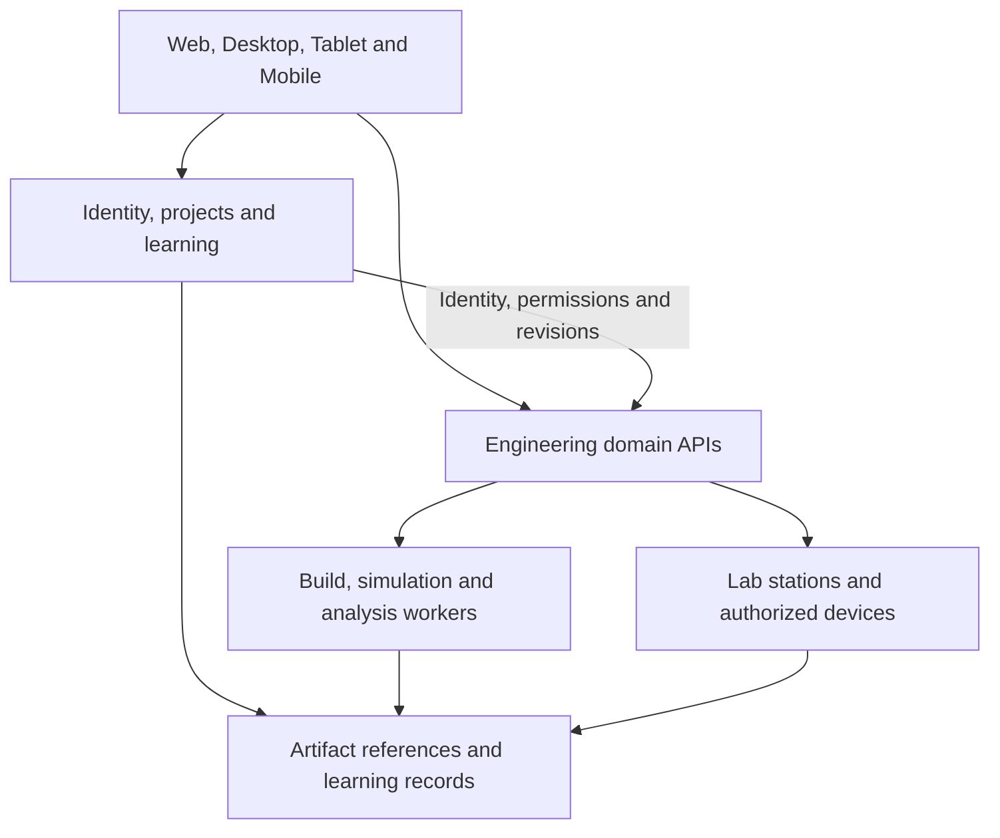

# CIRNET — STEM and digital engineering learning ecosystem architecture

**Organization** · [cirnetlab](https://github.com/orgs/cirnetlab/repositories)  
**Status** · Target architecture reviewed on 15 November 2026 and proposed for adoption. The repository inventory comes from the source snapshot in the attachment dated the same day.  
**Related documents** · [CIRNET Lab-First specification](cirnet-architecture-lab-first-en.md) · [Tiếng Việt](cirnetlab-architecture-vi.md)

## 1. Scope and overall architecture

CIRNET is a multiplatform ecosystem for STEM education and digital engineering. Learners, instructors and engineers can study, design, program, simulate, compute, build, experiment with real devices, analyze results and submit evidence. A project can connect these experiences through revisions and artifacts with provenance. Each domain can maintain its own model, lifecycle and acceptance criteria.

- **User experiences** include Studio, Lab, IDE, Blocks, Analyze, Learn, Desktop and Tablet/Mobile applications and the public site.
- **Shared domains** manage identity, organizations, projects, academic records, contracts and data infrastructure. Domain APIs enforce resource-specific permissions.
- **Engineering domains** handle simulation and physical circuits, build and flash, scientific computing, Robotics, IoT, Silicon and AI assistance. Each job uses engines and devices with capabilities appropriate to the configuration.
- **Evidence** includes pinned design revisions, firmware, simulation results, measurements, reports and submission records, with applicable access controls.

The diagram describes ownership and data flow. Modules may share a process, run in separate workers or deploy as services based on measured load, isolation and operations. Clients use versioned APIs and SDKs. Services read and write through the owner's interface, including when they share a database cluster. Lab-First specifies circuit design, simulation, physical experiments and electrical safety. The selected schemas, ICD and manifests define the interfaces of a particular integration set.

## 2. Repository inventory and boundaries

The source records **33 repositories as of 15 November 2026**, including **30 product and tooling repositories** and **3 documentation, rules and configuration repositories**. Use names as recorded, including `cirnet_web` and `cirnet-nhspice`. In the source snapshot, many repositories contain only a README and license. The matrix below records target roles. Verify each capability against specific artifacts, test results and release scope. The declared Windows workspace is `E:\ALL_PROJECTS\LUAN_VAN_TOT_NGHIEP\REPO`, a collection of clones with independent revisions.

### 2.1 Experiences and applications · 9 repositories

| Repository | Ownership and outputs |
|---|---|
| [cirnet_web](https://github.com/cirnetlab/cirnet_web) | Public website, documentation and demonstrations. Use content approved for publication. |
| [cirnet-interface](https://github.com/cirnetlab/cirnet-interface) | Lab CircuitGraph editor, breadboard and Three.js view, and instrument panels. Provides the Lab Workbench and embeddable UI. |
| [cirnet-studio](https://github.com/cirnetlab/cirnet-studio) | Engineering workspace shell, navigation, tool layout and project explorer. Composes editors and tools through versioned interfaces. |
| [cirnet-ide](https://github.com/cirnetlab/cirnet-ide) | Source editor, LSP, debugger UI, terminal and serial monitor. Calls Toolchains and Devices for build and device operations. |
| [cirnet-blocks](https://github.com/cirnetlab/cirnet-blocks) | Block language, typed AST/IR, source mapping, semantic checks and target-specific source export. |
| [cirnet-analyze](https://github.com/cirnetlab/cirnet-analyze) | Notebooks, plotting, analysis workflows, dataset linking, comparison UI and derived measurements. |
| [cirnet-learn](https://github.com/cirnetlab/cirnet-learn) | Learning, assignment, submission, feedback and progress experiences. Authoritative academic data comes from LMS. |
| [cirnet-desktop](https://github.com/cirnetlab/cirnet-desktop) | Native shell, install and update, local files, permissioned USB, serial and debugging bridge, and offline experience. |
| [cirnet-app](https://github.com/cirnetlab/cirnet-app) | Mobile and tablet learning, projects, notifications and data or device observation under permissions and verified OS capabilities. |

### 2.2 Platform, projects, data and learning · 6 repositories

| Repository | Ownership and outputs |
|---|---|
| [cirnet-platform](https://github.com/cirnetlab/cirnet-platform) | Identity, tenant, membership, cross-application sessions, identity federation and common policy. Publishes versioned context and claims for domain APIs. |
| [cirnet-contracts](https://github.com/cirnetlab/cirnet-contracts) | Shared envelopes, cross-domain schemas and DTOs, API/RPC/NCAP, Rust and TypeScript SDKs, code generation and conformance fixtures. Domain owners define business semantics. |
| [cirnet-project](https://github.com/cirnetlab/cirnet-project) | `EngineeringProject`, revisions and branches, project permissions, collaboration, artifact relationships and reference registration. |
| [cirnet-format-project](https://github.com/cirnetlab/cirnet-format-project) | Portable project package specification, parser and writer, manifest, integrity checks and format migration. |
| [cirnet-database](https://github.com/cirnetlab/cirnet-database) | Provisioning, migration runner, database operations conventions, backup and restore, and retention tooling. Each domain owns its data and business migrations. |
| [cirnet-lms](https://github.com/cirnetlab/cirnet-lms) | Courses, classes, authoritative learning content and enrollment, assignments, submissions, rubrics, gradebook, progress and academic audit. |

### 2.3 Lab and simulation · 5 repositories

| Repository | Ownership and outputs |
|---|---|
| [cirnet-remote](https://github.com/cirnetlab/cirnet-remote) | Lab API and WebSocket, Lab action permissions, experiment management, scheduling and leases, plan orchestration, results, metadata and the Lab release lock. Standalone deployments may provide local Lab data under §3. |
| [cirnet-hardware](https://github.com/cirnetlab/cirnet-hardware) | Rust HardwareStation, private edge RPC, worker supervision, drivers and transport, station operation and recovery, and safety and cleanup evidence. |
| [cirnet-simulator](https://github.com/cirnetlab/cirnet-simulator) | Default C++ worker, device models, discrete-event digital simulation, bounded DC, private worker protocol and SPICE adapter. Publishes workers, simulation results and waveforms. |
| [cirnet-fpga](https://github.com/cirnetlab/cirnet-fpga) | RTL and HDL, board-specific bitstreams, ICD, trigger and capture, timing, protected routing control, SDRAM and CDC, and FPGA/HIL evidence. |
| [cirnet-nhspice](https://github.com/cirnetlab/cirnet-nhspice) | Conditional native SPICE dependency packaging for patch sets, independent releases or license boundaries. Simulator owns the adapter and worker and may pin the upstream dependency directly. |

The six Lab-First core repositories are Interface in §2.1, Contracts in §2.2, and Remote, Hardware, Simulator and FPGA in §2.3. `cirnet-nhspice` is a dependency packaging option. Reconcile the `cirnet-core-spice` heading recorded in the source README with the repository name when selecting the SPICE strategy.

### 2.4 Developer tools, computing and extensibility · 6 repositories

| Repository | Ownership and outputs |
|---|---|
| [cirnet-cli](https://github.com/cirnetlab/cirnet-cli) | Command-line experience for project creation and opening, doctor, build and test, simulation and packaging where APIs and capabilities exist. |
| [cirnet-toolchains](https://github.com/cirnetlab/cirnet-toolchains) | Compiler and SDK registry, adapters, build manifests, bounded workers and build artifact provenance. |
| [cirnet-devices](https://github.com/cirnetlab/cirnet-devices) | Board and chip catalog, BoardProfile, pin maps, flash and debug adapters, physical and transport compatibility. |
| [cirnet-numerics](https://github.com/cirnetlab/cirnet-numerics) | Linear algebra, FFT and DSP, ODE, optimization, interpolation, precision, units and benchmarks. |
| [cirnet-integrations](https://github.com/cirnetlab/cirnet-integrations) | External LMS and roster, Git, EDA and service connections, with mapping, connector permissions and synchronization controls. |
| [cirnet-extensions](https://github.com/cirnetlab/cirnet-extensions) | Plugin SDK and ABI, manifests, host permissions, package verification, sandbox and extension lifecycle. |

### 2.5 Specialized domains · 4 repositories

| Repository | Ownership and outputs |
|---|---|
| [cirnet-robotics](https://github.com/cirnetlab/cirnet-robotics) | Robot models, kinematics, control, scenes, experiment specifications and ROS adapters where needed. |
| [cirnet-iot](https://github.com/cirnetlab/cirnet-iot) | Fleet, registered devices, twins, credentials, telemetry, policy-bound commands and alerts, and protocol adapters. |
| [cirnet-silicon](https://github.com/cirnetlab/cirnet-silicon) | Educational ASIC flows, synthesis, STA, physical design checks, EDA and PDK adapters, and provenance. |
| [cirnet-ai](https://github.com/cirnetlab/cirnet-ai) | Tutoring and coding assistance, authorized retrieval, model gateway, evaluation and audit of advisory output. |

### 2.6 Documentation, rules and configuration · 3 repositories

| Repository | Ownership and outputs |
|---|---|
| [cirnet-rules](https://github.com/cirnetlab/cirnet-rules) | Shared agent rules, instructions, skills and checks where adopted. Product repositories keep their own instructions and link to the authoritative architecture. |
| [about-cirnetlab](https://github.com/cirnetlab/about-cirnetlab) | Organization profile and branding, and proposed location for the Organization and Lab-First document pairs. |
| [.github](https://github.com/cirnetlab/.github) | GitHub Organization profile, templates and shared configuration. |

Repositories define source and responsibility boundaries. Select installable components by workflow and available capabilities. Integrate through released packages and APIs. Keep editors in Interface and IDE, academic records in LMS, action permissions with resource owners, shared computation in Numerics and circuit models in Simulator. Desktop's bridge controls native privileges. Consider another repository when independent releases, licensing, isolation or team ownership justify one.

## 3. Ownership, deployment profiles and cutover

Choose **standalone Lab** to operate, test and release a self-contained Lab configuration. Choose the **integrated ecosystem** for each shared domain that meets its acceptance criteria. Each deployment records its authoritative owner and issuer by tenant or workspace and record type. Each transition has a defined cutover point.

| Responsibility | Standalone Lab or before cutover | Integrated after cutover |
|---|---|---|
| Sign-in, identity and tenant | Remote manages local Lab accounts and sessions or trusts a configured provider. | Platform owns identity, institutions and tenants, membership and cross-application sessions. Each API checks audience, issuer, expiry and scope for the deployment. |
| Workspace, project, revision and project ACL | Remote keeps the design, revisions and permissions in the local Lab workspace. | Project owns `EngineeringProject`, revisions and ACLs. Remote runs authorized revision and digest inputs and retains the execution reference. |
| Assignments, disclosure and grades | Remote owns local Lab configuration and technical feedback. | LMS owns assignments, classes, submissions, rubrics, academic disclosure and grades. Remote owns the assigned versions of technical configuration, endpoints, component profiles and Lab evidence. |
| Experiments, physical slots and protection | Remote manages experiments and leases. Hardware and station circuitry enforce interlocks and execution conditions. | The Lab retains those responsibilities. Platform, class and project context inform Remote's action and resource checks. |
| Lab captures and submissions | Remote manages metadata, provenance and capture read authorization. | Remote owns Lab capture records. Project and LMS link authorized references. LMS owns assessment, submission and grade records. |

**Cutover procedure.** Map legacy and target IDs by tenant and resource type. Link principals using verified issuer and subject, and account for collisions and existing permissions. Run adapters and shadow-read reconciliation, and exercise compatibility fixtures. Define migrated records, versions and checkpoints. Fence writes at the legacy owner at cutover. Switch the writer or issuer for the selected scope, verify authorization, export and retention after migration, and revoke old sessions or permissions where applicable. Reconcile new writes before returning authority to the legacy source in a rollback. Record mapping provenance and reconciliation results. Each record has one domain that authorizes writes at a time.

**Effective permissions.** Platform supplies identity and common policy. Project, LMS, Remote, Devices and IoT check permissions for their own resources. A physical action, for example, requires a station-scoped Lab permission, valid lease and station protection conditions. Course instructors have authority in assigned classes. Controller and station operation permissions are granted separately. Platform owns common quotas in integrated deployments. Each execution domain owns capacity and real-time admission.

## 4. EngineeringProject, format and evidence lifecycle

`EngineeringProject` manages identity, revisions, permissions and relationships among engineering documents. A revision pins content or artifact references required to reopen a design or reproduce a task. Specialized content retains its data types and owner.

| Document or reference | Authority and use |
|---|---|
| CircuitGraph | Lab. Contracts owns the schema. Remote and Interface use the graph for design and execution. |
| Source tree, BlockProgram AST/IR | IDE, Blocks and Toolchains |
| Scene or CAD and robot models | Studio or Robotics, depending on document type |
| RTL, netlist, constraints and reports | FPGA or Silicon, within FPGA or ASIC scope |
| Dataset, notebook and analysis results | Analyze and Numerics, with references to authorized measurement or other input data |
| BoardProfile, target binding and build artifact | Devices or Toolchains, depending on artifact type |
| Experiment, capture, telemetry, submission and grade | References to Remote, IoT, LMS or the appropriate execution domain |

- Every committed revision has its own identity. Namespaces for `tenantId`, `principalId`, `workspaceId`, `projectId`, `revisionId`, `artifactId`, `jobId`, `experimentId`, `stationId`, `assignmentId` and `submissionId` are governed by their owners. Cross-domain links carry type, scope and provenance.
- The producer owns each artifact's contents, status and authorization for access. Project tracks relationships and references. Storage infrastructure holds bytes and technical metadata. A published artifact has an immutable content identity and digest. Scope and ACL, retention and revocation have their own lifecycles. Check permissions through the owner's API when reading, sharing or exporting, including when the ID or digest is known. Separately check access to the project reference and to the underlying bytes. Finalized submissions record the revision, digest and evidence receipt state.
- Write and verify large artifact bytes before publishing a complete reference. Domain databases hold metadata. File or object storage holds payloads at a consistent recovery point. When retention expires or access is withdrawn, record the reference state under policy so consumers can handle unavailable evidence.
- Format-Project owns the portable package manifest, encoding and format migration. Use domain-owned document type and version identifiers for contents. Validate file bounds, paths, archive expansion, checksums, model licenses and preserved metadata during import and export. Check permissions on each exported entry. Leases, tokens, secret answers and internal metadata stay within their authorized domains.
- A project revision is required for reproducible builds, simulation and assessment tied to source. Continuous telemetry and project-independent work use the tenant, device, dataset or other applicable scope.

**Cross-domain flow.** Save revision → select tool and verify permissions → execute with exact inputs → collect artifacts and evidence → view and compare → submit where applicable. Label results `MEASURED`, `SIMULATED` or `COMPUTED` by how they were produced. Preserve original measurements and publish analysis as derived artifacts with units, uncertainty and input digests where applicable.

## 5. Cross-repository contracts and runtime integration

| Contract family | Semantic owner | Standardization boundary |
|---|---|---|
| Identity, tenant and authorization | Platform and each domain responsible for its resources | Contracts publishes shared envelopes and claims and public DTOs |
| Projects, revisions and artifacts | Project governs lifecycle, ACL and references. The producer governs each artifact. | Contracts publishes identifiers and API reference DTOs. Format-Project owns the portable package encoding. |
| Graph, Lab API, RPC and NCAP | Remote for Lab policy, Hardware for station execution | Contracts owns schemas, SDK, RPC and NCAP. Simulator owns the private worker protocol. FPGA owns the host–FPGA ICD, with mappings verified by Hardware and Contracts. |
| Toolchain, build, board and flash | Toolchains for builds, Devices for targets and flash and debug | Share DTOs through versioned interfaces with actual consumers. |
| Learning and assessment | LMS | Owner-maintained course, enrollment, assignment, submission and grade APIs and fixtures. |
| Numerics, notebooks and specialized engineering | Numerics, Analyze, Robotics, IoT and Silicon | Domain owners maintain detailed schemas. Contracts defines common envelopes, identifiers and references. |
| Integrations, extensions and AI | Integrations, Extensions and AI by function | External connector APIs, host permissions and provenance metadata are scoped. |

Each public contract has one canonical schema source and a domain that approves business semantics. Publish domain-specific formats with their owners and use Contracts for shared handoffs and SDKs with actual consumers. Regenerate generated files from their sources after contract changes. Producers and consumers pin artifacts and versions and verify compatibility in both directions as promised. Track independent versions for APIs, schemas, formats, worker and FPGA protocols, board packages, plugin ABI, release sets and binaries.

**Jobs.** Use fields appropriate to the job, such as job or operation ID, tenant, actor, action authorization, inputs and digests, project revision where applicable, capability, quota and deadline, idempotency key, correlation ID, producer version, state, results and cancellation permissions. Distinguish acceptance, running state and final outcome. Bound and authorize worker execution and return typed errors. Physical state and quarantine belong to the station.

**Events and large payloads.** Use HTTPS APIs and authenticated streams with scope, ordering and resync. Consumers handle duplicates and gaps using event or operation IDs, cursors or authorized snapshots. Reconnect queries existing operations. Reconcile mutations when the outcome is uncertain. Stream large waveforms, firmware, CAD, datasets and reports or provide authorized downloads. NCAP serves Lab captures. Other domains retain suitable formats under a shared artifact envelope.

**Loose integration.** Exchange versioned APIs and references across domains. When durable event publication is required, record the state change and publish intent in one transaction at the owner. Consumers deduplicate and surface pending synchronization or failures. Restore domains independently and rehearse recovery across reference dependencies.

## 6. Lab-First within the ecosystem

The Web Workbench supports design, virtual runs and physical control in one learning workflow. Virtual Digital runs browser → Rust Remote → Rust Hardware → C++ worker → Web, records the result and capture, and is accepted against a pinned artifact set. Remote owns the Lab release lock. Lab can run independently of the shared domains described in §3.

Physical Lab operates the circuit assembled at the station. For remote use, an on-site operator assembles the circuit or confirms a preinstalled configuration. Control requests require permission and a lease. After scan, binding and route validation, Hardware and FPGA enforce energy permits and cutoff at the station. Establish safety and executability, use topology for diagnostics and derive functional outcomes from measurements. FPGA routing connects infrastructure only to observed, authorized endpoints. One shared electrical fabric supports one physical run and is reassigned after safe Stop is confirmed. See the [CIRNET Lab-First specification](cirnet-architecture-lab-first-en.md).

Rust is the target for Lab Remote, Hardware and Contracts runtime. C++ is the default Simulator engine, TypeScript serves the Web and HDL serves FPGA. Python serves platform tests, benchmarks and parity checks. Support for learner Python or MicroPython requires a separate decision on sandbox or board runtime, distribution and scope. Bounded DC, Virtual Analog with a SPICE solver and physical analog routing have separate capabilities and criteria.

## 7. Engineering domains and example workflows

| Domain or use case | Workflow and responsibility |
|---|---|
| **Embedded programming** | IDE or Blocks edits source or IR → Project pins a revision → Toolchains builds in a worker with pinned compiler, SDK and target → Devices checks BoardProfile, device identity, electrical domain and compatibility → authorized actor flashes or debugs → record results and recovery. Check build, flash, run and debug independently. |
| **Engineering analysis** | Authorized Lab captures, datasets or IoT telemetry → Analyze references inputs → Numerics computes under defined engine, version, units, precision, seed and limits → store derived artifacts and provenance. Notebooks run user code in bounded workers. |
| **Robotics** | Robotics owns models, coordinate systems, kinematics, control and reports. Numerics supports computation. Devices and Toolchains support targets. Physical robots require a validated motion safety envelope, watchdog and emergency stop. |
| **IoT** | Devices describes board types. IoT governs registered instances, telemetry, credentials, twins and command policy. Lab Hardware governs stations and their interlocks. Dashboards call authorized, scoped and audited APIs. |
| **FPGA and Silicon** | IDE and Project hold RTL and constraints → FPGA builds and tests boards or Silicon runs the ASIC flow with authorized EDA and PDK → store timing, reports and evidence. RTL, FPGA and ASIC sign-off have separate acceptance requirements. Respect PDK, SDK and IP distribution terms. |
| **AI assistance** | AI explains source and models, retrieves authorized material, interprets logs and suggests changes. Record model version, sources and reliability information where available. AI output is advisory. Grades, flashing, energization, safety decisions, exports and data changes follow their domain-authorized workflows. |

BoardProfile records family and part, memory, pins, electrical domains, bootloader and debug, compatible toolchains and target packaging and transport. Display ESP32, STM32, Arduino-compatible, PIC, Raspberry Pi, Orange Pi, FPGA and other targets only where the configured adapter is verified. Linux SBCs, MCUs and FPGAs use distinct artifacts and programming workflows. Fuse or bootloader operations use target-specific authorization and recovery conditions.

Blocks owns typed IR and source maps for block-level diagnostics and readable source export. IDE and CLI use the same applicable build contracts and APIs. Build outputs record digests, tools, target compatibility and trusted provenance before flashing. Run third-party tools within adapter-specific permissions and limits.

## 8. Integrated learning and academic evidence

1. Instructors create assignments, rubrics and resource permissions in LMS. A Lab assignment links to the matching Remote technical configuration, endpoints and expectations by versioned ID.
2. Learners open the assignment in Learn, save the revision in Project, use Studio, IDE, Blocks, Lab or Analyze under permission, and submit pinned revisions and artifact references.
3. LMS checks evidence provenance and the rubric. Record an algorithm version for automatic scoring, audit submissions and grades, and allow authorized review, corrections and reassessment requests.
4. Disclosure defines what learners may see across interfaces, logs, AI, APIs, exports and feedback. Lab technical feedback, automated rubric scores and AI suggestions each have an explicit source and authority.

Schools may connect an external LMS through `cirnet-integrations`. Evaluate LTI 1.3/LTI Advantage, roster interchange and SSO when deployment needs them. Select a grade system of record and synchronization direction for each academic scope. Scope connector permissions and access to answers using the LMS and data owner's boundaries.

## 9. Platforms, security and operations

| Environment | Scope and conditions |
|---|---|
| Web | Studio, Lab, Blocks, IDE, Analyze and Learn through the browser. Render 3D on the client. Route Lab controls through authorized Remote APIs. |
| Desktop | Workspace, files, USB, serial and debug through a signed native shell, IPC allowlist and action-scoped permissions. Offline build and simulation depend on available local engines. |
| Tablet and Mobile | Learning, light block editing, projects, notifications, monitoring or approvals under OS capabilities and permissions. |
| Campus or on-premises | Classes and Lab stations with tenant and role scoping, backup, managed edge and equipment access procedures. |
| Cloud | Shared applications and managed jobs under tenant, quota, region and worker limits. |
| Hybrid cloud and Lab edge | Authenticated gateway, time-bounded station authorization and edge-side checks. Private Hardware RPC and electrical protection stay at the edge. Local deadlines, leases and watchdogs handle loss of connectivity. |

Share design-system components and SDKs where appropriate. Desktop, Tablet/Mobile and Web tailor workflows to device evidence. Synchronize offline drafts with revision conflict detection. The appropriate service is authoritative for leases, permissions and grades. Reconnect reads state before deciding on further action.

- **Identity and tenants.** Use appropriate issuer, audience, scopes, expiry and tenant. Resource owners check project, class, flash and debug, IoT, Lab and plugin permissions. Cookie sessions use HTTPS, Secure/HttpOnly, SameSite, CSRF and Origin checks. Authenticate services, use MFA for sensitive roles and limit permissions from client to worker or edge. Remote equipment access uses authorized entry points and preserves local safety controls under OT guidance. [NIST SP 800-82 Rev. 3](https://csrc.nist.gov/pubs/sp/800/82/r3/final)
- **Jobs and supply chain.** Pin versions, verify digests and trusted provenance, and check SBOM and license at release. Compiler, EDA, notebook and simulation workers enforce input and CPU, memory, disk, time and network limits, secret isolation, cancellation and audit. Extensions declare minimum permissions and operate within a host boundary. Devices accept compatible firmware and use verified recovery procedures.
- **Data and IP.** Classify public and internal data, projects, licensed PDK and IP, answers, learner records, telemetry, captures and secrets. Enforce tenant scope at API, data access and artifact retrieval, including download URLs, events, search, logs, connectors and AI retrieval. Define retention, encrypted backups, deletion and export, and applicable consent by subject, owner and deployment location. Share or use private data for training only under applicable policy and permissions.
- **Observability and recovery.** Propagate correlation, scope and version across boundaries. Measure APIs, queues and workers, revision conflicts, captures, Stop and cutoff, quarantine, grading, IoT health and AI quotas. Provide readiness checks, backup and restore, idempotency and station or board recovery. Set load and latency targets by deployment and measurement.

## 10. Releases, documentation and verification

**Composition manifest.** Record repositories, source SHA, byte digests, toolchain, OS and ABI, fingerprints, SDK and runtime dependencies, schemas and migration and rollback requirements. `cirnet-remote/integration/release-set.json` is the Lab lock. Platform may own a cross-application deployment catalog when required. That catalog references the Lab release set, and Lab owners accept Lab compatibility. Publish results for the actual bundle, pin run resources and reconcile state during upgrades or rollback.

New GitHub tags and release titles use `<repo_name>-<version>`. For example, `cirnet-simulator-0.2.2` illustrates the format. Retain historical tags. Candidates and approved releases have their own manifests, versions and evidence. Deployment checks migration, draining or Stop, data recovery and board or firmware compatibility where relevant.

**Authoritative documents.** Proposed placement is the shared `architecture/` directory in `about-cirnetlab` for both Vietnamese and English pairs, keeping relative links valid. The Organization document establishes ecosystem decisions and domain ownership. Lab-First specifies Lab execution and safety. Source owners publish implementation specifications, ABI and schemas, evidence and manifests. Each language pair shares a revision and synchronizes decisions, gates, identifiers and links. Repositories and `cirnet-rules` link to the common sources and retain scoped guidance.

**Cross-repository work.** Determine the owner, contract and active version. Read repository guidance, change the source, verify consumers and failures, then update applicable evidence, docs and changelogs. Use versioned packages for dependencies across repositories. A multi-clone workspace supports development with auditable commits. Each capability evolves under its applicable quality gates.

| Gate | Minimum evidence |
|---|---|
| ARCH-OWN | One authoritative source per scope, clear dependencies and verified migration scope |
| CONTRACT | Schema, SDK, RPC/ABI, portable package, old and new fixtures and producer/consumer compatibility |
| SECURITY | Tenant isolation, resource authorization, secrets, untrusted inputs, audit, export and disclosure |
| REPRO | Exact source, artifact, tool and input digests and reproduction in a defined environment |
| E2E-LAB | Browser → Remote → Hardware → C++ worker → results, persistence, Stop and failures for the pinned set |
| PHYSICAL-SAFETY | Board measurements and HIL under Lab-First, independent protection, Stop, infrastructure routing and quarantine |
| ACADEMIC | Submission revision, provenance, rubric, grade audit and answer disclosure authorization |
| DEVICE | Board identity, firmware and target match, flash permission, outcomes and recovery |
| NUMERICAL | Units, reference data, error or tolerance, precision, performance and reproducibility |
| EDA | Tools, PDK and licenses, with reports scoped to RTL, FPGA or ASIC |
| CROSS-PLATFORM | Tested OS and device matrix, native permissions, UX and offline synchronization |
| RELEASE | Exact artifacts, CI, SBOM and licensing, install, restore, rollback, Vietnamese and English docs and release scope |

Keep unit and domain tests with their owners. Keep conformance fixtures with the contract source and consumers. Integration owners coordinate E2E with exact artifacts. On release, record the owner, version and consumers, permissions, failure and Stop behavior, limits, tests, migration and rollback, environment, evidence and documentation. Distinguish `TARGET`, `DESIGNED`, `IMPLEMENTED`, `TESTED`, `VERIFIED` and `RELEASED`. Support status applies to the verified environment. Use `NOT_RUN` for a gate awaiting execution, `BLOCKED` for a gated check and `FAILED` for a failed test. Use `UNAVAILABLE` for an unavailable capability in the configuration.

## 11. Architectural decisions and open items

| ID | Decision |
|---|---|
| CIRNET-ECO-001 | The Organization architecture defines ecosystem scope. Lab-First specifies the Lab domain. |
| CIRNET-ECO-002 | Multiplatform experiences reference EngineeringProject and versioned contracts when the workflow needs them. |
| CIRNET-ECO-003 | Each data scope has one authoritative owner at each point in a cutover. |
| CIRNET-ECO-004 | Rust for Lab Backend, Hardware and Contracts runtime, C++ as default Simulator and Python for platform verification. |
| CIRNET-ECO-005 | Public schemas, packages and fixtures use canonical sources. Business owners approve the semantics. |
| CIRNET-ECO-006 | Build, flash, run and grade have distinct permissions and conditions. |
| CIRNET-ECO-007 | Identity, academic authority, Lab permissions and safety have distinct authorities. AI is advisory. |
| CIRNET-ECO-008 | Published revisions and artifacts carry digests and provenance. ACL and retention have their own governance lifecycle. |
| CIRNET-ECO-009 | Publish capabilities by environment and verified evidence. |
| CIRNET-ECO-010 | FPGA routes only permitted infrastructure to observed endpoints on the physical circuit. |
| CIRNET-ECO-011 | Repositories follow their existing domains. Choose process and service boundaries by load, isolation and operations. |
| CIRNET-ECO-012 | Workers and extensions use isolation and permissions appropriate to the job. |
| CIRNET-ECO-013 | Enforce tenant isolation and protect learning data and IP under owner policy. |
| CIRNET-ECO-014 | Keep architecture names stable and version contracts and artifacts independently. |
| CIRNET-ECO-015 | Each scope has synchronized document editions and traceable evidence. |

| Open decision or gate | Owner and closure condition |
|---|---|
| Identity, Project and LMS cutover | Platform, Project, LMS and Remote verify identity mapping, permissions, IDs, cutover criteria and rollback by scope |
| Portable format, artifact storage, retention and data residency | Format-Project, Project, data owners and operations settle packaging and ACLs, read access, recovery and school data policies by environment |
| Lab compatibility and safety | Remote integrates the exact release set, Hardware and FPGA verify boards, ICD and HIL, and Simulator verifies workers and solver |
| Independent SPICE packaging or upstream pin | Simulator and the dependency owner select an approach based on model licenses, patch sets, reproducibility and release needs |
| Academic governance and integration | LMS and Integrations settle the grade system of record, applicable consent, export, roster and LTI requirements |
| Python or MicroPython learner runtime | Toolchains, Devices and product owners decide on a sandbox or board runtime and licensing |
| Shared UX, AI and tool distribution | Application owners choose packages with actual consumers. AI establishes models, providers, scopes, sources and retention. Toolchains and Silicon establish distribution rights for SDKs, EDA and PDKs. |
| Authoritative documentation location | Organization confirms directory, links and how language editions stay on one revision |

## 12. Review findings and sources

| Issue in the source documents | Revision |
|---|---|
| Both documents described Organization-wide architecture | One ecosystem scope and one Lab specification linked by decision scope and ownership (§1, §6, §10). |
| Three responsibility areas overlapped between Remote and shared domains | Standalone and integrated profiles, scoped write authority and cutover criteria (§3). |
| The inventory of 33 repositories could imply 33 deployed services | Preserve the inventory and target roles. Choose components by workflow, release and evidence (§1–2, §10). |
| Project, format and the artifact registry could overlap | Project owns revisions and ACLs, Format-Project owns the container, and producers govern content and retrieval (§4–5). |
| Grade authority, Lab permissions, job state and safety could overlap | Assign owners to academic records and evidence, use Lab-First for physical control and scope job envelopes by type (§3, §5–9). |

**Sources.** The attached `cirnetlab-architecture(1).md` and `cirnet-architecture-lab-first(4).md` are the primary sources. Inventory, README-only status and the local workspace are recorded by the source for the stated date. Verify repository state, selected releases, deployment permissions and capabilities with the appropriate owners before publication.
