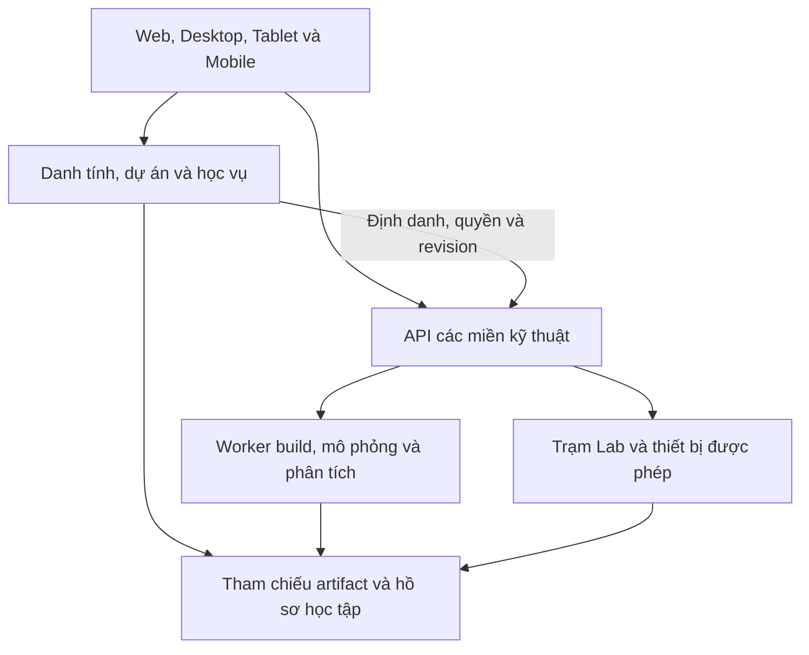

# CIRNET — Kiến trúc hệ sinh thái giáo dục STEM và kỹ thuật số

**Organization** · [cirnetlab](https://github.com/orgs/cirnetlab/repositories)  
**Trạng thái** · Kiến trúc mục tiêu đã rà soát ngày 15/11/2026, đề xuất áp dụng. Kiểm kê repository lấy từ ảnh chụp nguồn trong bản đính kèm cùng ngày.  
**Tài liệu liên quan** · [Đặc tả CIRNET Lab-First](cirnet-architecture-lab-first-vi.md) · [English](cirnetlab-architecture-en.md)

## 1. Phạm vi và kiến trúc tổng thể

CIRNET là hệ sinh thái giáo dục STEM và kỹ thuật số đa nền tảng. Người học, giảng viên và kỹ sư có thể học, thiết kế, lập trình, mô phỏng, tính toán, biên dịch, thử nghiệm thiết bị thật, phân tích và nộp bằng chứng. Một dự án có thể kết nối các trải nghiệm này bằng revision và artifact có nguồn gốc rõ. Mỗi miền có thể duy trì mô hình dữ liệu, vòng đời và tiêu chí nghiệm thu riêng.

- **Trải nghiệm người dùng** gồm Studio, Lab, IDE, Blocks, Analyze, Learn, ứng dụng Desktop, Tablet/Mobile và website công khai.
- **Các miền dùng chung** quản danh tính, tổ chức, project, học vụ, hợp đồng và hạ tầng dữ liệu. Các API nghiệp vụ áp quyền cụ thể của miền.
- **Các miền kỹ thuật** thực hiện mô phỏng/mạch thật, build/flash, tính toán, Robotics, IoT, Silicon và hỗ trợ AI. Mỗi tác vụ dùng engine và thiết bị đủ khả năng theo cấu hình.
- **Bằng chứng** gồm thiết kế cố định theo revision, firmware, kết quả mô phỏng, số đo, báo cáo và hồ sơ nộp bài theo quyền truy cập tương ứng.

Sơ đồ mô tả quyền sở hữu và luồng dữ liệu. Các module có thể cùng tiến trình, ở worker riêng hoặc là service tùy mức tải, ranh giới cách ly và vận hành. Mỗi client dùng API/SDK đã version hóa. Các dịch vụ đọc và ghi qua interface của owner, kể cả khi dùng chung một cụm DB. Lab-First là đặc tả chuyên ngành cho thiết kế mạch, mô phỏng, thí nghiệm thật và an toàn điện. Dùng schema/ICD và manifest đã chọn để xác định giao diện thực của một bộ tích hợp.

## 2. Kiểm kê và ranh giới repository

Bản gốc ghi **33 repository tại 15/11/2026**, gồm **30 repository sản phẩm và công cụ** cùng **3 repository tài liệu, quy tắc và cấu hình**. Giữ tên hiện có theo kiểm kê, bao gồm `cirnet_web` và `cirnet-nhspice`. Trong ảnh chụp nguồn, nhiều repo mới có README/LICENSE. Ma trận dưới đây ghi vai trò đích. Xác nhận từng tính năng bằng artifact, test và phạm vi phát hành cụ thể. Workspace Windows được khai báo là `E:\ALL_PROJECTS\LUAN_VAN_TOT_NGHIEP\REPO`, tập hợp các clone có revision riêng.

### 2.1 Trải nghiệm và ứng dụng · 9 repository

| Repository | Quyền sở hữu và đầu ra |
|---|---|
| [cirnet_web](https://github.com/cirnetlab/cirnet_web) | Website, tài liệu và demo công khai. Chỉ sử dụng nội dung được phép xuất bản. |
| [cirnet-interface](https://github.com/cirnetlab/cirnet-interface) | CircuitGraph editor, breadboard/Three.js và instrument panel của Lab. Cung cấp Lab Workbench và UI có thể nhúng. |
| [cirnet-studio](https://github.com/cirnetlab/cirnet-studio) | Shell không gian kỹ thuật, navigation, layout công cụ và project explorer. Tích hợp editor và công cụ qua interface đã version hóa. |
| [cirnet-ide](https://github.com/cirnetlab/cirnet-ide) | Trình soạn mã, LSP, debugger UI, terminal và serial monitor. Gọi Toolchains và Devices cho build và thiết bị. |
| [cirnet-blocks](https://github.com/cirnetlab/cirnet-blocks) | Ngôn ngữ khối, AST/IR có kiểu, ánh xạ nguồn, kiểm ngữ nghĩa và xuất mã theo target. |
| [cirnet-analyze](https://github.com/cirnetlab/cirnet-analyze) | Notebook, biểu đồ, workflow phân tích, liên kết dataset, UI so sánh và dẫn xuất số đo. |
| [cirnet-learn](https://github.com/cirnetlab/cirnet-learn) | Trải nghiệm học, giao/nộp bài, phản hồi và tiến trình. Dữ liệu học vụ lấy từ LMS có thẩm quyền. |
| [cirnet-desktop](https://github.com/cirnetlab/cirnet-desktop) | Native shell, cài đặt/cập nhật, lưu tệp cục bộ, USB/serial/debug qua bridge có quyền, trải nghiệm offline. |
| [cirnet-app](https://github.com/cirnetlab/cirnet-app) | Mobile/Tablet cho học tập, project, thông báo và quan sát dữ liệu hoặc thiết bị theo quyền và capability từng OS. |

### 2.2 Nền tảng, dự án, dữ liệu và học vụ · 6 repository

| Repository | Quyền sở hữu và đầu ra |
|---|---|
| [cirnet-platform](https://github.com/cirnetlab/cirnet-platform) | Identity, tenant, membership, phiên liên ứng dụng, xác thực liên kết và chính sách chung. Cấp context/claims version hóa cho miền sử dụng. |
| [cirnet-contracts](https://github.com/cirnetlab/cirnet-contracts) | Envelope dùng chung, schema/DTO liên miền, API/RPC/NCAP, SDK Rust/TS, codegen và conformance fixtures. Owner nghiệp vụ xác định ngữ nghĩa của miền. |
| [cirnet-project](https://github.com/cirnetlab/cirnet-project) | `EngineeringProject`, revision/branch, quyền dự án, collaboration, quan hệ và đăng ký tham chiếu artifact. |
| [cirnet-format-project](https://github.com/cirnetlab/cirnet-format-project) | Đặc tả gói dự án di động, parser/writer, manifest, kiểm toàn vẹn và migration định dạng. |
| [cirnet-database](https://github.com/cirnetlab/cirnet-database) | Provisioning, runner migration, chuẩn vận hành DB, backup/restore và công cụ retention. Mỗi miền sở hữu dữ liệu và migration nghiệp vụ tương ứng. |
| [cirnet-lms](https://github.com/cirnetlab/cirnet-lms) | Course, lớp, học liệu/ghi danh có thẩm quyền, đề bài, submission, rubric, gradebook, tiến trình và audit học vụ. |

### 2.3 Lab và mô phỏng · 5 repository

| Repository | Quyền sở hữu và đầu ra |
|---|---|
| [cirnet-remote](https://github.com/cirnetlab/cirnet-remote) | API/WS Lab, quyền thao tác Lab, quản lý thí nghiệm, scheduler/lease, điều phối lập kế hoạch, kết quả, metadata và release lock của Lab. Bản độc lập có thể cung cấp dữ liệu Lab cục bộ theo §3. |
| [cirnet-hardware](https://github.com/cirnetlab/cirnet-hardware) | Rust HardwareStation, RPC riêng trên edge, supervisor worker, driver/transport, vận hành và phục hồi trạm, kết quả xác nhận an toàn/cleanup. |
| [cirnet-simulator](https://github.com/cirnetlab/cirnet-simulator) | C++ worker mặc định, device models, digital event, DC giới hạn, giao thức worker riêng và adapter SPICE. Xuất worker, kết quả và waveform ảo. |
| [cirnet-fpga](https://github.com/cirnetlab/cirnet-fpga) | RTL/HDL, bitstream theo bo, ICD, trigger/capture, timing, điều khiển định tuyến có bảo vệ, SDRAM/CDC và bằng chứng FPGA/HIL. |
| [cirnet-nhspice](https://github.com/cirnetlab/cirnet-nhspice) | Đóng gói dependency SPICE native có điều kiện nếu cần patch set, phát hành độc lập hoặc ranh giới license. Simulator quản adapter và worker. Có thể tích hợp trực tiếp phiên bản upstream đã khóa. |

Sáu repo lõi Lab-First gồm Interface ở §2.1, Contracts ở §2.2 và Remote, Hardware, Simulator, FPGA ở §2.3. `cirnet-nhspice` là lựa chọn đóng gói dependency. Tên heading `cirnet-core-spice` ghi nhận trong README nguồn cần đối chiếu với tên repo khi xác định chiến lược SPICE.

### 2.4 Công cụ lập trình, tính toán và mở rộng · 6 repository

| Repository | Quyền sở hữu và đầu ra |
|---|---|
| [cirnet-cli](https://github.com/cirnetlab/cirnet-cli) | UX dòng lệnh cho create/open, doctor, build/test, mô phỏng và đóng gói theo capability/API. |
| [cirnet-toolchains](https://github.com/cirnetlab/cirnet-toolchains) | Registry compiler/SDK, adapter, build manifest, worker có giới hạn và provenance của artifact tạo ra. |
| [cirnet-devices](https://github.com/cirnetlab/cirnet-devices) | Catalog board/chip, BoardProfile, pin map, adapter flash/debug, tương thích vật lý và transport. |
| [cirnet-numerics](https://github.com/cirnetlab/cirnet-numerics) | Kernel đại số tuyến tính, FFT/DSP, ODE, tối ưu, nội suy, precision/units và benchmark. |
| [cirnet-integrations](https://github.com/cirnetlab/cirnet-integrations) | Kết nối LMS/roster, Git, EDA và dịch vụ bên ngoài, cùng mapping, quyền connector và kiểm soát đồng bộ. |
| [cirnet-extensions](https://github.com/cirnetlab/cirnet-extensions) | SDK/ABI plugin, manifest, quyền host, xác minh package, sandbox và vòng đời extension. |

### 2.5 Miền chuyên sâu · 4 repository

| Repository | Quyền sở hữu và đầu ra |
|---|---|
| [cirnet-robotics](https://github.com/cirnetlab/cirnet-robotics) | Mô hình, động học, điều khiển, cảnh robot, đặc tả thí nghiệm và adapter ROS khi cần. |
| [cirnet-iot](https://github.com/cirnetlab/cirnet-iot) | Fleet, thiết bị đã đăng ký, twin, credential, telemetry, lệnh/alert có policy và adapter giao thức. |
| [cirnet-silicon](https://github.com/cirnetlab/cirnet-silicon) | Luồng ASIC giáo dục, synthesis, STA, kiểm thiết kế vật lý, EDA/PDK adapters và provenance. |
| [cirnet-ai](https://github.com/cirnetlab/cirnet-ai) | Tutor/coding support, truy xuất theo quyền, gateway model, đánh giá và audit nội dung tư vấn. |

### 2.6 Tài liệu, quy tắc và cấu hình · 3 repository

| Repository | Quyền sở hữu và đầu ra |
|---|---|
| [cirnet-rules](https://github.com/cirnetlab/cirnet-rules) | Bộ quy tắc, hướng dẫn, skill và kiểm tra dùng chung cho agent khi được áp dụng. Repo sản phẩm giữ hướng dẫn riêng và dẫn nguồn kiến trúc chuẩn. |
| [about-cirnetlab](https://github.com/cirnetlab/about-cirnetlab) | Hồ sơ Organization, thương hiệu và nơi đề xuất lưu cặp tài liệu kiến trúc cấp Organization và Lab-First. |
| [.github](https://github.com/cirnetlab/.github) | Hồ sơ GitHub Organization, template và cấu hình dùng chung. |

Các repo là ranh giới quản lý mã và trách nhiệm. Phạm vi cài đặt được chọn theo workflow và năng lực đã có. Dùng package/API đã phát hành khi tích hợp. Giữ nội dung editor ở Interface/IDE, học vụ ở LMS, quyền thao tác trên tài nguyên ở domain owner, tính toán dùng chung ở Numerics và mô hình mạch ở Simulator. Giữ phạm vi quyền native được kiểm soát ở bridge của Desktop. Xem xét thêm repo khi có nhu cầu phát hành, license, cách ly hoặc nhóm sở hữu độc lập rõ.

## 3. Quyền sở hữu, cấu hình triển khai và chuyển giao

Chọn **Lab độc lập** để vận hành, kiểm thử và phát hành một bộ Lab tự chủ. Chọn **hệ sinh thái tích hợp** theo từng miền đủ điều kiện. Mỗi deployment ghi owner và issuer có thẩm quyền theo phạm vi tenant/workspace và loại bản ghi. Từng nguồn có thời điểm chuyển giao xác định.

| Trách nhiệm | Lab độc lập hoặc trước chuyển giao | Tích hợp sau chuyển giao |
|---|---|---|
| Đăng nhập, identity và tenant | Remote quản tài khoản/phiên Lab cục bộ hoặc tin cậy nhà cung cấp được cấu hình. | Platform quản identity, institution/tenant, membership và phiên liên ứng dụng. Mỗi API kiểm audience, issuer, hạn và scope theo deployment. |
| Workspace, project, revision và ACL dự án | Remote giữ thiết kế/revision và quyền trong workspace Lab cục bộ. | Project là nguồn `EngineeringProject`, revision và ACL. Remote dùng revision/digest có quyền để chạy, giữ bản ghi tham chiếu của execution. |
| Bài thực hành, công bố và điểm | Remote quản cấu hình Lab cục bộ và phản hồi kỹ thuật. | LMS quản đề bài, lớp, bài nộp, rubric, chính sách công bố học vụ và điểm. Remote giữ phiên bản cấu hình kỹ thuật, endpoint, hồ sơ linh kiện và bằng chứng Lab được giao. |
| Thí nghiệm, slot vật lý và bảo vệ | Remote quản experiment/lease. Hardware và phần cứng giữ liên động và điều kiện thực thi trạm. | Cùng quyền Lab. Platform/lớp/project cung cấp context để Remote kiểm quyền theo thao tác và tài nguyên. |
| Capture Lab và hồ sơ nộp | Remote quản metadata, provenance và quyền đọc capture. | Remote quản bản ghi đo Lab. Project và LMS liên kết qua reference được cấp quyền. LMS quản thẩm định, bản ghi nộp và điểm. |

**Cách chuyển giao.** Tạo mapping giữa ID cũ và ID mới theo tenant và loại tài nguyên. Liên kết principal theo issuer và subject đã xác minh, xử lý trùng lặp và quyền hiện có. Chạy adapter và kiểm đọc đối chiếu, thử fixtures tương thích. Chốt phần dữ liệu cần migrate, phiên bản và checkpoint. Dừng hoặc chặn ghi ở owner cũ tại mốc cắt, chuyển writer/issuer cho phạm vi đã chọn, xác nhận authorization, export và retention sau migration, thu hồi phiên/quyền cũ khi cần. Chỉ rollback về nguồn cũ sau khi kiểm và đối soát các lần ghi phát sinh. Ghi provenance của mapping và kết quả đối soát. Mỗi bản ghi có một miền xác nhận ghi tại một thời điểm.

**Quyền hiệu lực.** Platform cấp danh tính và chính sách chung. Project, LMS, Remote, Devices và IoT tự kiểm tra quyền trên tài nguyên của mình. Ví dụ, thao tác vật lý cần quyền Lab theo station, lease hợp lệ và điều kiện bảo vệ của trạm. Course instructor có quyền trong lớp đã gán. Các quyền controller và vận hành trạm được cấp riêng. Hạn mức dùng chung thuộc Platform khi tích hợp, còn capacity và admission thời gian thực thuộc miền thực thi.

## 4. EngineeringProject, định dạng và vòng đời bằng chứng

`EngineeringProject` quản lý định danh, revision, quyền và quan hệ giữa các tài liệu kỹ thuật. Một revision cố định nội dung hoặc tham chiếu artifact cần thiết để mở lại thiết kế hoặc tái lập tác vụ. Nội dung chuyên ngành giữ kiểu dữ liệu và owner của nó.

| Tài liệu hoặc tham chiếu | Nơi định nghĩa và sử dụng |
|---|---|
| CircuitGraph | Lab. Contracts quản schema, Remote và Interface dùng graph trong thiết kế và thực thi. |
| Source tree, BlockProgram AST/IR | IDE/Blocks và Toolchains |
| Scene/CAD và mô hình robot | Studio hoặc Robotics theo loại tài liệu |
| RTL, netlist, constraint và báo cáo | FPGA/Silicon theo phạm vi FPGA hoặc ASIC |
| Dataset, notebook và kết quả phân tích | Analyze và Numerics, dẫn tới dữ liệu đo hoặc nguồn khác có quyền |
| BoardProfile, target binding và build artifact | Devices hoặc Toolchains theo loại artifact |
| Experiment, capture, telemetry, bài nộp và điểm | Tham chiếu đến owner Remote, IoT, LMS hoặc miền thực thi tương ứng |

- Mọi revision đã chốt cần định danh riêng. Namespaces cho `tenantId`, `principalId`, `workspaceId`, `projectId`, `revisionId`, `artifactId`, `jobId`, `experimentId`, `stationId`, `assignmentId` và `submissionId` được quản theo owner. Liên kết giữa các miền đi cùng kiểu, scope và provenance.
- Producer sở hữu nội dung, trạng thái và quyền cấp truy cập artifact do mình tạo. Project lưu quan hệ và tham chiếu. Hạ tầng lưu trữ giữ dữ liệu gốc và metadata kỹ thuật. Artifact đã công bố dùng định danh và digest của nội dung bất biến. Scope/ACL, retention và trạng thái bị thu hồi có vòng đời riêng. Kiểm quyền qua API của miền sở hữu dữ liệu khi đọc, chia sẻ hoặc xuất, kể cả khi đã có ID/digest. Quyền truy cập tham chiếu của dự án và quyền lấy dữ liệu gốc được kiểm riêng. Bài nộp đã chốt ghi revision, digest và trạng thái đã nhận evidence.
- Artifact lớn được ghi và kiểm checksum trước khi công bố reference hoàn chỉnh. DB thuộc domain về metadata. Payload ở file/object storage theo triển khai, nhất quán theo recovery point. Nếu hết hạn hoặc phải thu hồi dữ liệu, lưu trạng thái reference theo chính sách để consumer xử lý được thiếu bằng chứng.
- Format-Project sở hữu manifest/encoding của gói di động và schema migration. Dùng định danh kiểu tài liệu và version của owner để mô tả nội dung. Thẩm định giới hạn tệp, path traversal, archive expansion, checksum, model license và metadata được giữ khi import/export. Đối chiếu quyền trên từng thành phần trước khi xuất. Lease, token, đáp án bí mật và metadata nội bộ chỉ nằm ở miền có thẩm quyền.
- Revision dự án bắt buộc khi tái lập build, mô phỏng hoặc chấm bài theo source. Telemetry liên tục và các việc độc lập dự án gắn với tenant, thiết bị, dataset hoặc scope phù hợp.

**Luồng liên miền.** Lưu revision → chọn công cụ và kiểm quyền → chạy với exact inputs → nhận artifact và bằng chứng → xem/so sánh → nộp bài nếu cần. Ghi nguồn `MEASURED`, `SIMULATED` hoặc `COMPUTED` theo cách tạo kết quả. Giữ dữ liệu đo gốc và lưu phân tích dưới artifact dẫn xuất có units, sai số/độ không đảm bảo và source digest khi áp dụng.

## 5. Hợp đồng liên repo và tích hợp runtime

| Nhóm hợp đồng | Owner ngữ nghĩa | Ranh giới chuẩn hóa |
|---|---|---|
| Identity, tenant và quyền | Platform và từng miền có quyền trên tài nguyên | Contracts xuất envelope/claims dùng chung và DTO công khai |
| Project, revision và artifact | Project quản lifecycle/ACL và references. Producer quản artifact cụ thể. | Contracts xuất ID và DTO/API reference. Format-Project quản encoding gói di động. |
| Graph, Lab API, RPC, NCAP | Remote cho chính sách Lab, Hardware cho thực thi trạm | Contracts giữ schema/SDK/RPC/NCAP. Simulator giữ giao thức worker riêng. FPGA giữ ICD host–FPGA cùng mapping được kiểm bởi Hardware và Contracts. |
| Toolchain, build, board và flash | Toolchains cho build, Devices cho target và flash/debug | Chia sẻ nhóm DTO qua interface đã version hóa khi có consumer. |
| Learning và assessment | LMS | API course, enrollment, assignment, submission và grade cùng fixtures do owner duy trì. |
| Numeric, notebook và miền chuyên sâu | Numerics, Analyze, Robotics, IoT, Silicon | Schema chi tiết ở owner. Envelope, định danh và tham chiếu dùng chung theo Contracts. |
| Integration, extension và AI | Integrations, Extensions, AI theo chức năng | API external connector, host permission và metadata provenance theo scope. |

Public contract có một nơi quản schema chuẩn và một miền xác nhận ngữ nghĩa nghiệp vụ. Đưa domain-specific format vào package của owner, dùng Contracts cho handoff dùng chung và SDK thực sự có consumer. Generated files được thay từ nguồn sau thay đổi contract. Producer và consumer pin artifact/version, kiểm tương thích hai chiều theo cam kết. Dùng phiên bản riêng cho API, schema, format, worker/FPGA protocol, board package, plugin ABI, release set và binary.

**Tác vụ.** Envelope dùng thông tin phù hợp với loại tác vụ như job/operation ID, tenant, actor, quyền thao tác, input/digest, project revision nếu áp dụng, capability, quota/deadline, idempotency key, correlation ID, producer version, trạng thái, kết quả và quyền hủy. Tách tiếp nhận, đang chạy và kết quả cuối. Worker đi qua giới hạn tài nguyên và xác thực ngữ cảnh, trả lỗi có kiểu. Physical state và quarantine thuộc trạm.

**Event và dữ liệu lớn.** Dùng API HTTPS và stream được xác thực, có số thứ tự và resync theo scope. Consumer xử lý trùng và khoảng thiếu bằng event/operation ID, cursor hoặc snapshot có quyền. Reconnect chỉ tra cứu thao tác đã có. Với mutation cần đối soát khi kết quả chưa rõ. Waveform, firmware, CAD, dataset và báo cáo lớn truyền qua stream hoặc tải có quyền. NCAP phục vụ capture Lab. Miền khác giữ format phù hợp trong envelope artifact chung.

**Tích hợp lỏng.** Dùng API và tham chiếu có version giữa miền. Khi cần phát kết quả bền vững qua event, ghi trạng thái và yêu cầu phát trong cùng giao dịch ở owner. Consumer khử trùng và hiển thị trạng thái đang đồng bộ hoặc lỗi. Tách phục hồi từng domain và diễn tập restore theo phụ thuộc reference.

## 6. Lab-First trong hệ sinh thái

Web Workbench hỗ trợ thiết kế, chạy ảo và điều khiển thí nghiệm thật trên cùng luồng học tập. Virtual Digital dùng browser → Remote Rust → Hardware Rust → worker C++ → Web, ghi result/capture và nghiệm thu theo bộ artifact khóa. Remote giữ Lab release lock. Lab có thể chạy độc lập với các miền tích hợp ở §3.

Physical Lab dùng mạch đang lắp tại trạm. Khi thực hành từ xa, người vận hành tại chỗ lắp mạch hoặc xác nhận mạch đã chuẩn bị sẵn. Yêu cầu điều khiển phải có quyền và lease. Sau xác minh quét, binding và route, Hardware/FPGA giữ các điều kiện cho phép cấp năng lượng và cắt tại trạm. Safety và thực thi phải được chứng minh, topology phục vụ chẩn đoán và kết quả chức năng dùng phép đo. FPGA chỉ nối hạ tầng tới đầu nối quan sát và được phép. Một fabric điện dùng chung có một lượt chạy vật lý và chỉ được bàn giao sau xác nhận safe stop. Xem [đặc tả CIRNET Lab-First](cirnet-architecture-lab-first-vi.md).

Rust là đích của Lab Remote, Hardware và Contracts runtime, C++ là engine Simulator mặc định, TypeScript cho Web và HDL cho FPGA. Python ở luồng kiểm thử, benchmark và đối chiếu nền tảng. Quyết định hỗ trợ Python/MicroPython cho bài của người học cần xác định riêng sandbox hoặc runtime của board, phân phối và scope quyền. Bounded DC, Virtual Analog với solver SPICE và physical analog routing có capability và tiêu chí riêng.

## 7. Miền kỹ thuật và workflow mẫu

| Miền hay tình huống | Workflow và quyền sở hữu |
|---|---|
| **Lập trình nhúng** | IDE/Blocks chỉnh source hoặc IR → Project chốt revision → Toolchains build trong worker với compiler/SDK và target đã khóa → Devices kiểm BoardProfile, danh tính thiết bị, vùng điện và tương thích → actor được quyền flash/debug → ghi kết quả và recovery. Quyền build, flash, run và debug kiểm riêng. |
| **Phân tích kỹ thuật** | Capture của Lab, dataset hoặc IoT telemetry có quyền → Analyze tham chiếu source → Numerics chạy phép tính theo engine, version, units, precision, seed và giới hạn → lưu artifact dẫn xuất và provenance. Notebook chạy code của người dùng trong worker có giới hạn. |
| **Robotics** | Robotics quản model, hệ tọa độ/động học, điều khiển và báo cáo. Numerics hỗ trợ tính. Devices/Toolchains hỗ trợ target. Robot thật cần envelope an toàn chuyển động, watchdog và emergency stop phù hợp. |
| **IoT** | Devices mô tả loại board. IoT quản instance đã đăng ký, dữ liệu telemetry, credential, twin và chính sách lệnh. Lab Hardware quản riêng station và liên động. Dashboard gọi API có quyền, scope và audit. |
| **FPGA và Silicon** | IDE/Project giữ RTL và constraints → FPGA build/test theo bo hoặc Silicon chạy flow ASIC với EDA/PDK được cấp quyền → lưu timing, báo cáo và chứng cứ. Nghiệm thu RTL, FPGA và ASIC sign-off có yêu cầu riêng. Giữ phạm vi license/phân phối của PDK, SDK và IP. |
| **AI hỗ trợ** | AI giải thích mã/mô hình, truy xuất tài liệu được phép, đọc log và gợi ý. Ghi model/version, nguồn và thông tin đánh giá độ tin cậy khi có. Đầu ra AI có vai trò tư vấn. Điểm, nạp firmware, cấp nguồn, quyết định an toàn, xuất và sửa dữ liệu thuộc quy trình có thẩm quyền của từng miền. |

BoardProfile có family/part, memory, pin, voltage domain, bootloader/debug, toolchain và target package/transport. Chỉ hiển thị ESP32, STM32, Arduino-compatible, PIC, Raspberry Pi, Orange Pi, FPGA hoặc target khác khi adapter của cấu hình được xác minh. SBC Linux, MCU và FPGA dùng artifact và quy trình nạp riêng. Thao tác ảnh hưởng fuse/bootloader áp điều kiện phục hồi và quyền riêng của target.

Blocks giữ IR có kiểu và source map để trả diagnostics theo khối và export mã có thể đọc. IDE/CLI gọi cùng API/build contract theo khả năng. Kết quả build gắn digest, phiên bản công cụ, đúng target và nguồn tin cậy trước khi flash. Công cụ bên thứ ba được chạy theo giới hạn và quyền của từng adapter.

## 8. Giáo dục tích hợp và bằng chứng học tập

1. Giảng viên tạo đề, rubric và quyền sử dụng tài nguyên trong LMS. Lab assignment liên kết phiên bản cấu hình kỹ thuật, endpoint và kỳ vọng của Remote qua ID.
2. Sinh viên nhận bài qua Learn, lưu revision trong Project, chạy Studio/IDE/Blocks/Lab/Analyze theo quyền, rồi nộp revision và artifact references cố định.
3. LMS xác minh nguồn evidence và rubric. Lưu version thuật toán nếu có auto-score, ghi audit bài nộp/điểm và cho phép người có thẩm quyền xem xét, sửa hoặc xử lý yêu cầu đánh giá lại.
4. Chính sách công bố quy định phần người học được xem trong cả giao diện, log, AI, API, export và phản hồi. Feedback kỹ thuật của Lab, kết quả tự chấm theo rubric và gợi ý AI có nguồn và thẩm quyền rõ.

Một trường có thể dùng LMS ngoài qua `cirnet-integrations`. LTI 1.3/LTI Advantage, roster interchange và SSO là lựa chọn đánh giá khi có nhu cầu triển khai. Chọn hệ thống giữ hồ sơ điểm và hướng đồng bộ cho từng phạm vi học vụ. Scope connector và quyền xem đáp án áp theo ranh giới của LMS và miền sở hữu dữ liệu.

## 9. Đa nền tảng, security và vận hành

| Môi trường | Phạm vi và điều kiện |
|---|---|
| Web | Studio, Lab, Blocks, IDE, Analyze và Learn qua browser. Kết xuất 3D ở client. Điều khiển Lab đi qua Remote có quyền. |
| Desktop | Workspace/file/USB/serial/debug qua native shell có chữ ký, IPC allowlist và quyền theo hành động. Build và virtual offline tùy engine cục bộ. |
| Tablet/Mobile | Học, blocks nhẹ, dự án, thông báo, giám sát hoặc phê duyệt theo quyền/capability của OS. |
| Campus/on-prem | Các lớp học và Lab stations với tenant/role, backup, quản lý edge và quy trình tiếp cận thiết bị. |
| Cloud | Shared apps và tác vụ được quản lý theo tenant, quota, dữ liệu vùng và giới hạn worker. |
| Hybrid cloud + Lab edge | Gateway có xác thực, quyền có thời hạn cho station và kiểm tra tại edge. Private Hardware RPC và bảo vệ điện ở edge. Mất kết nối xử lý theo đồng hồ, lease và watchdog cục bộ. |

Thiết kế hệ thống và SDK được dùng chung khi phù hợp. Desktop, Tablet/Mobile và Web chọn trải nghiệm theo thiết bị và kết quả kiểm thử. Bản nháp offline đồng bộ với kiểm xung đột revision. Lease, quyền và điểm theo dịch vụ có thẩm quyền. Reconnect đọc trạng thái trước khi quyết định thao tác tiếp theo.

- **Danh tính và tenant.** Dùng issuer/audience, scope, expiry và tenant phù hợp. Quyền project, lớp, flash/debug, IoT, Lab và plugin được kiểm tại resource owner. Phiên cookie có HTTPS, Secure/HttpOnly, SameSite, CSRF và Origin. Xác thực dịch vụ, MFA cho vai trò nhạy cảm và giới hạn quyền trên path từ client đến worker/edge. Truy cập từ xa vào thiết bị đi qua cổng được cấp quyền và bảo toàn các cơ chế an toàn tại chỗ theo hướng dẫn OT. [NIST SP 800-82 Rev. 3](https://csrc.nist.gov/pubs/sp/800/82/r3/final)
- **Tác vụ và supply chain.** Khóa phiên bản, kiểm digest và nguồn tin cậy, SBOM và license khi phát hành. Worker compile, EDA, notebook và simulator kiểm kích thước input, giới hạn CPU/RAM/disk/time/network, phân vùng secret, timeout/cancel và audit. Extension khai báo quyền tối thiểu và chạy trong ranh giới host. Thiết bị nhận firmware phù hợp board và cơ chế recovery đã kiểm.
- **Dữ liệu và IP.** Phân loại public, nội bộ, project, PDK/IP có license, đáp án, hồ sơ người học, telemetry, capture và secret. Kiểm tenant ở API, data access và artifact read, bao gồm URL tải, event, search, log, connector và AI retrieval. Chọn retention, backup mã hóa, xóa/xuất và điều kiện đồng ý theo đối tượng, bên sở hữu và nơi triển khai. Dữ liệu riêng chỉ được chia sẻ hoặc dùng cho huấn luyện theo policy và quyền đã cấp.
- **Quan sát và phục hồi.** Gắn correlation, scope và phiên bản xuyên ranh giới. Đo API, queue/worker, revision conflicts, capture, Stop/cutoff, quarantine, grading, IoT health và AI quota. Có health/readiness, backup/restore, idempotency và quy trình recovery của trạm/board. Mục tiêu tải và độ trễ được xác định theo deployment và phép đo.

## 10. Phát hành, tài liệu và kiểm chứng

**Manifest tích hợp.** Ghi repo, source SHA, digest bytes, toolchain, OS/ABI, fingerprints, SDK/runtime dependencies, schema và yêu cầu migration/rollback. `cirnet-remote/integration/release-set.json` là lock của Lab. Catalog triển khai liên ứng dụng nếu cần có thể do Platform quản, tham chiếu Lab release set và giao nghiệm thu tương thích Lab cho owner Lab. Công bố kết quả theo bundle thực, pin tài nguyên của run và đối soát khi nâng cấp/rollback.

Tag và tiêu đề GitHub Release dùng `<repo_name>-<version>` cho bản phát hành mới, ví dụ `cirnet-simulator-0.2.2` minh họa định dạng. Lưu tag lịch sử. Candidate và release đã phê duyệt có manifest/version và bằng chứng riêng. Deploy có bước kiểm migration, drain/Stop, khôi phục dữ liệu và tương thích của board/firmware nếu liên quan.

**Tài liệu chuẩn.** Đề xuất đặt hai cặp Việt–Anh cùng thư mục `architecture/` trong `about-cirnetlab` để giữ liên kết giữa file. Organization ghi quyết định và quyền sở hữu toàn hệ. Lab-First ghi cách thực thi và an toàn Lab. Source owner công bố đặc tả triển khai, ABI/schema, chứng cứ và manifest. Mỗi cặp bản dịch cùng revision và đồng bộ bảng quyết định, gate, ID và link. Các repo và `cirnet-rules` dẫn nguồn chung, giữ hướng dẫn riêng theo ranh giới.

**Làm việc liên repo.** Xác định owner, contract và phiên bản đang dùng. Đọc hướng dẫn repo, sửa ở nguồn, kiểm consumer và lỗi, rồi cập nhật chứng cứ, docs và changelog áp dụng. Dùng package version hóa cho dependency xuyên repo. Workspace nhiều clone phục vụ phát triển với commit có thể kiểm. Mỗi capability độc lập tiến hóa theo cổng chất lượng tương ứng.

| Cổng | Bằng chứng tối thiểu |
|---|---|
| ARCH-OWN | Owner/nguồn có thẩm quyền duy nhất theo scope, dependency rõ, kiểm phạm vi migration |
| CONTRACT | Schema, SDK, RPC/ABI, gói dự án, fixtures cũ/mới và tương thích producer/consumer |
| SECURITY | Tenant isolation, quyền theo tài nguyên, secret, dữ liệu nhập, audit, export và disclosure |
| REPRO | Exact source/artifact/tool/input digests và tái chạy theo môi trường |
| E2E-LAB | Browser → Remote → Hardware → C++ worker → kết quả, lưu bền, Stop và lỗi theo bộ khóa |
| PHYSICAL-SAFETY | Phép đo trên bo và HIL theo Lab-First, bảo vệ độc lập, đường Stop, routing hạ tầng và cách ly |
| ACADEMIC | Revision bài nộp, provenance, rubric, audit điểm và quyền xem đáp án |
| DEVICE | Danh tính board, firmware/target match, flash permission, trạng thái và recovery |
| NUMERICAL | Đơn vị, dữ liệu đối chiếu, sai số, precision, hiệu năng và khả năng tái lập |
| EDA | Tool/PDK/license, báo cáo đúng phạm vi RTL, FPGA hay ASIC |
| CROSS-PLATFORM | Ma trận OS/thiết bị thử thực, quyền native, UX và offline/sync |
| RELEASE | Artifact đúng, CI, SBOM/license, install, restore, rollback, tài liệu Việt–Anh và phạm vi công bố |

Unit/domain test đặt cùng owner. Conformance có fixtures ở nguồn contract và consumer. E2E do owner tích hợp điều phối với exact artifacts. Khi phát hành feature, ghi owner, phiên bản và consumer, quyền, hành vi lỗi/dừng, giới hạn, test, migration/rollback, môi trường, bằng chứng và tài liệu tương ứng. Định danh rõ `TARGET`, `DESIGNED`, `IMPLEMENTED`, `TESTED`, `VERIFIED` và `RELEASED`. Trạng thái hỗ trợ theo môi trường. Gate chưa chạy ghi `NOT_RUN`, gate bị chặn ghi `BLOCKED` và test lỗi ghi `FAILED`. Dùng `UNAVAILABLE` cho năng lực chưa dùng được trong cấu hình.

## 11. Quyết định kiến trúc và điểm cần chốt

| ID | Quyết định |
|---|---|
| CIRNET-ECO-001 | Kiến trúc Organization sở hữu phạm vi hệ sinh thái. Lab-First là đặc tả của miền Lab. |
| CIRNET-ECO-002 | Trải nghiệm đa nền tảng tham chiếu EngineeringProject và các hợp đồng version hóa khi workflow cần. |
| CIRNET-ECO-003 | Một owner có thẩm quyền cho mỗi dữ liệu theo phạm vi và từng thời điểm chuyển giao. |
| CIRNET-ECO-004 | Rust cho Lab Backend/Hardware/Contracts runtime, C++ Simulator mặc định, Python cho luồng verification nền tảng. |
| CIRNET-ECO-005 | Public schema, package và fixtures dùng nguồn chuẩn. Owner nghiệp vụ xác nhận ngữ nghĩa. |
| CIRNET-ECO-006 | Build, flash, run và grade có quyền và điều kiện riêng. |
| CIRNET-ECO-007 | Identity, quyền học vụ, Lab và safety có chủ thể có thẩm quyền riêng. AI tư vấn. |
| CIRNET-ECO-008 | Revision và artifact đã công bố có digest và provenance. ACL/retention có vòng đời quản trị. |
| CIRNET-ECO-009 | Chỉ công bố capability theo môi trường và bằng chứng đã xác minh. |
| CIRNET-ECO-010 | FPGA chỉ định tuyến hạ tầng được phép tới đầu nối quan sát trên mạch thật. |
| CIRNET-ECO-011 | Repo theo miền hiện có. Chọn ranh giới process/service theo tải, cách ly và vận hành. |
| CIRNET-ECO-012 | Worker và extension dùng cách ly và quyền theo loại tác vụ. |
| CIRNET-ECO-013 | Tenant isolation, dữ liệu học tập và IP được bảo vệ theo owner và chính sách. |
| CIRNET-ECO-014 | Tên kiến trúc ổn định, phiên bản hợp đồng và artifact độc lập. |
| CIRNET-ECO-015 | Mỗi phạm vi có cặp tài liệu đồng bộ và chứng cứ truy vết được. |

| Quyết định/cổng mở | Bên chịu trách nhiệm và điều kiện chốt |
|---|---|
| Chuyển giao identity, Project và LMS | Platform, Project, LMS và Remote kiểm mapping, quyền, ID, tiêu chí chuyển đổi và rollback theo phạm vi |
| Định dạng gói, artifact store, retention và data residency | Format-Project, Project, các owner dữ liệu và vận hành chốt package/ACL, cấp quyền đọc, phục hồi và dữ liệu học tập theo môi trường |
| Tương thích và an toàn Lab | Remote tích hợp exact release set, Hardware/FPGA kiểm bo/ICD/HIL, Simulator xác minh worker/solver |
| SPICE đóng gói riêng hay pin upstream | Simulator và owner dependency chọn theo model/license, patch set, khả năng tái lập và nhu cầu phát hành |
| Quản trị học vụ và tích hợp | LMS và Integrations chốt hệ thống giữ điểm, consent khi áp dụng, export, roster và quyết định LTI theo yêu cầu |
| Hỗ trợ runtime Python/MicroPython của người học | Toolchains/Devices và miền sản phẩm chốt sandbox hoặc board runtime và license |
| UX dùng chung, AI và phân phối công cụ | Các owner ứng dụng chốt package có consumer. AI chốt model/provider/quyền, nguồn và retention. Toolchains/Silicon chốt quyền phân phối SDK/EDA/PDK. |
| Nơi lưu tài liệu chuẩn | Organization xác nhận đường dẫn, link và quy trình giữ hai bản ngôn ngữ cùng revision |

## 12. Điểm rà soát và nguồn

| Điểm trong hai bản nguồn | Chuẩn hóa trong bản rà soát |
|---|---|
| Hai tài liệu cùng mô tả kiến trúc toàn Organization | Một phạm vi hệ sinh thái và một đặc tả Lab liên kết qua phạm vi quyết định và owner (§1, §6, §10). |
| Ba luồng trách nhiệm của Remote và miền chung đang chồng | Cấu hình độc lập và tích hợp, quyền ghi theo phạm vi và điều kiện chuyển giao (§3). |
| Dễ hiểu 33 repo là 33 dịch vụ đang triển khai | Giữ nguyên kiểm kê và vai trò đích, chọn thành phần triển khai theo workflow, release và bằng chứng (§1–2, §10). |
| Project, format và artifact registry dễ chồng lấn | Project sở hữu revision/ACL, Format-Project sở hữu container, producer quản nội dung và quyền truy xuất (§4–5). |
| Hiệu lực điểm, quyền Lab, trạng thái job và an toàn dễ bị trộn | Học vụ và bằng chứng có owner, physical control theo Lab-First, job envelope theo loại tác vụ (§3, §5–9). |

**Nguồn.** Hai bản Markdown đính kèm `cirnetlab-architecture(1).md` và `cirnet-architecture-lab-first(4).md` là nguồn trực tiếp. Kiểm kê, README-only và workspace local là thông tin của bản nguồn tại ngày nêu trên. Xác minh trạng thái repository, selected release, quyền triển khai và capability qua owner trước khi công bố.
